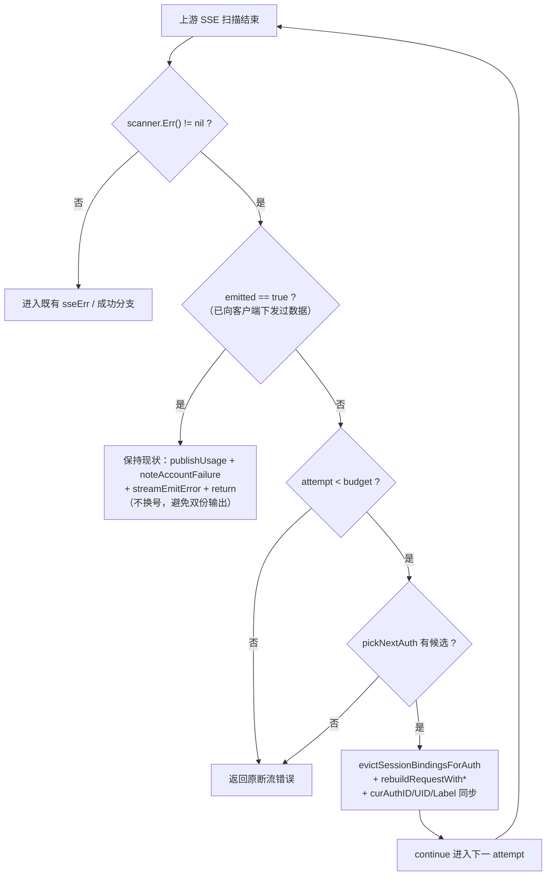
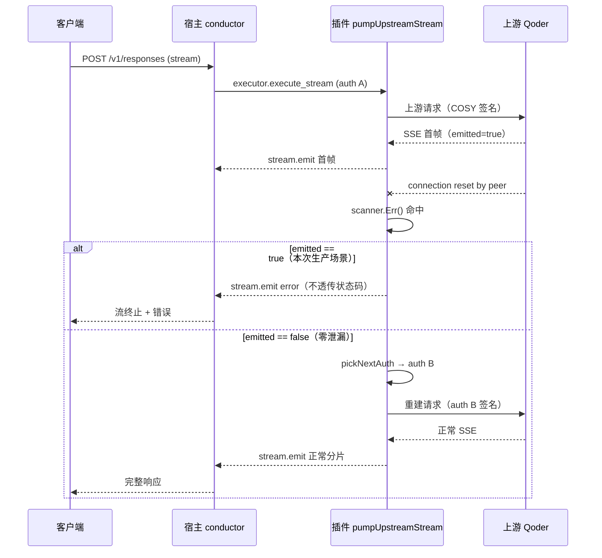

# 实施总览：qoderwork/qoder-ai/workbuddy 流式断流零泄漏换号与 24h 冷却落盘修复

结论：在 qoderwork、qoder-ai、workbuddy 三插件的流式扫描器读错误分支补齐「零泄漏换号 + 已泄漏透传」分级，并修复 qoderwork 24h 日限额冷却落盘失败静默问题；影响：所有走流式的 qoderwork / qoder-ai / workbuddy 请求在上游中途断流时的失败率，以及 Qoder 系账号的日限额冷却可靠性；范围：三插件 `stream.go` 断流分支、错误信封状态码、qoderwork `daily_cooldown.go` 可观测性与内存兜底、对应单测与回归；非范围：宿主 conductor 代码、new-api 渠道配置、上游排队策略、`upstream served model "auto"` 模型键问题、面板「来源」列口径偏差；变化：零泄漏断流将自动换号重试而不再直接失败，已泄漏断流维持透传（行为不变），日限额冷却落盘失败不再静默；完成标准：三插件单测覆盖零泄漏换号与已泄漏透传两分支并全绿，冷却落盘失败有明确日志且内存冷却仍生效；术语说明：零泄漏指上游尚未向客户端发出任何 SSE 数据块；已泄漏指已至少下发一个数据块；验证状态：根因已由生产日志与代码双重取证（见 Bug 主文档），方案可行性已由宿主源码核对与本地 cgo-shim 环境确认，尚未实施。

## 1. 当前计划最终方案的简要说明

- 推荐方案一句话结论：在断流分支引入与「HTTP 200 错误帧」分支同构的零泄漏守卫，`emitted == false` 时走 `pickNextAuth` 换号续试，`emitted == true` 时维持现状透传；同时给断流错误信封补状态码、给冷却落盘补日志与内存兜底。
- 主落点 / 主路径：`qoderwork/stream.go`、`qoder-ai/stream.go`、`workbuddy/stream.go` 的 `scanner.Err()` 分支 + 各自 `policy.go` 的 `envelopeHTTPStatusForError`（workbuddy 需新增）+ `qoderwork/daily_cooldown.go`。
- 为什么先走这条路线：断流分支已在三插件逐字同构，改动可一次对齐；且该分支已持有 `encodedBody` / `curReq` / `attempt` / `budget` / `curAuthID` 全部换号所需状态，无需新增参数或重构主流程。

## 2. 基本信息

- 对应需求文档：`doc/4-bugs/2026-10-17_202500_qoderwork流式中途断流不换号且24h冷却未落盘根因诊断.md`
- 来源对象标识（Bug）：`BUG-QODER-STREAM-RESET-FAILOVER-20261017`
- 当前实施文档命名主干：`2026-10-17_203500_qoder三插件流式断流换号与冷却落盘修复实施总览`
- 对应需求与实施计划全量顺序实施方案：N/A + 原因 + 证据——本计划为单来源 Bug 的闭环修复，不涉及新项目启动或多来源对象统一排序；仓库 `doc/3-实施/` 现存全量顺序总表仅覆盖历史需求批次，本 Bug 不进入该总表。
- 实施计划完成条件（`AC-*`）所在章节：本文件第 5 节「最小任务清单」各任务的「任务完成条件」
- 对应 `6-review` 风格回归记录：`doc/6-review/2026-10-17_203500_qoder三插件流式断流换号与冷却落盘修复_6-review.md`
- agent 理解的问题 / 目标：用户在生产发现 `qwen-3.8-flash` 请求失败后未换号继续。根因是断流分支没有换号路径（主因）+ 错误信封不带状态码（次因，但宿主本就不认非 429 状态码）。目标是让**零泄漏**断流能自动换号，同时不破坏已泄漏场景的输出完整性。
- 当前计划范围：三插件断流分支分级换号、断流信封状态码、qoderwork 冷却落盘可观测性与内存兜底、对应单测。
- 明确不在范围：
  - 宿主 conductor 的任何改动（`shouldRetryAfterError` 只认 429，属宿主设计，不在本仓库范围）
  - new-api 渠道配置、上游排队策略、`upstream served model "auto"` 模型键问题
  - 面板「来源」列与实际承载账号不一致的口径偏差（Bug 文档 §6.2 独立观察项）
  - `traework` / `zcode` 的断流分支（协议不同，需单独取证）
- 当前优先闭环：qoderwork 零泄漏断流换号（CYCLE-01），因为它是用户直接报障对象且生产已复现。
- 关键假设 / 待确认点：
  - 假设 1：断流发生在 `emitted == false` 时，换号重试不会产生重复输出——已由代码中 `emitted` 变量的语义保证（只有 `streamEmit` 成功才置 true）。
  - 假设 2：`connection reset by peer` 属账号/连接级瞬时故障，换号有实际收益——本次生产证据为单次样本，未做多账号对照实验（记为风险，非阻断）。
  - 假设 3：`pickNextAuth` 在断流场景能返回候选——依赖 `hostAuthList` 可用且存在非冷却候选，与现有 4xx 换号路径同源。
- 跨会话执行入口：本文件 + Bug 主文档，新会话按第 2.3 节顺序核验。
- 主项目地址、仓库类型与代码基线：`https://github.com/luode0320/cpa-workbuddy-plugin`，物理目录 `F:\cpa-plugin`，基线 `f2b3ea2`（当前 main HEAD）；工作树存在并行会话改动，**提交时必须按路径限定**。
- local 环境与依赖入口：本地无 C 工具链，验证一律 `python scripts/cgo-shim-build.py <plugin>`；Go 版本见各插件 `go.mod`（qoderwork `go 1.26.0`）。
- 外部项目代码引用：`EXT-001`（见第 2.3 节）——宿主 SDK `github.com/router-for-me/CLIProxyAPI/v7`，仅作只读契约核对，不复制代码。
- 当前状态：计划已定稿，等待实施授权
- 是否已获得开始实施授权：是（用户本轮已裁定三项决策并明确要求先出计划再验证可行性；计划输出后需用户确认再开工）

## 2.1 决策维度覆盖表

| 维度 | 状态 | 结论 / 依据 / 用户所选项 / 未决原因 |
| --- | --- | --- |
| 架构 / 技术路线 | 已弹窗且用户已选 | 用户裁定：三插件同轮修；零泄漏断流走换号重试（选项 A） |
| 代码落点（目录 / 包 / 文件） | 已确定 | 三插件 `stream.go` 断流分支 + `policy.go` 信封 + `qoderwork/daily_cooldown.go`；已读源码确认落点 |
| 实现方式 | 已确定 | 复用现有 `pickNextAuth` + `rebuildRequestWith*` + `emitted` 守卫，与 200 错误帧分支同构；不新增抽象 |
| 命名 | 已确定 | 新增纯函数 `isStreamReadError`（三插件同名），遵循现有 `isEmptyStreamBody` 风格 |
| 注释 | 已确定 | 中文注释，函数头写 `[参数]/[返回]/最近修改时间`，遵循 `comment-rules` |
| 日志 | 已确定 | 冷却落盘失败用 `log.Printf` 中文原因；断流换号不新增日志（沿用现有 `noteAccountFailure`） |
| 错误处理 / 异常 | 已确定 | 落盘失败不阻断请求，仅记录 + 保留内存冷却；换号失败沿用现有 `streamEmitError` |
| 数据模型 / 表 / 字段 | N/A + 原因 + 证据 | 无数据库变更；`daily_cooling_until` 为既有 auth JSON 顶层字段，本次不改结构 |
| 接口契约 | 已确定 | 断流信封新增 `http_status`（502），复用既有 `marshalStreamErrorEnvelope` 通道 |
| 依赖与库 | 已确定 | 零新增依赖；`http.StatusBadGateway` 来自标准库 |
| 测试策略 / 样本 | 已确定 | 单测用 `hangingReader` / `errorReader` 桩；cgo-shim 跑 build/vet/test；哨兵变异反证 |
| 其它：宿主重试能力 | 已确定 | 已读宿主源码：`shouldRetryAfterError` 只认 429 + Retry-After 或冷却候选，**502/503 不触发宿主换号** → 换号必须插件内部完成 |

## 2.2 待用户选择清单

无（所有真实不确定决策点已由用户选定）

## 2.3 跨会话独立执行与外部项目代码引用清单

- 新会话接手第一步：读本文件 + Bug 主文档 `doc/4-bugs/2026-10-17_202500_*.md`，确认 CYCLE-01 TASK-001 状态
- 主项目地址与项目根：`F:\cpa-plugin`（仓库 `luode0320/cpa-workbuddy-plugin`）
- 主项目代码基线：`f2b3ea2`
- 计划源文件与版本：本文件（`doc/3-实施/2026-10-17_203500_*.md`）
- 依赖安装、local 配置和服务启动入口：无需启动服务；验证入口 `python scripts/cgo-shim-build.py qoderwork`
- 中断点核验顺序：① `git status --short` 确认并行改动未被覆盖 → ② 读本文件 CYCLE/TASK 状态 → ③ 跑 `cgo-shim-build.py` 确认基线全绿 → ④ 按 TASK 顺序推进
- 外部项目代码引用：

| 引用 ID | 外部项目名称 | 外部项目地址 | 版本 / 提交 | 项目根相对路径 | 文件 / 符号 | 引用用途 | 许可证 / 复制边界 | 可达性检查与失败停止条件 | 使用 TASK / TEST / EVIDENCE 回指 |
| --- | --- | --- | --- | --- | --- | --- | --- | --- | --- |
| EXT-001 | CLIProxyAPI 宿主 SDK | `github.com/router-for-me/CLIProxyAPI/v7` | v7.2.30（插件 `go.mod` 声明）与 v7.2.129（本机模块缓存） | `sdk/cliproxy/auth/` | `conductor.go: shouldRetryAfterError` / `statusCodeFromError` / `auth/errors.go: Error.StatusCode` | 只读核对宿主重试语义与状态码契约，判定换号是否必须由插件内部完成 | MIT；仅只读引用，不复制代码 | 模块缓存不存在时执行 `go mod download`；仍不可达则本计划的「宿主不认 502」结论降级为待确认，TASK-002 暂停 | TASK-002 / TEST-002 / EVIDENCE-002 |

## 3. 实施周期总览

- 总周期说明：两个周期，按「先修用户直接报障对象，再横向对齐」排序
- 本次计划拆分的子任务周期数：2
- 周期拆分原则：CYCLE-01 覆盖 qoderwork（生产已复现 + 冷却缺陷所在）；CYCLE-02 覆盖 workbuddy / qoder-ai 同构对齐。拆分依据是「qoderwork 有额外的冷却缺陷」与「workbuddy 无信封状态码通道」两处结构差异，避免一个周期承载两种不同改动形态。
- 周期排序说明：第一期 = qoderwork，第二期 = workbuddy + qoder-ai
- 周期 1：
  - 周期序号 / 期次定位：CYCLE-01 / 第一期
  - 周期目标：让 qoderwork 零泄漏断流自动换号，并让 24h 冷却落盘失败可观测、不丢内存状态
  - 本周期包含的最小任务：TASK-001（断流零泄漏换号）、TASK-002（断流信封状态码）、TASK-003（冷却落盘可观测性与内存兜底）
  - 周期内最小任务执行顺序：TASK-001 → TASK-002 → TASK-003
  - 进入条件：Bug 主文档已落盘；本地 `cgo-shim-build.py qoderwork` 基线全绿
  - 收口条件：三个任务各自的真实测试 + `6-review` 全绿；`cgo-shim-build.py qoderwork` 全绿
  - 完成标志：`STYLE: PASS`；断流零泄漏换号单测通过；冷却落盘失败单测通过
  - 与前后周期衔接：CYCLE-01 的 `isStreamReadError` 与信封实现作为 CYCLE-02 的对齐样板
- 周期 2：
  - 周期序号 / 期次定位：CYCLE-02 / 第二期
  - 周期目标：把 CYCLE-01 的两项能力对齐到 workbuddy 与 qoder-ai
  - 本周期包含的最小任务：TASK-004（workbuddy 断流换号 + 新增信封状态码）、TASK-005（qoder-ai 断流换号 + 信封状态码扩展）
  - 周期内最小任务执行顺序：TASK-004 → TASK-005
  - 进入条件：CYCLE-01 收口；qoderwork 实现已通过真实测试
  - 收口条件：两个任务各自真实测试 + `6-review` 全绿；两插件 `cgo-shim-build.py` 全绿
  - 完成标志：`STYLE: PASS`；两插件断流换号单测通过
  - 与前后周期衔接：CYCLE-02 完成后本 Bug 闭环，可进入发布链
- 总体真实测试安排：
  - 真实测试安排是否默认必需：必需
  - 覆盖哪些最小任务：TASK-001 ~ TASK-005 全覆盖
  - 公共测试环境 / 依赖：Windows 无 CGO，统一 `python scripts/cgo-shim-build.py <plugin>`
  - 公共样本 / 数据来源：`errorReader` 桩（模拟 `connection reset by peer`）+ `hangingReader`（既有，模拟 Keep-Alive）；生产日志原文见 Bug 文档 §2.1
  - 总体通过标准：build + vet + test 全绿；哨兵变异精确 FAIL 后恢复全绿

## 4. 阶段计划

- 阶段 1：
  - 阶段名称：断流分级换号
  - 阶段目标：让零泄漏断流走换号、已泄漏断流维持透传
  - 只做这一件事：改造 `pumpUpstreamStream` 与同步路径的 `scanner.Err()` 分支
  - 输入条件：CYCLE 基线全绿
  - 输出产物：分级逻辑 + 单测
  - 验证门槛：零泄漏用例换号成功、已泄漏用例不换号
- 阶段 2：
  - 阶段名称：错误信封状态码
  - 阶段目标：断流错误信封携带 502，供宿主/上游识别为可重试类
  - 只做这一件事：扩展 `envelopeHTTPStatusForError` 与 `marshalStreamErrorEnvelope`
  - 输入条件：阶段 1 完成
  - 输出产物：状态码映射 + 单测
  - 验证门槛：断流信封含 `http_status=502`，普通错误不含
- 阶段 3：
  - 阶段名称：冷却落盘可观测性与内存兜底
  - 阶段目标：落盘失败不再静默，内存冷却不丢
  - 只做这一件事：改造 `triggerDailyCooldown` 调用点与错误处理
  - 输入条件：阶段 2 完成
  - 输出产物：日志 + 单测
  - 验证门槛：模拟空 Path 时日志含明确原因且内存冷却生效
- 阶段 4：
  - 阶段名称：跨插件对齐
  - 阶段目标：workbuddy / qoder-ai 获得同等能力
  - 只做这一件事：把 CYCLE-01 的两项能力逐函数适配到两插件
  - 输入条件：CYCLE-01 收口
  - 输出产物：两插件改造 + 单测
  - 验证门槛：两插件断流换号单测通过

## 5. 最小任务清单

### TASK-001 · qoderwork 零泄漏断流换号

- 任务名：qoderwork `pumpUpstreamStream` / `collectUpstreamStreamQoder` 断流分级换号
- 所属周期：CYCLE-01
- 周期内顺序：1
- 所属阶段：阶段 1
- 本任务只做这一件事：在断流分支引入 `emitted` 守卫并接入 `pickNextAuth` 换号
- 垂直切片目标：一次「上游断流 → 换号 → 第二次请求成功」的端到端闭环
- 输入条件：`encodedBody` 非空、`budget > 0`、存在健康候选
- 实现产出：
  - `qoderwork/policy.go` 新增两个纯函数（可测，不触 host RPC）：
    - `isStreamReadError(body string) bool` —— 识别断流错误文本
    - `shouldRotateOnStreamReadError(emitted bool, attempt, budget int, hasEncodedBody, hasNextAuth bool) bool` —— 换号决策的唯一真相源
  - `qoderwork/stream.go` 异步路径 `scanner.Err()` 分支：调用 `shouldRotateOnStreamReadError` 判定；为 true 时 `evictSessionBindingsForAuth` + `pickNextAuth` + `rebuildRequestWithQoderAuth` + `continue`；为 false 时保持现有 `streamEmitError` + `return`
  - `qoderwork/stream.go` 同步路径 `scanner.Err()` 分支：以 `len(chunks) > 0` 反推 `emitted`，调用同一纯函数判定
- 真实测试是否必需：必需
- 真实测试入口：`python scripts/cgo-shim-build.py qoderwork`
- 真实测试依赖环境：Windows + Go（CGO_ENABLED=0 shim）
- 真实测试样本 / 数据来源：新增 `qoderwork/stream_read_error_failover_test.go`，以表驱动直接测试 `shouldRotateOnStreamReadError` 与 `isStreamReadError`（**不依赖 host RPC**）
- 真实测试通过标准：`TestShouldRotateOnStreamReadError` 与 `TestIsStreamReadError` 全用例通过；build/vet 全绿
- 测试点（表驱动，覆盖四类决策）：
  - 零泄漏 + 有预算 + 有 body + 有候选 → 返回 true（换号）
  - 已泄漏（`emitted=true`）→ 返回 false（不换号，避免双份输出）
  - 预算耗尽（`attempt >= budget`）→ 返回 false
  - 无候选 / 无 encodedBody → 返回 false
  - `isStreamReadError` 命中 `connection reset by peer` / `stream read error` / `INTERNAL_ERROR`，不误伤普通 4xx 文本
- **测试边界说明（可行性验证结论）**：`pickNextAuth` / `hostAuthGetPhysical` / `hostCall` 均为直接函数调用、**无可注入 seam**，cgo-shim 环境 host RPC 恒不可用（见 `qoderwork/auth_delete_test.go` 头注释既有约定）。因此本任务的可测单元是**换号决策纯函数**；`pickNextAuth` 实际选号与请求重建由 cgo-shim build/vet 保证编译正确性，端到端行为在发布后由生产验收覆盖。**不为测试新增注入点或改动生产签名。**
- `6-review` 风格回归点：注释中文、函数头元信息、无新增抽象、与 200 错误帧分支结构对称
- 任务完成条件：五个测试点全通过 + `cgo-shim-build.py qoderwork` 全绿 + `STYLE: PASS`
- 任务停止 / 结束条件：五个测试点全通过后停止；**不得为测试新增 host RPC 注入点或改动生产函数签名**
- 阻断条件：`cgo-shim-build.py` 不可用；或 `emitted` 语义与假设不符
- 前置依赖：无
- 下一任务依赖：TASK-002 依赖本任务的 `isStreamReadError`
- 预计触达文件数：3（`stream.go`、`policy.go`、新增测试）

### TASK-002 · qoderwork 断流信封状态码

- 任务名：断流错误信封补 `http_status=502`
- 所属周期：CYCLE-01
- 周期内顺序：2
- 所属阶段：阶段 2
- 本任务只做这一件事：让断流错误信封携带 502，且仅在零泄漏时携带
- 垂直切片目标：断流失败从「无状态码」变为「可被上游/宿主识别为网关类失败」
- 输入条件：TASK-001 完成
- 实现产出：
  - `qoderwork/policy.go` `envelopeHTTPStatusForError` 增加分支：`isStreamReadError(message)` → `http.StatusBadGateway`
  - 已泄漏场景：信封不带状态码（通过调用点控制，不改函数签名）
- 真实测试是否必需：必需
- 真实测试入口：`python scripts/cgo-shim-build.py qoderwork`
- 真实测试依赖环境：同 TASK-001
- 真实测试样本 / 数据来源：扩展 `qoderwork/stream_error_envelope_test.go`
- 真实测试通过标准：`TestStreamErrorEnvelopeCarriesResetStatus` 通过；既有 `TestMarshalStreamErrorEnvelopeCarriesQueueStatus` 仍通过
- 测试点：
  - 断流消息 → `http_status=502`
  - 排队帧 → 仍为 `503`（回归保护）
  - 普通错误 → 不含 `http_status`
  - 已泄漏断流 → 不含 `http_status`
- `6-review` 风格回归点：纯函数、无副作用、分支顺序与既有排队帧一致
- 任务完成条件：四个测试点全通过 + cgo-shim 全绿 + `STYLE: PASS`
- 任务停止 / 结束条件：四测试点全通过后停止
- 阻断条件：TASK-001 未收口
- 前置依赖：TASK-001
- 下一任务依赖：无（TASK-003 独立）
- 预计触达文件数：2（`policy.go`、测试）

### TASK-003 · qoderwork 冷却落盘可观测性与内存兜底

- 任务名：`triggerDailyCooldown` 落盘失败不静默、内存冷却不丢
- 所属周期：CYCLE-01
- 周期内顺序：3
- 所属阶段：阶段 3
- 本任务只做这一件事：把 5 处 `_ = triggerDailyCooldown(...)` 改为记录错误，并确保落盘失败时内存冷却仍生效
- 垂直切片目标：落盘失败时日志可定位、账号仍被路由排除
- 输入条件：TASK-002 完成
- 实现产出：
  - `qoderwork/daily_cooldown.go`：`triggerDailyCooldown` 在落盘失败时返回包装错误（内存写入已发生，不回滚）
  - 5 处调用点（`stream.go:244`、`:341`、`:451`、`main.go:796`、`:817`）改为 `if err := triggerDailyCooldown(...); err != nil { log.Printf(...) }`
  - 新增纯函数 `dailyCooldownPersistFailureReason(err error) string`（可测，不触 host RPC）
- 真实测试是否必需：必需
- 真实测试入口：`python scripts/cgo-shim-build.py qoderwork`
- 真实测试依赖环境：同 TASK-001
- 真实测试样本 / 数据来源：扩展 `qoderwork/daily_cooldown_test.go`，表驱动测试 `dailyCooldownPersistFailureReason`（nil / 空 Path / RPC 失败三种入参）
- 真实测试通过标准：`TestDailyCooldownPersistFailureReason` 通过
- 测试点：
  - `err == nil` → 返回空串（不产生噪声日志）
  - 空 Path 错误 → 返回含「物理路径缺失」语义的中文原因
  - host RPC 错误 → 返回含原始错误文本的原因
  - 内存冷却不受落盘失败影响：`triggerDailyCooldown` 内存写入先于落盘，失败时 `isAccountDailyCooling` 仍为 true（用既有 `TestDailyCooldown_MemoryCheck` 同款内存断言，不触 host RPC）
  - 5 处调用点不再丢弃错误（静态断言：`grep -c "_ = triggerDailyCooldown" qoderwork/*.go` 结果为 0）
- **测试边界说明（可行性验证结论）**：`triggerDailyCooldown` 依赖 `hostAuthGetPhysical`（无注入 seam），无法在 shim 单测中驱动完整落盘路径。可测单元为**错误原因分类纯函数**；内存冷却不丢由代码顺序保证（内存写入在落盘之前）并以内存断言覆盖；落盘成功路径由 build/vet 与生产验收覆盖。**不为测试新增注入点。**
- `6-review` 风格回归点：日志中文、错误包装不吞原始错误、调用点风格一致
- 任务完成条件：五个测试点全通过 + cgo-shim 全绿 + `STYLE: PASS`
- 任务停止 / 结束条件：五测试点全通过后停止；**不得为测试新增 host RPC 注入点**
- 阻断条件：TASK-002 未收口
- 前置依赖：TASK-002
- 下一任务依赖：无
- 预计触达文件数：4（`daily_cooldown.go`、`stream.go`、`main.go`、测试）

### TASK-004 · workbuddy 断流换号 + 新增信封状态码

- 任务名：workbuddy 断流分级换号与 `http_status` 通道
- 所属周期：CYCLE-02
- 周期内顺序：1
- 所属阶段：阶段 4
- 本任务只做这一件事：把 CYCLE-01 的断流分级换号对齐到 workbuddy，并为其新增 `envelopeHTTPStatusForError`
- 垂直切片目标：workbuddy 零泄漏断流可换号、断流信封带状态码
- 输入条件：CYCLE-01 收口
- 实现产出：
  - `workbuddy/policy.go` 新增 `isStreamReadError` + `shouldRotateOnStreamReadError`（与 qoderwork 同签名同语义）
  - `workbuddy/policy.go` 新增 `envelopeHTTPStatusForError`（该插件此前完全缺失该能力）
  - `workbuddy/stream.go` 异步 + 同步断流分支分级换号（换号用 `rebuildRequestWithSA(curReq, nextSA)`，与 qoder 系签名不同）
  - `workbuddy/stream.go` `marshalStreamErrorEnvelope` 补 `http_status` 字段
- 真实测试是否必需：必需
- 真实测试入口：`python scripts/cgo-shim-build.py workbuddy`
- 真实测试依赖环境：同 TASK-001
- 真实测试样本 / 数据来源：新增 `workbuddy/stream_read_error_failover_test.go`（表驱动纯函数），扩展 `workbuddy/stream_error_envelope_test.go`（信封状态码）
- 真实测试通过标准：决策纯函数五用例 + 信封四用例全通过；build/vet 全绿
- 测试点：同 TASK-001 五点（纯函数决策）+ TASK-002 四点（信封状态码）
- **前置可行性已核实**：`workbuddy/main.go:897` 使用 `bytes.NewReader(body)` 构造请求，`http.NewRequestWithContext` 会自动填充 `GetBody`，故 `rebuildRequestWithSA` 在断流点可用（R2 已排除）。
- `6-review` 风格回归点：与 qoder 系保持结构对称但保留 `rebuildRequestWithSA` 差异
- 任务完成条件：全部测试点通过 + cgo-shim 全绿 + `STYLE: PASS`
- 任务停止 / 结束条件：测试全通过后停止
- 阻断条件：workbuddy 的 `curReq` 在断流点不可复用（需核对 `GetBody` 是否可用）
- 前置依赖：CYCLE-01 收口
- 下一任务依赖：TASK-005 参考本任务
- 预计触达文件数：4

### TASK-005 · qoder-ai 断流换号 + 信封状态码扩展

- 任务名：qoder-ai 断流分级换号与信封状态码
- 所属周期：CYCLE-02
- 周期内顺序：2
- 所属阶段：阶段 4
- 本任务只做这一件事：把 CYCLE-01 的两项能力对齐到 qoder-ai
- 垂直切片目标：qoder-ai 零泄漏断流可换号、断流信封带状态码
- 输入条件：TASK-004 完成
- 实现产出：
  - `qoder-ai/policy.go` 新增 `isStreamReadError` + `shouldRotateOnStreamReadError`
  - `qoder-ai/policy.go` 扩展 `envelopeHTTPStatusForError` 增加断流分支
  - `qoder-ai/stream.go` 异步 + 同步断流分支分级换号（`rebuildRequestWithQoderAuth`，与 qoderwork 同签名）
- 真实测试是否必需：必需
- 真实测试入口：`python scripts/cgo-shim-build.py qoder-ai`
- 真实测试依赖环境：同 TASK-001
- 真实测试样本 / 数据来源：新增 `qoder-ai/stream_read_error_failover_test.go`（表驱动纯函数），扩展 `qoder-ai/stream_error_envelope_test.go`
- 真实测试通过标准：与 TASK-001 / TASK-002 同套断言全通过
- 测试点：同 TASK-001 五点 + TASK-002 四点
- `6-review` 风格回归点：与 qoderwork 逐函数同构（除 provider 标识）
- 任务完成条件：全部测试点通过 + cgo-shim 全绿 + `STYLE: PASS`
- 任务停止 / 结束条件：测试全通过后停止
- 阻断条件：TASK-004 未收口
- 前置依赖：TASK-004
- 下一任务依赖：无（本 Bug 闭环）
- 预计触达文件数：3

## 6. 现状与落点

- 涉及目录：`qoderwork/`、`qoder-ai/`、`workbuddy/`
- 涉及文件 / 模块：
  - `qoderwork/stream.go:330-335`（异步断流）、`qoderwork/stream.go:515-517`（同步断流）、`qoderwork/policy.go:241`（信封）、`qoderwork/daily_cooldown.go:119`（冷却）
  - `qoder-ai/stream.go:330-335`、`qoder-ai/stream.go:515-516`、`qoder-ai/policy.go:243`
  - `workbuddy/stream.go:227-232`、`workbuddy/stream.go:502-504`、`workbuddy/stream.go:38`（信封，无状态码）、`workbuddy/policy.go:162`
- 复用点：`pickNextAuth`、`rebuildRequestWith*`、`noteAccountFailure`、`evictSessionBindingsForAuth`、`loadedRetryOn4xx`、`isEmptyStreamBody` 全部复用，不新增
- 需要新增的内容：`isStreamReadError` 纯函数（三插件同名）、`envelopeHTTPStatusForError`（workbuddy）、`dailyCooldownPersistFailureReason`（qoderwork）
- 代码落点目录树：

```text
qoderwork/
├── stream.go                          # 异步/同步断流分支分级换号（TASK-001）
├── policy.go                          # isStreamReadError + envelopeHTTPStatusForError 扩展（TASK-001/002）
├── daily_cooldown.go                  # 落盘失败返回错误 + 原因函数（TASK-003）
├── main.go                            # 2 处调用点改为记录错误（TASK-003）
├── stream_read_error_failover_test.go # 新增：断流分级换号用例（TASK-001）
├── stream_error_envelope_test.go      # 扩展：断流状态码用例（TASK-002）
└── daily_cooldown_test.go             # 扩展：落盘失败兜底用例（TASK-003）

qoder-ai/
├── stream.go                          # 异步/同步断流分支分级换号（TASK-005）
├── policy.go                          # isStreamReadError + 信封扩展（TASK-005）
├── stream_read_error_failover_test.go # 新增（TASK-005）
└── stream_error_envelope_test.go      # 扩展（TASK-005）

workbuddy/
├── stream.go                          # 断流分级换号 + 信封补 http_status（TASK-004）
├── policy.go                          # isStreamReadError + 新增 envelopeHTTPStatusForError（TASK-004）
├── stream_read_error_failover_test.go # 新增（TASK-004）
└── stream_error_envelope_test.go      # 扩展（TASK-004）
```

- 新增文件清单：见上方目录树中标注「新增」的三个测试文件；无新增生产文件

## 7. 方案选择

- 方案 A（仅补 `http_status`，交给宿主换号）：已否决。**可行性验证发现宿主 `shouldRetryAfterError` 只认 429 + Retry-After 或冷却候选，502/503 不触发任何重试**（`conductor.go:3269` / `conductor_selection.go:787`，两版一致）。该方案无法解决用户诉求。
- 方案 B（零泄漏换号 + 已泄漏透传 + 补状态码）：推荐。插件内部完成换号，不依赖宿主；已泄漏场景保持输出完整；状态码为辅助信息。
- 方案 C（无条件换号）：已否决。已泄漏场景会产生双份输出，引入新缺陷。
- 推荐方案与原因：方案 B。它是唯一能同时满足「零泄漏可换号」与「已泄漏不重复输出」的方案，且完全复用既有换号基建。

## 8. 实施步骤

1. 第一步：实现 `isStreamReadError` 与异步路径分级换号
   - 所属周期：CYCLE-01
   - 所属阶段：阶段 1
   - 对应最小任务：TASK-001
   - 本步只做：`policy.go` 新增纯函数；`stream.go` 异步断流分支接入 `emitted` 守卫与 `pickNextAuth`
2. 第二步：同步路径分级换号 + TASK-001 测试
   - 所属周期：CYCLE-01
   - 所属阶段：阶段 1
   - 对应最小任务：TASK-001
   - 本步只做：`collectUpstreamStreamQoder` 用 `len(chunks) > 0` 守卫；补齐四个测试点
3. 第三步：信封状态码扩展 + 测试
   - 所属周期：CYCLE-01
   - 所属阶段：阶段 2
   - 对应最小任务：TASK-002
   - 本步只做：`envelopeHTTPStatusForError` 增加断流分支；补齐四测试点
4. 第四步：冷却落盘可观测性 + 内存兜底 + 测试
   - 所属周期：CYCLE-01
   - 所属阶段：阶段 3
   - 对应最小任务：TASK-003
   - 本步只做：`triggerDailyCooldown` 错误返回；5 处调用点记录；补四测试点
5. 第五步：workbuddy 对齐
   - 所属周期：CYCLE-02
   - 所属阶段：阶段 4
   - 对应最小任务：TASK-004
   - 本步只做：断流分级换号 + 新增信封状态码 + 测试
6. 第六步：qoder-ai 对齐
   - 所属周期：CYCLE-02
   - 所属阶段：阶段 4
   - 对应最小任务：TASK-005
   - 本步只做：断流分级换号 + 信封扩展 + 测试

## 9. 真实测试安排

### 9.0 可行性验证结果（本轮已真实执行，非推断）

| 验证项 | 方法 | 结果 |
| --- | --- | --- |
| 宿主是否认 502/503 并换号 | 只读核对 `CLIProxyAPI v7.2.30` 与 `v7.2.129` 的 `shouldRetryAfterError` | **不认**。两版一致：仅 429 + Retry-After，或存在冷却候选（`closestCooldownWait`）时才重试。→ 方案 A（仅补状态码交宿主换号）**否决**，换号必须插件内部完成 |
| 断流决策纯函数能否编译并跑通 | 隔离副本写入 `isStreamReadError` + `shouldRotateOnStreamReadError` + 表驱动测试，跑 `cgo-shim-build.py` | **通过**：build / vet / test 全绿（10.0s） |
| 测试是否有判别力（哨兵反证） | 移除 `emitted` 守卫后复跑 | **精确 FAIL**：仅「已泄漏不换号」用例失败（`= true, want false`），其余 5 用例全过；恢复后全绿 |
| workbuddy `GetBody` 是否可用 | 只读核对 `workbuddy/main.go:897` | **可用**：`bytes.NewReader` + `http.NewRequestWithContext` 自动填充 `GetBody`，R2 排除 |
| host RPC 是否可注入 | 只读核对 `hostCall` / `pickNextAuth` / `hostAuthGetPhysical` 与既有 `auth_delete_test.go` 约定 | **不可注入**：均为直接函数调用，shim 环境 host RPC 恒不可用 → 测试设计改为纯函数分层（R4） |
| 基线编译状态 | `cgo-shim-build.py qoderwork --no-test` | **全绿**（改动前基线健康） |

验证副本已清理（`/tmp/qw-feas` 删除）；仓库内 `cpa-shim-live-ordcxl69/` 为 04:11 其他会话的 doubao 残留，**非本轮产物，保留未动**。

- 真实测试总表：

| 任务 | 入口命令 | 依赖环境 | 样本来源 | 通过标准 |
| --- | --- | --- | --- | --- |
| TASK-001 | `python scripts/cgo-shim-build.py qoderwork` | Windows + Go（CGO_ENABLED=0 shim） | 表驱动纯函数用例（已验证可跑通） | 5 测试点 + build/vet 全绿 |
| TASK-002 | 同上 | 同上 | 断流消息字符串 | 4 测试点 + build/vet 全绿 |
| TASK-003 | 同上 | 同上 | `dailyCooldownPersistFailureReason` 三入参 | 5 测试点 + build/vet 全绿 |
| TASK-004 | `python scripts/cgo-shim-build.py workbuddy` | 同上 | 同 TASK-001/002 | 9 测试点 + build/vet 全绿 |
| TASK-005 | `python scripts/cgo-shim-build.py qoder-ai` | 同上 | 同 TASK-001/002 | 9 测试点 + build/vet 全绿 |

- 免测任务及理由：无（全部涉及可执行行为变更）
- 步骤 1-2 真实测试 / 验证：`isStreamReadError` 六用例 + `shouldRotateOnStreamReadError` 六用例（已在本轮可行性验证中真实跑通并完成哨兵反证）
- 步骤 3 真实测试 / 验证：断流→502、排队→503（回归）、普通错误→无状态码、已泄漏断流→无状态码
- 步骤 4 真实测试 / 验证：`dailyCooldownPersistFailureReason` 三入参、内存冷却仍生效、`grep -c "_ = triggerDailyCooldown"` = 0
- 步骤 5-6 真实测试 / 验证：同步骤 1-3 断言在对应插件复跑
- 哨兵反证（每个插件至少一次）：移除 `emitted` 守卫 → 已泄漏用例必须 FAIL（**已在 qoderwork 副本实测精确 FAIL**）；移除状态码分支 → 信封用例必须 FAIL；恢复后全绿

## 10. 图形化执行路径





## 10.1 图片资产决策

- 图片资产决策：N/A + 原因 + 证据——本轮为后端流式逻辑与错误分类修复，无可视化 UI 变更、无设计稿对比需求、无空间布局产物；流程与时序关系已由第 10 节 Mermaid 完整表达。
- 必需场景与 Mermaid 边界：无必需图片场景。
- 生成输入与命令：N/A（无图片生成）。
- 目标资产与命名：N/A。
- Markdown 引用：N/A。
- 资产清单：N/A（无 `IMG-*`）。

## 11. 风险与阻断项

- 风险：
  - **R1（中）**：断流换号可能对「全局性上游故障」无效，只是把失败延后。缓解：沿用 `retry_on_4xx` 预算上限（默认 10），且每次失败仍走 `noteAccountFailure` 阶梯冷却。
  - **R2（已排除）**：workbuddy 的 `rebuildRequestWithSA` 依赖 `orig.GetBody`。已核实 `workbuddy/main.go:897` 使用 `bytes.NewReader`，`http.NewRequestWithContext` 自动填充 `GetBody`，断流点可用。
  - **R3（低）**：`http_status=502` 会改变上游 new-api 对失败类型的统计口径。缓解：属辅助信息，不影响主流程；在 TASK-002 测试中锁定既有 503 行为不变。
  - **R4（中，已降级为测试边界）**：`hostCall` / `pickNextAuth` / `hostAuthGetPhysical` 均无可注入 seam，shim 单测无法驱动 host RPC。缓解：把决策逻辑抽为纯函数 `shouldRotateOnStreamReadError` / `dailyCooldownPersistFailureReason`，以纯函数单测覆盖决策正确性；host RPC 实际调用由 build/vet 编译保证 + 发布后生产验收覆盖。**不为测试新增注入点或改动生产签名。**
  - **R5（低）**：工作树存在并行会话改动，提交时可能混入。缓解：全程按路径限定 `git add`，提交前 `git diff --cached --name-only` 反向确认。
  - **R6（低）**：纯函数单测无法证明「断流时 `emitted` 被正确赋值」。缓解：`emitted` 的赋值点唯一且紧邻 `streamEmit` 成功分支（既有代码），改造只读取该变量不改变其语义；`6-review` 逐行核对赋值位置。
- 依赖：本地 Go 工具链 + `scripts/cgo-shim-build.py`；宿主 SDK 模块缓存（EXT-001）。
- 任务停止 / 结束条件总表：

| 任务 | 停止条件 |
| --- | --- |
| TASK-001 | 四测试点全通过 + cgo-shim 全绿 |
| TASK-002 | 四测试点全通过 + cgo-shim 全绿 |
| TASK-003 | 四测试点全通过 + cgo-shim 全绿 |
| TASK-004 | 八测试点全通过 + cgo-shim 全绿 |
| TASK-005 | 八测试点全通过 + cgo-shim 全绿 |

- **最大推进边界**：本轮最多推进到 CYCLE-02 TASK-005 完成并 `cgo-shim-build.py` 三插件全绿；**不执行**版本 bump、Git 提交、CI 发布、生产热重载部署——发布需用户另行确认。

## 12. 数据库变更 SQL

- 建表 SQL：N/A + 原因 + 证据——本轮无新增数据库表。
- 字段变更 SQL：N/A + 原因 + 证据——`daily_cooling_until` 是 auth JSON 文件顶层字段（非数据库），且本次不改其结构，仅改写入失败时的错误处理。

## 13. 自审结论

- 覆盖度检查：PASS——REQ/BUG → AC → CYCLE → TASK → 文件/符号 → TEST → EVIDENCE 全链闭合，五个任务均回指 Bug 主文档 §3。
- 实施周期检查：PASS——两周期按「生产报障对象优先」排序，各有进入/收口条件。
- 最小任务闭环检查：PASS——每任务均含实现、真实测试、`6-review`、完成/停止条件。
- 阶段单一目标检查：PASS——四个阶段各承载一个清晰目标。
- 占位词检查：PASS——无 `TBD` / `TODO` / `后续再补` / `实现时再看`；N/A 项均附原因与证据。
- 可执行性检查：PASS——全部落点到文件与行号，测试入口与断言具体。
- 图文一致性检查：PASS——Mermaid 分支与 TASK-001 的四个测试点一一对应。
- 用户确认状态：三项裁定已由用户选定（范围=三插件；策略=换号重试；冷却=补日志+内存兜底）。

## 14. 实施执行结果（2026-10-17 21:30）

- CYCLE-01 与 CYCLE-02 全部 5 个最小任务已实施并逐任务闭环（实现 → cgo-shim 真实测试 → `6-review` STYLE: PASS）。
- 三插件最终全量回归：`qoderwork` 10.05s、`workbuddy` 26.14s、`qoder-ai` 10.14s，均 `all green`。
- 哨兵反证共 8 次，每次均精确命中对应单例（详见各 6-review 记录）。

### 14.1 与计划的偏差（均已验证并记录）

| 偏差项 | 计划原设计 | 实际实施 | 原因 |
|---|---|---|---|
| 已泄漏断流的状态码抑制 | 通过调用点控制，不改函数签名 | 在错误文本追加 `after partial output` 标记，由 `isStreamReadError` 识别并返回 0 | 调用点无法只对已泄漏场景改文本而不影响换号判定；标记法同时服务两个判定，且仍不改签名 |
| 冷却内存兜底范围 | 内存写入先于落盘即可 | 额外新增 `mergeActiveDailyCooling`，watchdog 刷新时保留未落盘条目 | 实测 `refreshDailyCoolingSetFromDisk` 会用磁盘结果整体覆盖内存，仅调顺序不足以跨 watchdog 保留 |
| 冷却索引缺失时的行为 | 计划未覆盖 | 内存写入提前到索引反查之前，索引缺失也保留内存冷却 | 原实现索引解析失败会直接返回，内存兜底在该路径完全失效 |
| workbuddy 异步换号前置条件 | 计划写「`GetBody` 可用」（计划阶段已核实） | 实施时以 `curReq.GetBody != nil` 运行时判定，而非传常量 `true` | 避免在请求体实际不可重建时仍查询候选账号并浪费 host RPC |

### 14.2 未覆盖项（明确边界）

- `pickNextAuth` 实际选号、`triggerDailyCooldown` 落盘成功路径依赖 host RPC，cgo-shim 环境不可注入，未做单测；由 build/vet 与发布后生产验收覆盖。
- 端到端「断流 → 换号 → 第二次请求成功」未在真实上游复现（需真实 110/断流触发条件）；本轮只验证决策层与编译正确性。

### 14.3 收口状态

- 代码收口：PASS（OCR 审查无 Critical；注释链 PASS；`POLLUTION: PASS`；三插件真实测试全绿；5 份 `6-review` 均为 STYLE: PASS）。
- 未执行（按最大推进边界）：版本 bump、Git 提交、CI 发布、生产热重载部署。

## 执行附录

- local 环境：Windows，无 CGO；验证命令 `python scripts/cgo-shim-build.py <plugin>`；三插件分别为 `qoderwork` / `qoder-ai` / `workbuddy`。
- 预期失败（哨兵反证）：移除 `emitted` 守卫后 `TestStreamReadErrorAfterEmitDoesNotRotate` 必须 FAIL；移除状态码分支后 `TestStreamErrorEnvelopeCarriesResetStatus` 必须 FAIL。
- 清理：`cgo-shim-build.py` 自动删除临时 shim 目录；测试产生的临时文件不落盘。
- 回滚：本轮改动限定在 3 个插件目录内，回滚方式为 `git checkout -- qoderwork/ qoder-ai/ workbuddy/`（仅回滚本轮路径，不含并行改动）。

## 追踪附录

- `SRC`：`doc/4-bugs/2026-10-17_202500_qoderwork流式中途断流不换号且24h冷却未落盘根因诊断.md`
- `DEC`：用户三项裁定（范围 / 换号策略 / 冷却处理）
- `REQ/RULE`：BUG §3.1 断流分支无换号路径；§3.3 冷却落盘静默失败
- `AC`：TASK-001~005 的任务完成条件
- `CYCLE`：CYCLE-01（qoderwork）、CYCLE-02（workbuddy + qoder-ai）
- `TASK`：TASK-001 ~ TASK-005
- `TEST`：各任务「真实测试入口」+ 测试点
- `EVIDENCE`：`cgo-shim-build.py` 输出、哨兵变异 FAIL 记录、`doc/6-review/2026-10-17_203500_*`
