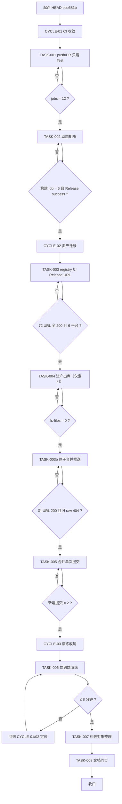
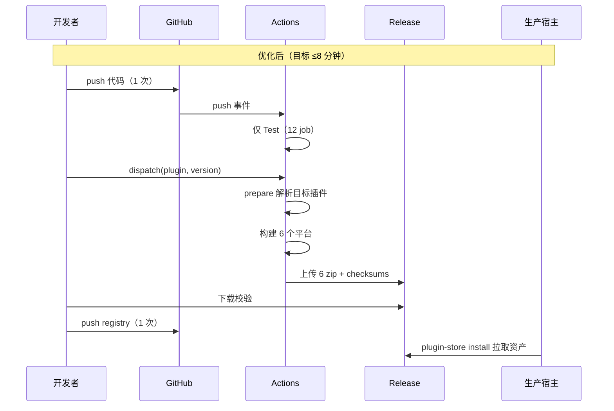

# 需求实施总览：发布链路提速

结论：把「每次发布拉起 85 个 CI job」收敛为「只构建目标插件」，并把发布产物从 git 仓库迁到 GitHub Release，使单次发布从 17–27 分钟降到 5–8 分钟；影响：所有插件发布者与生产部署链路；范围：build.yml 触发与矩阵、资产托管方式、发布脚本与文档同步；非范围：插件业务代码、生产宿主配置、历史 git 历史重写；变化：一次发布只需 2 次推送（原 4 次），push 不再跑跨平台构建；完成标准：单插件发布端到端 ≤8 分钟且 6 平台资产校验通过；术语说明：`matrix` 指 GitHub Actions 构建矩阵，`direct` 指宿主插件商店按 URL 直连下载的安装类型；验证状态：关键前提已用真实下载与宿主源码取证；CYCLE-01（TASK-001/002）已真实执行并通过，端到端耗时待 CYCLE-03 演练确认。

## 1. 当前计划最终方案简要说明

- 推荐方案一句话结论：CI 侧按「事件类型 + 目标插件」双重收敛构建矩阵，资产侧把二进制从 git 迁到 GitHub Release 并让 registry 的 `direct` URL 指向 Release。
- 主落点 / 主路径：`.github/workflows/build.yml`（触发与矩阵）、`scripts/publish-assets.py`（URL 生成）、`.gitignore` + `git rm --cached`（资产出库）。
- 为什么先走这条路线：实测证明 17–27 分钟的耗时几乎全部来自 runner 排队（macOS 排队 10.9–20.6 分钟，真实执行仅 0.9–1.6 分钟），而排队由「发 1 个插件却跑 72 个构建」和「每次 push 再跑一遍全量」共同放大；同时 `direct` 类型已实测可下载 Release 资产且哈希一致，无需改宿主代码。

## 2. 基本信息

- 对应需求文档：本文件（来源对象为「发布链路提速」需求，单来源对象，无需全量顺序总表）。
- 来源对象标识（需求或 Bug）：需求-发布链路提速
- 当前实施文档命名主干：2026-10-18_040625_发布链路提速
- 对应需求与实施计划全量顺序实施方案：N/A + 原因：单一来源对象，未触发新项目/多来源对象排序场景 + 证据：本轮仅一条需求主线。
- 实施计划完成条件（`AC-*`）所在章节：第 9 节
- 对应 `6-review` 风格回归记录：`doc/6-review/`（每个最小任务收口时生成）
- agent 理解的问题 / 目标：用户反馈「发布很慢」。实测根因是 CI 并发排队而非编译本身，目标是把单次发布端到端压到 8 分钟以内。
- 当前计划范围：CI 触发收敛、矩阵按插件过滤、资产托管迁移、发布脚本合并提交、仓库瘦身、文档与项目 skill 同步。
- 明确不在范围：插件业务逻辑；生产宿主配置与容器重启；git 历史重写（不改写已推送历史）；registry schema 变更。
- 当前优先闭环：CYCLE-02 的 TASK-003 → TASK-004 → TASK-003b（原子切换资产托管）。CYCLE-01 已把 dispatch 从 85 job 降到 20。
- 关键假设 / 待确认点：见第 10.2 节 `FEAS-*`；无阻塞性未决项。
- 跨会话执行入口：见第 2.3 节。
- 主项目地址、仓库类型与代码基线：`F:\cpa-plugin`，git 仓库，remote `origin=ssh://git@ssh.github.com:443/luode0320/cpa-workbuddy-plugin.git`，基线 HEAD `ebe681b`。
- local 环境与依赖入口：Windows + Git Bash；Python 3（`python`）；GitHub API token 位于 `C:/Users/luode/.github/token`（仅读取，禁止回显）。
- 外部项目代码引用：见第 2.3 节 `EXT-001`（CLIProxyAPI 宿主源码，只读引用）。
- 当前状态：CYCLE-01 已完成（TASK-001、TASK-002 真实验证通过）；下一步为 CYCLE-02 的 TASK-003。
- 是否已获得开始实施授权：是（用户 2026-10-18 指示继续执行）。

## 2.1 决策维度覆盖表

| 维度 | 状态 | 结论 / 依据 / 用户所选项 / 未决原因 |
| --- | --- | --- |
| 架构 / 技术路线 | 已弹窗且用户已选 | 用户选择「push 只跑 Test」「资产改为 Release URL」 |
| 代码落点（目录 / 包 / 文件） | 已确定 | `.github/workflows/build.yml`、`scripts/*.py`、`.gitignore`、`registry.json` |
| 实现方式 | 已确定 | prepare job 动态生成矩阵；publish 脚本改 URL 基址；`git rm --cached` 出库 |
| 命名 | 已确定 | 沿用现有 job 名与脚本名，不新增命名 |
| 注释 | 已确定 | 沿用现有中文注释风格，仅在新逻辑处补一句说明 |
| 日志 | 已确定 | prepare 步骤打印解析出的插件与矩阵条数 |
| 错误处理 / 异常 | 已确定 | prepare 解析不出插件时直接 fail，不静默回退全量矩阵 |
| 数据模型 / 表 / 字段 | N/A | 无数据库变更 |
| 接口契约 | 已确定 | registry `direct` 契约不变，仅换 URL 基址 |
| 依赖与库 | 已确定 | 不新增第三方依赖，复用 Python 标准库 |
| 测试策略 / 样本 | 已确定 | 真实 dispatch 演练（`-verify` 版本）+ 真实 push 观察 job 数 |
| 其它相关维度 | N/A | 无 |

## 2.2 待用户选择清单

无（所有真实不确定决策点已由用户选定）。

## 2.3 跨会话独立执行与外部项目代码引用清单

- 新会话接手第一步：`cd F:/cpa-plugin && git log --oneline -3 && git status --short`，确认 HEAD 与工作树，再读本文件第 3、5 节。
- 主项目地址与项目根：`F:\cpa-plugin`
- 主项目代码基线：`ebe681b`（2026-10-18 03:26）
- 计划源文件与版本：本文件
- 依赖安装、local 配置和服务启动入口：无需安装依赖；脚本用 `python scripts/*.py` 直接运行；GitHub API 凭据读 `C:/Users/luode/.github/token`。
- 中断点核验顺序：① `git diff --stat` 看已改文件 → ② 对照第 5 节确认当前 TASK → ③ 跑该 TASK 的「真实测试入口」→ ④ 通过才继续。
- 外部项目代码引用：

| 引用 ID | 外部项目名称 | 外部项目地址 | 版本 / 提交 | 项目根相对路径 | 文件 / 符号 | 引用用途 | 许可证 / 复制边界 | 可达性检查与失败停止条件 | 使用 TASK / TEST / EVIDENCE 回指 |
| --- | --- | --- | --- | --- | --- | --- | --- | --- | --- |
| EXT-001 | CLIProxyAPI（宿主） | 本机 `F:\CLIProxyAPI` | 以本机工作树为准（只读） | `internal/pluginstore/` | `registry.go:ValidateArtifact`、`direct.go:DownloadArtifact`、`github.go:get`、`plugin_store.go:pluginStoreReleaseTagCandidates` | 证明 `direct` 类型接受任意 https URL、下载跟随重定向、`github-release` 类型不识别带插件前缀的 tag | 只读引用，不复制代码 | `ls F:/CLIProxyAPI/internal/pluginstore/registry.go` 不存在则停止并回写计划 | TASK-003 / TEST-003 / EVIDENCE-003 |

## 3. 实施周期总览

- 总周期说明：三个周期，按「先降 job 数 → 再降推送量 → 最后演练与收尾」推进。
- 本次计划拆分的子任务周期数：3
- 周期拆分原则：每个周期对应一个可独立观测的耗时来源（排队 job 数 / 推送字节 / 端到端总时长）。
- 周期排序说明：
  - 周期 1（CYCLE-01）：CI 触发与矩阵收敛 —— 收益最大、风险最低，先做。
  - 周期 2（CYCLE-02）：资产托管迁移 —— 依赖周期 1 稳定的 CI 产物，且必须先改 URL 再出库。
  - 周期 3（CYCLE-03）：端到端演练与收尾 —— 只有前两周期都闭环后才能测出真实耗时。

- 周期 1：
  - 周期序号 / 期次定位：CYCLE-01 / 第一期
  - 周期目标：单次 `workflow_dispatch` 的构建 job 从 72 个降到 6 个，push 只执行 12 个 Test job（构建与发布 job 全部 skipped）。
  - 本周期包含的最小任务：TASK-001、TASK-002
  - 周期内最小任务执行顺序：TASK-001 → TASK-002
  - 进入条件：计划获批。
  - 收口条件：两次真实 CI 运行证据齐全（push 只跑 Test；dispatch 只构建目标插件且 Release 成功）。
  - 完成标志：`run jobs` 数量断言通过。
  - 与前后周期衔接：为 CYCLE-02 提供稳定、可预测的产物生成路径。

- 周期 2：
  - 周期序号 / 期次定位：CYCLE-02 / 第二期
  - 周期目标：二进制不再进 git，registry 全部指向 Release；一次发布只剩 2 次推送。
  - 本周期包含的最小任务：TASK-003、TASK-004、TASK-003b、TASK-005
  - 周期内最小任务执行顺序：TASK-003（本地切 URL + 校验）→ TASK-004（本地出库）→ TASK-003b（原子合并推送）→ TASK-005（流程合并）
  - 进入条件：CYCLE-01 收口。
  - 收口条件：12 个插件 × 6 平台 URL 全部 200 且哈希一致；`git ls-files release-assets` 为空。
  - 完成标志：新版本发布不再产生 assets 提交。
  - 与前后周期衔接：CYCLE-03 用新链路做真实发布演练。

- 周期 3：
  - 周期序号 / 期次定位：CYCLE-03 / 第三期
  - 周期目标：端到端验证提速效果并完成仓库与文档收尾。
  - 本周期包含的最小任务：TASK-006、TASK-007、TASK-008
  - 周期内最小任务执行顺序：TASK-006 → TASK-007 → TASK-008
  - 进入条件：CYCLE-02 收口。
  - 收口条件：一次真实发布端到端 ≤8 分钟，仓库体积下降，文档与 skill 已同步。
  - 完成标志：计时证据与文档 grep 证据齐全。
  - 与前后周期衔接：无后续周期。

- 总体真实测试安排：
  - 真实测试安排是否默认必需：是（涉及 CI 行为与发布脚本，全部需真实运行）。
  - 覆盖哪些最小任务：TASK-001 ~ TASK-007；TASK-008 为纯文档，免测。
  - 公共测试环境 / 依赖：GitHub Actions（真实运行）+ 本地 Python + GitHub API token。
  - 公共样本 / 数据来源：`coze-provider`（发布频率高、体积小、当前版本 0.1.3）作为演练插件。
  - 总体通过标准：job 数、耗时、URL 可达性、哈希一致性四类硬断言全过。

## 4. 阶段计划

- 阶段 1：
  - 阶段名称：CI 事件收敛
  - 阶段目标：让 push / PR 不再触发跨平台构建。
  - 只做这一件事：改 `on` 触发与 `concurrency`。
  - 输入条件：现有 build.yml。
  - 输出产物：新的触发配置。
  - 验证门槛：真实 push 一次，`actions/runs/<id>/jobs` 中 Test = 12 且 success，构建与发布 job 为 skipped。
- 阶段 2：
  - 阶段名称：矩阵按插件过滤
  - 阶段目标：dispatch / tag 只构建目标插件。
  - 只做这一件事：新增 prepare job + 动态矩阵 + Release 依赖修正。
  - 输入条件：阶段 1 完成。
  - 输出产物：新的 build / build-cross / release 定义。
  - 验证门槛：真实 dispatch 一次，构建 job = 6（总计 20 = 12 Test + 1 prepare + 6 构建 + 1 Release）且 Release 成功。
- 阶段 3：
  - 阶段名称：资产托管迁移
  - 阶段目标：registry 指向 Release，二进制退出 git。
  - 只做这一件事：改 URL 基址 + 出库 + 合并提交。
  - 输入条件：阶段 2 完成。
  - 输出产物：新 registry、新 .gitignore、退役的 prune 脚本。
  - 验证门槛：12×6 URL 全 200 且哈希一致；`git ls-files release-assets` 为空。
- 阶段 4：
  - 阶段名称：演练与收尾
  - 阶段目标：用新链路真实发一次版本并计时。
  - 只做这一件事：端到端演练 + 仓库瘦身 + 文档同步。
  - 输入条件：阶段 3 完成。
  - 输出产物：计时证据、瘦身后的仓库、同步后的文档。
  - 验证门槛：端到端 ≤8 分钟。

## 5. 最小任务清单

### 最小任务 1：push/PR 只跑 Test 并启用并发取消

- 任务名：TASK-001 收敛 push/PR 触发
- 所属周期：CYCLE-01
- 周期内顺序：1
- 所属阶段：阶段 1
- 本任务只做这一件事：让 `push` 与 `pull_request` 只运行 `test` job，并对分支 push 启用 `cancel-in-progress`。
- 垂直切片目标：代码 push 只产生 12 个可执行 Test job（另 3 个构建/发布 job 为 `skipped`），且连续推送时旧 run 被取消。
- 输入条件：现有 `.github/workflows/build.yml`。
- 实现产出：
  - `on.push` 增加 `paths-ignore: ['doc/**','skills/**','release-assets/**','**/*.md']`（`**/*.md` 显式覆盖子目录，避免依赖 `**.md` 的平台解释差异）。**注意**：`paths-ignore` 命中时 GitHub **不创建 run**，不是「创建 run 但跳过 job」——纯文档 push 的正确预期是 run 数不增加。
  - 顶层增加 `concurrency: {group: 'build-${{ github.workflow }}-${{ github.ref }}', cancel-in-progress: '${{ github.event_name == ''push'' && github.ref_type == ''branch''}}'}`。
  - `build`、`build-cross` 两个 job 各增加 `if`：`github.event_name == 'workflow_dispatch' || startsWith(github.ref, 'refs/tags/')`；`release` 原有 `if` 已限定 dispatch 带 version 或 tag，push 场景天然不成立，无需叠加冗余条件。
- 真实测试是否必需：是。
- 真实测试入口：提交一个**含代码改动**的 commit 并 push 到 main（仅 doc 改动不会产生 run），然后 `GET /repos/luode0320/cpa-workbuddy-plugin/actions/runs?per_page=3` 与 `/actions/runs/<id>/jobs?per_page=100`。
- 真实测试依赖环境：GitHub Actions + GitHub API token。
- 真实测试样本：本轮工作流文件自身的改动（`.github/workflows/build.yml` 属代码路径，不被 `paths-ignore` 排除）。
- 真实测试通过标准：该 push run 的 `jobs` 总数为 15，其中 `Test (...)` = 12 且结论 `success`，`build` / `build-cross` / `release` 三条记录存在但结论均为 `skipped`；不出现任何 `linux/amd64`、`darwin/arm64` 等矩阵构建 job。
- 测试点：路径过滤生效（doc-only push 不新增 run）；job 级 `if` 生效（构建与发布被 skipped 而非执行）；并发取消对分支 push 生效。
- `6-review` 风格回归点：YAML 缩进、表达式引号、与现有 `set -euo pipefail` 风格一致。
- 任务完成条件：push run 证据满足通过标准；工作流文件语法可被 GitHub 接受（run 未因 workflow 语法错误失败）。
- 任务停止 / 结束条件：证据采集完成即停止，不继续改矩阵。
- 阻断条件：若 push 仍触发构建 job，说明 `if` 未生效，停止并回读文件，不得叠加第二套过滤。
- 前置依赖：无。
- 下一任务依赖：TASK-002 依赖本任务的 `if` 基线。
- 预计触达文件数：1

### 最小任务 2：dispatch/tag 按目标插件过滤矩阵并修正 Release 依赖

- 任务名：TASK-002 动态矩阵与 Release 依赖
- 所属周期：CYCLE-01
- 周期内顺序：2
- 所属阶段：阶段 2
- 本任务只做这一件事：把 `build` / `build-cross` 的固定 72 项矩阵改为由 `prepare` job 按事件与目标插件动态生成。
- 垂直切片目标：dispatch `coze-provider` 时只产生 6 个构建 job，Release 正常执行。
- 输入条件：TASK-001 完成。
- 实现产出：
  - 新增 `prepare` job：`if` 同构建 job；用内联 Python 依据 `github.event.inputs.plugin`（dispatch）或 `github.ref_name`（tag）解析目标插件，输出 `native` / `cross` 两个 JSON 矩阵到 `$GITHUB_OUTPUT`；解析失败 `sys.exit(1)`；**矩阵为空时同样 `sys.exit(1)`**。
  - **矩阵必须输出映射形态 `{"include": [...]}`，不能输出裸数组**（实测：裸数组会让 `strategy.matrix` 求值失败，构建 job 一条都不生成，run 直接失败且日志里没有 job 级报错，极难定位）。
  - **禁止任何 job 级 `matrix` 引用**：官方上下文可用性表规定 `jobs.<id>.if` 只能使用 `github / needs / vars / inputs`，不含 `matrix`；写 `if: matrix.id == ...` 会被静默判为 false 导致整个矩阵被跳过。所有筛选必须集中在 `prepare` 的 Python 里，只输出目标项。
  - `build` 改为 `needs: [test, prepare]`、`strategy.matrix: ${{ fromJSON(needs.prepare.outputs.native) }}`。
  - `build-cross` 改为 `needs: [test, prepare]`、`strategy.matrix: ${{ fromJSON(needs.prepare.outputs.cross) }}`。
  - `release` 的 `needs` 增加 `test` / `prepare`；`if` 必须在原有条件外再与 `always() && needs.test.result == 'success' && needs.prepare.result == 'success' && needs.build.result == 'success' && needs.build-cross.result == 'success'` 组合（**必须用 `== 'success'` 而非 `!= 'failure'`**——后者会把 `skipped` 误判为可放行；被 skipped 的依赖默认让下游跳过，必须用 `always()` 显式续跑）。
  - 删除 `build` / `build-cross` 中 72 行硬编码 include，改为 `prepare` 内的一张紧凑插件表（id/src）。
  - **并发组必须按事件与插件隔离**（实测缺陷）：`group` 只含 `github.ref` 时，一次普通 push 会取消正在进行的 dispatch 发布 run，造成 Release 半成品。改为 `build-<workflow>-<event_name>-<inputs.plugin>-<ref>`。
- 真实测试是否必需：是。
- 真实测试入口：`POST /actions/workflows/build.yml/dispatches`，`inputs={plugin:'coze-provider', version:'0.1.4-verify1'}`，随后轮询该 run 并 `GET /actions/runs/<id>/jobs?per_page=100`。
- 真实测试依赖环境：同上。
- 真实测试样本 / 数据来源：`coze-provider`，版本后缀 `-verify1`（`VER_RE` 允许）。
- 真实测试通过标准：构建 job = 6（总计 20 = 12 Test + 1 prepare + 6 构建 + 1 Release）；Release job 结论 `success`；不出现其他插件的构建 job。
- 测试点：dispatch 过滤；**tag 过滤必须单独验证**——tag push 时 `github.event.inputs.plugin` 为空，`prepare` 需走 `github.ref_name` 分支，仅测 dispatch 不能证明 tag 路径正确（见 R-9）。
- `6-review` 风格回归点：Python 内联脚本缩进、输出键名、错误信息中文一致。
- 任务完成条件：jobs 证据满足通过标准；Release 成功产出 7 个资产。
- 任务停止 / 结束条件：证据采集完成即停止，不进入资产迁移。
- 阻断条件：构建 job 数为 0 时先检查矩阵是否为 `{"include": [...]}` 映射，不得回退到全量矩阵。
- 实测（run `39102986892`）：20 job = 12 Test + 1 Prepare + 6 coze 构建 + 1 Release 全 success；Release 产出 7 资产；验证后已删除。
- 前置依赖：TASK-001。
- 下一任务依赖：CYCLE-02 依赖本任务的稳定产物。
- 预计触达文件数：1

### 最小任务 3：publish-assets.py 改指向 Release URL

- 任务名：TASK-003 registry 全量切换到 Release URL
- 所属周期：CYCLE-02
- 周期内顺序：1
- 所属阶段：阶段 3
- 本任务只做这一件事：把 `publish-assets.py` 生成的 artifact URL 基址从 raw.githubusercontent 改为 Release 下载地址，并对现有 12 个插件做一次全量重写。
- 垂直切片目标：registry 中 12 个插件的全部 artifact URL 指向 Release 且哈希一致。
- 输入条件：CYCLE-01 收口。
- 实现产出：
  - `RAW_BASE` 改为 `https://github.com/luode0320/cpa-workbuddy-plugin/releases/download`，URL 拼接改为 `{BASE}/{plugin}-v{version}/{zip}`。
  - 新增一次性的 `--all-current` 模式：遍历 registry 中每个插件，按其当前 version 从 **Release 的 `checksums.txt`** 读取 sha256（无需下载 72 个 zip，实测 72/72 与 registry 现值一致），回写 URL/sha256/size（size 取自 Release API 的 asset size，实测 72/72 一致），不改变 version。
  - **平台集合必须取自 registry 现有 artifacts，而非 Release 资产列表**：10 个插件的 Release 仍带已下线的 `freebsd_amd64` zip，registry 只保留 6 平台。若按 Release 列表回写会把 freebsd 重新写回 registry，违反 6 平台口径。
- 真实测试是否必需：是。
- 真实测试入口：`python scripts/publish-assets.py --all-current`，随后用脚本逐个 `GET` 72 个 URL 并比对 sha256 与 size。
- 真实测试依赖环境：本地 Python + GitHub 网络（必要时走 SOCKS 隧道，见项目发布 skill Step 16）。
- 真实测试样本 / 数据来源：registry 现有 12 个插件及其 Release 资产。
- 真实测试通过标准：72 个 URL 全部 HTTP 200，`sha256` 与 `size` 全部匹配；每个插件 `artifacts` 长度严格 = 6；`python scripts/validate-registry.py registry.json` 输出 OK。
- 测试点：URL 拼接正确（`-v` 分隔）；6 平台齐全无 freebsd 回归。
- `6-review` 风格回归点：保持现有 argparse 风格；新增参数不破坏原两参数调用。
- 任务完成条件：72 项校验全过，registry 中不再出现 `raw.githubusercontent.com/.../release-assets/`。
- 任务停止 / 结束条件：校验通过即停止，暂不删除本地资产。
- 阻断条件：任一 URL 404 时停止，先补发对应 Release，不得跳过该插件。
- **回滚方案（必须与 TASK-004 合并提交）**：TASK-003 单独提交后、TASK-004 执行前，若发现遗漏，`git checkout HEAD~1 -- registry.json` 即可完整回滚（旧 raw URL 此时仍然有效，因为资产尚未出库）。**一旦 TASK-004 出库并推送，旧 raw URL 立即 404，回滚将失效**——因此 TASK-003 与 TASK-004 必须在同一次推送内完成，中间不留给生产 `plugin-store install` 的窗口。
- 前置依赖：CYCLE-01。
- 下一任务依赖：TASK-004 必须先等本任务全绿（否则删资产会导致旧 URL 404）。
- 预计触达文件数：1

### 最小任务 3.5：TASK-003 与 TASK-004 合并推送

- 任务名：TASK-003b 原子切换推送
- 所属周期：CYCLE-02
- 周期内顺序：3
- 所属阶段：阶段 3
- 本任务只做这一件事：把 TASK-003 的 registry 改动与 TASK-004 的资产出库放进**同一次 commit 和同一次 push**。
- 垂直切片目标：远端不存在「新 registry URL + 旧资产已删」或「旧 raw URL + 资产已删」的中间态。
- 输入条件：TASK-003 本地校验全绿、TASK-004 本地索引断言通过。
- 实现产出：单次 `git add registry.json .gitignore` + `git rm -r --cached release-assets` → 一个 commit → 一次 push。- 真实测试是否必需：是。
- 真实测试入口：推送后立即 `GET` 远端 raw registry，确认 version 未变、URL 已指向 Release；同时 `GET` 任一新 URL 200、任一旧 raw URL 404。
- 真实测试依赖环境：GitHub raw CDN（1–2 分钟传播延迟）。
- 真实测试样本：`coze-provider 0.1.3`。
- 真实测试通过标准：新 URL 200；`git ls-tree -r HEAD release-assets` 为空；生产 `plugin-store install` 在该 commit 之后可正常安装。
- 测试点：无中间态窗口。
- `6-review` 风格回归点：commit message 遵循现有 `chore(release):` 风格。
- 任务完成条件：上述断言全过。
- 任务停止 / 结束条件：推送与验证完成即停止。
- 阻断条件：若 push 失败，本地 commit 保留，重试即可，不得拆分推送。
- 前置依赖：TASK-003、TASK-004。
- 下一任务依赖：TASK-005。
- 预计触达文件数：0（仅 git 操作）

### 最小任务 4：release-assets 退出 git 跟踪

- 任务名：TASK-004 资产出库与 prune 脚本退役
- 所属周期：CYCLE-02
- 周期内顺序：2
- 所属阶段：阶段 3
- 本任务只做这一件事：把 `release-assets/` 从 git 索引移除并加入 `.gitignore`，同时停用 `prune-release-assets.py`。
- 垂直切片目标：`git ls-files release-assets` 为空，工作树保留本地缓存。
- 输入条件：TASK-003 全绿。
- 实现产出：
  - `.gitignore` 增加 `release-assets/`。
  - `git rm -r --cached --quiet -- release-assets`（只移索引，不删磁盘文件）。
  - 删除 `scripts/prune-release-assets.py`（职责随资产出库消失）。
- 真实测试是否必需：是。
- 真实测试入口：`git ls-files release-assets | wc -l` 应为 0；`ls release-assets | wc -l` 应仍为 12；`git status --short` 中不出现未跟踪的 `release-assets/` 噪音。
- 真实测试依赖环境：本地 git。
- 真实测试样本 / 数据来源：当前 84 个受跟踪文件。
- 真实测试通过标准：索引计数 0、磁盘目录仍在、`git status` 干净。
- 测试点：`--cached` 未误删磁盘；`.gitignore` 生效。
- `6-review` 风格回归点：`.gitignore` 分组位置与现有注释风格一致。
- 任务完成条件：三项计数断言全过。
- 任务停止 / 结束条件：断言通过即停止。
- 阻断条件：若 `git rm` 误删磁盘文件，立即从 Release 重新下载恢复，不得继续。
- 前置依赖：TASK-003。
- 下一任务依赖：TASK-005。
- 预计触达文件数：2

### 最小任务 5：发布链路合并为单次 registry 提交

- 任务名：TASK-005 发布脚本与 skill 流程合并
- 所属周期：CYCLE-02
- 周期内顺序：4
- 所属阶段：阶段 3
- 本任务只做这一件事：把「下载资产 → 提交资产 → publish → 提交 registry」四步合并为「下载校验 → publish → 一次提交」。
- 垂直切片目标：一次发布只产生 2 次推送（代码 + registry）。
- 输入条件：TASK-004 完成。
- 实现产出：
  - `download-release-assets.py` 行为不变（仍下载到本地缓存），文档中明确其产物不再入库。
  - 项目 skill `project-cpa-workbuddy-plugin-release-rules` 的 Step 9–11 合并为两步：Step 9「下载 + checksums 校验」、Step 10「publish + 单次 commit + push」。
  - 删除 Step 13.5 资产清理段，改为「本地缓存可随时删除」。
- 真实测试是否必需：是。
- 真实测试入口：按新流程对 `coze-provider` 发一个 `-verify2` 版本，统计 `git log` 新增提交数与 `git push` 次数。
- 真实测试依赖环境：完整发布链路。
- 真实测试样本 / 数据来源：`coze-provider 0.1.4-verify2`。
- 真实测试通过标准：新增提交 = 2（代码 + registry）；`git status` 无 assets 变更；registry 指向 Release URL。
- 测试点：单次提交包含 version + artifacts；无中间态（新 version + 旧 artifacts）。
- `6-review` 风格回归点：skill 文档步骤编号连续、命令与脚本参数顺序一致。
- 任务完成条件：提交数与状态断言通过。
- 任务停止 / 结束条件：证据齐全即停止。
- 阻断条件：若出现 assets 变更进入提交，停止并检查 `.gitignore`。
- 前置依赖：TASK-004。
- 下一任务依赖：TASK-006。
- 预计触达文件数：2

### 最小任务 6：端到端发布演练与计时

- 任务名：TASK-006 真实发布演练
- 所属周期：CYCLE-03
- 周期内顺序：1
- 所属阶段：阶段 4
- 本任务只做这一件事：用新链路完整发布一个真实版本并记录各阶段耗时。
- 垂直切片目标：单插件发布端到端 ≤8 分钟。
- 输入条件：CYCLE-02 收口。
- 实现产出：无代码改动，产出计时证据表（push 耗时 / CI 排队 / CI 执行 / 下载校验 / publish / 远端验证）。
- 真实测试是否必需：是。
- 真实测试入口：对 `coze-provider` 发布 `0.1.4`（真实版本），记录 `created_at → updated_at`。
- 真实测试依赖环境：完整链路。
- 真实测试样本 / 数据来源：`coze-provider 0.1.4`。
- 真实测试通过标准：`updated_at - created_at ≤ 8 分钟`；6 平台资产远端校验 ALL PASS；生产 `plugin-store install` 成功。
- **阈值口径（R-8）**：8 分钟是目标值。若实测超限，必须先拆分各阶段耗时（push / 排队 / 执行 / 下载 / publish / 验证），确认瓶颈是 macOS 排队还是本机网络，再决定是否调整阈值；不得因单次超限直接判定方案失败。
- 测试点：无 429/排队超时；Release 未跳过；registry 无旧版本残留。
- `6-review` 风格回归点：无代码改动，N/A + 原因：本任务不产生代码。
- 任务完成条件：计时与校验证据齐全。
- 任务停止 / 结束条件：证据记录完成即停止，不做额外优化。
- 阻断条件：若 >8 分钟，回到 CYCLE-01/02 定位是哪一段回退，不得直接宣告完成。
- 前置依赖：TASK-005。
- 下一任务依赖：无。
- 预计触达文件数：0（仅文档记录）

### 最小任务 7：仓库瘦身（已降级为受限项）

- 任务名：TASK-007 本机仓库松散对象整理
- 所属周期：CYCLE-03
- 周期内顺序：2
- 所属阶段：阶段 4
- 本任务只做这一件事：对本机仓库执行 `git gc` 整理松散对象，并清理本地 `release-assets/` 缓存。
- 垂直切片目标：`.git` 中 2.57GB 松散对象被压入 pack，`git fsck` 无错误。
- **可行性验证结论：原目标「`.git` 从 6.7GB 显著下降」不成立，已降级。**
  - 实测：HEAD 可达 blob 6.86GB，其中 `release-assets/` 历史 blob 2690 个、合计 **6.65GB**，被 336 个历史版本目录引用。
  - 结论：`git gc` 只压松散对象，**不删除历史 blob**；回收需 `git filter-repo` + 强推，属高风险，列为**显式不在范围**。
- 输入条件：TASK-006 完成。
- 实现产出：执行 `git gc --prune=now`；删除本地 `release-assets/` 缓存目录。
- 真实测试是否必需：是。
- 真实测试入口：`git count-objects -vH` 前后对比；`git fsck --no-dangling`。
- 真实测试依赖环境：本地 git。
- 真实测试样本 / 数据来源：当前 `.git` 6.7GB（4.1GB pack + 2.57GB loose）。
- 真实测试通过标准：`git fsck` 无错误；松散对象计数归零；**不承诺 `.git` 总量下降**。
- 测试点：gc 后 `git log` / `git show` 可正常读取。
- `6-review` 风格回归点：N/A + 原因：无代码改动。
- 任务完成条件：fsck 与松散对象计数证据齐全。
- 任务停止 / 结束条件：gc 完成即停止。
- 阻断条件：`git fsck` 报错时停止，不得继续推送。
- 前置依赖：TASK-006。
- 下一任务依赖：TASK-008。
- 预计触达文件数：0

### 最小任务 8：文档与项目 skill 同步

- 任务名：TASK-008 规则文档同步
- 所属周期：CYCLE-03
- 周期内顺序：3
- 所属阶段：阶段 4
- 本任务只做这一件事：把新的发布链路写回 `AGENTS.md`、`CLAUDE.md`、`PROJECT_MEMORY.md`、`README.md`、`项目设计.md` 与两个项目 skill。
- 垂直切片目标：全仓不再出现「release-assets 入仓」「prune 脚本」「Step 13.5 清理」等已失效描述。
- 输入条件：TASK-007 完成。
- 实现产出（引用点已实测清点，共 7 处）：
  - `AGENTS.md:315`、`CLAUDE.md:315`：删除 release-assets 入仓与 prune 描述，改为 Release 托管 + 本地缓存可删。
  - `PROJECT_MEMORY.md:11`、`:82`：同义替换（第 82 条为历史事件，保留原文并标注「已废弃」）。
  - `README.md:198`：删除 `prune-release-assets.py` 条目，更新 `release-assets/` 与 `download-release-assets.py` 描述。
  - `项目设计.md:117`：删除 `prune-release-assets.py` 引用。
  - `skills/project-cpa-workbuddy-plugin-release-rules/SKILL.md:248`、`:310` 及 `references/source-notes.md:57`、`:63`：Step 9–11 合并、Step 13.5 改为本地缓存清理。
  - `skills/project-cpa-workbuddy-plugin-release-asset-prune-rules/`：整个 skill 退役（含 `SKILL.md`、`references/source-notes.md`）。
- 真实测试是否必需：否。
- 真实测试入口：N/A + 原因：纯文档改动，不改变可执行行为。
- 真实测试依赖环境：N/A。
- 真实测试样本 / 数据来源：N/A。
- 真实测试通过标准：`grep -rn "prune-release-assets" . --include=*.md --include=*.py` 为 0；`grep -rn "release-assets" AGENTS.md CLAUDE.md PROJECT_MEMORY.md README.md 项目设计.md skills/` 只剩「本地缓存 / Release 托管」语义。
- 测试点：文档与脚本现状一致。
- `6-review` 风格回归点：中文表述、编号连续、无失效交叉引用。
- 任务完成条件：grep 断言通过。
- 任务停止 / 结束条件：断言通过即停止。
- 阻断条件：若仍有代码引用被删 skill，先修引用再删。
- 前置依赖：TASK-007。
- 下一任务依赖：无。
- 预计触达文件数：8

## 6. 现状与落点

- 涉及目录：`.github/workflows/`、`scripts/`、仓库根、`skills/`、`doc/3-实施/`
- 涉及文件 / 模块：
  - `.github/workflows/build.yml`（触发、矩阵、Release 依赖）
  - `scripts/publish-assets.py`（URL 基址 + 全量重写模式）
  - `scripts/prune-release-assets.py`（删除）
  - `.gitignore`（资产出库）
  - `registry.json`（12 个插件的 URL）
  - `skills/project-cpa-workbuddy-plugin-release-rules/SKILL.md`
  - `skills/project-cpa-workbuddy-plugin-release-asset-prune-rules/`（退役）
  - `AGENTS.md`、`CLAUDE.md`、`PROJECT_MEMORY.md`
- 复用点：现有 `validate-registry.py`、`download-release-assets.py`、CI 的 `package-release.go` 全部保留复用。
- 需要新增的内容：`prepare` job、`publish-assets.py --all-current` 模式。
- 代码落点目录树：

```text
F:/cpa-plugin/
├── .github/
│   └── workflows/
│       └── build.yml                      # 触发收敛 + prepare 动态矩阵 + Release 依赖修正
├── scripts/
│   ├── publish-assets.py                  # URL 基址改 Release + --all-current 全量重写
│   ├── download-release-assets.py         # 行为不变，产物不再入库
│   └── prune-release-assets.py            # 删除（职责随资产出库消失）
├── .gitignore                             # 新增 release-assets/
├── registry.json                          # 12 插件 × 6 平台 URL 指向 Release
├── skills/
│   ├── project-cpa-workbuddy-plugin-release-rules/SKILL.md
│   └── project-cpa-workbuddy-plugin-release-asset-prune-rules/   # 整目录退役
├── AGENTS.md                              # 发布段同步
├── CLAUDE.md                              # 发布段同步
└── PROJECT_MEMORY.md                      # 第 11 条同步
```

## 7. 方案选择

- 方案 A（已选）：CI 收敛 + `direct` 类型指向 Release URL。
- 方案 B（否决）：把 registry 的 `install.type` 改为 `github-release`，由宿主直接读 Release。否决理由：宿主 `pluginStoreReleaseTagCandidates` 只生成 `version` 与 `v+version` 两种 tag 候选，不识别本仓库的 `<plugin>-v<version>` 命名；改用该类型需改宿主代码或改 tag 规范，成本与风险远高于方案 A。
- 方案 C（否决）：只做 CI 收敛、资产继续入仓。否决理由：用户已明确选择 Release 托管；且该方案无法解决每次发布多一次 18MB 推送与仓库膨胀。
- 推荐方案与原因：方案 A。实测已证明 `direct` 可下载 Release 资产且哈希一致，改动仅限脚本与 registry，无需触碰宿主。

## 8. 实施步骤

| 步骤 | 所属周期 | 所属阶段 | 对应最小任务 | 本步只做 |
| --- | --- | --- | --- | --- |
| 1 | CYCLE-01 | 阶段 1 | TASK-001 | 收敛 push/PR 触发并加并发取消 |
| 2 | CYCLE-01 | 阶段 2 | TASK-002 | 新增 prepare 动态矩阵并修正 Release 依赖 |
| 3 | CYCLE-02 | 阶段 3 | TASK-003 | registry 全量切到 Release URL |
| 4 | CYCLE-02 | 阶段 3 | TASK-004 | release-assets 出库（仅移索引） |
| 5 | CYCLE-02 | 阶段 3 | TASK-003b | registry + 出库合并为一次 commit 与一次 push |
| 6 | CYCLE-02 | 阶段 3 | TASK-005 | 发布流程合并为单次提交 |
| 7 | CYCLE-03 | 阶段 4 | TASK-006 | 真实发布演练与计时 |
| 8 | CYCLE-03 | 阶段 4 | TASK-007 | 松散对象整理 |
| 9 | CYCLE-03 | 阶段 4 | TASK-008 | 文档与 skill 同步 |

## 9. 真实测试安排

- 真实测试总表：

| 任务 | 测试入口 | 通过标准 |
| --- | --- | --- |
| TASK-001 | 真实 push 一次代码改动 | Test = 12 且 success，build/build-cross/release = skipped |
| TASK-002 | 真实 dispatch `coze-provider 0.1.4-verify1` | 构建 job = 6（总计 20），Release success |
| TASK-003 | `publish-assets.py --all-current` + 72 URL 校验 | 全 200 且 sha256/size 匹配 |
| TASK-004 | `git ls-files release-assets \| wc -l` | 0，且磁盘目录仍在 |
| TASK-003b | 推送后验证新 URL 200 / 旧 raw 404 | 无中间态 |
| TASK-005 | 发布 `coze-provider 0.1.4-verify2` | 新增提交 = 2，无 assets 变更 |
| TASK-006 | 发布 `coze-provider 0.1.4` | 端到端 ≤8 分钟，远端校验 ALL PASS |
| TASK-007 | `git gc --prune=now` + `git fsck` | fsck 无错误，松散对象归零 |
| TASK-008 | grep 断言 | 无失效引用 |

- 免测任务及理由：TASK-008 为纯文档改动，不改变可执行行为。
- 步骤 1 真实测试 / 验证：见 TASK-001。
- 步骤 2 真实测试 / 验证：见 TASK-002。
- 步骤 3 真实测试 / 验证：见 TASK-003。
- 步骤 4 真实测试 / 验证：见 TASK-004。
- 步骤 5 真实测试 / 验证：见 TASK-003b。
- 步骤 6 真实测试 / 验证：见 TASK-005。
- 步骤 7 真实测试 / 验证：见 TASK-006。
- 步骤 8 真实测试 / 验证：见 TASK-007。
- 步骤 9 真实测试 / 验证：grep 断言。

## 10. 图形化执行路径

- 流程图（Mermaid `flowchart`）：



- 时序图（Mermaid `sequenceDiagram`，优化后链路）：



- 泳道表：N/A + 原因：角色仅开发者与 GitHub，时序图已覆盖。

## 10.1 图片资产决策、生成与引用

- 图片资产决策：N/A + 原因：本计划为 CI 与脚本改造，无 UI 与视觉产物 + 证据：涉及文件均为 YAML/Python/Markdown。

## 10.2 可行性探针与假设清单

- `FEAS-001`：
  - 假设内容：GitHub Release 资产 URL 可被宿主 `direct` 类型下载并跟随重定向。
  - 影响面：方向级（决定资产能否移出 git）。
  - 探针级别：L2 隔离真实。
  - 验证方式：用宿主同款请求头 `Accept: application/octet-stream` 真实 GET Release 资产 URL，并只读核对宿主重定向实现。
  - 结论：已探针验证。
  - 证据：GET `coze-provider_0.1.3_windows_arm64.zip` 返回 200、2,855,709 字节、最终主机 `release-assets.githubusercontent.com`；宿主 `github.go:get` 最多 10 次重定向。
  - 关联 `TASK-*`：TASK-003。
- `FEAS-002`：
  - 假设内容：Release 资产 sha256 与本地 release-assets 一致。
  - 影响面：方向级。
  - 探针级别：L2 隔离真实。
  - 验证方式：下载后计算 sha256 与本地文件比对。
  - 结论：已探针验证。
  - 证据：`coze-provider_0.1.3_linux_amd64.zip` 远端与本地 sha256 均为 `692543f9e980…`。
  - 关联 `TASK-*`：TASK-003。
- `FEAS-003`：
  - 假设内容：宿主 `direct` 类型对 artifact URL 只校验 http/https 与无敏感参数，不限制域名。
  - 影响面：方向级。
  - 探针级别：L1 只读。
  - 验证方式：读 `internal/pluginstore/registry.go:ValidateArtifact`。
  - 结论：只读证据。
  - 证据：校验项仅 goos/goarch/url 非空、scheme ∈ {http,https}、无敏感 query、sha256 合法，无域名白名单。
  - 关联 `TASK-*`：TASK-003。
- `FEAS-004`：
  - 假设内容：宿主 `github-release` 类型不兼容 `<plugin>-v<version>` tag + 显式 version 参数。
  - 影响面：方向级（决定方案 B 被否决）。
  - 探针级别：L1 只读。
  - 验证方式：读 `plugin_store.go:pluginStoreReleaseTagCandidates` 与 `github.go:ReleaseVersion`。
  - 结论：只读证据。
  - 证据：候选仅 `version` 与 `v+version`，不含插件前缀 tag。
  - 关联 `TASK-*`：TASK-003。
- `FEAS-005`：
  - 假设内容：12 个插件的当前版本 Release 与 6/7 个资产均存在。
  - 影响面：方向级（缺任一则无法全量切 URL）。
  - 探针级别：L1 只读。
  - 验证方式：逐个 `GET /releases/tags/<id>-v<version>`。
  - 结论：已探针验证。
  - 证据：12 个全部 HTTP 200；10 个 8 资产、2 个 7 资产（qwenwork / coze 无 freebsd，符合 6 平台口径）。
  - 关联 `TASK-*`：TASK-003。
- `FEAS-006`：
  - 假设内容：job 级 `if` 无法引用 `matrix` 上下文，因此必须用 prepare 动态矩阵。
  - 影响面：方向级（决定 TASK-002 的实现方式）。
  - 探针级别：L1 只读（官方文档）。
  - 验证方式：查 GitHub 官方上下文可用性表 + 官方文档原文。
  - 结论：已探针验证。
  - 证据：官方上下文表规定 `jobs.<job_id>.if` 可用上下文仅 `github, needs, vars, inputs`，**不含 matrix**；误写 `if: matrix.id == ...` 会静默为 false 并跳过整个矩阵。
  - 关联 `TASK-*`：TASK-002。
- `FEAS-007`：
  - 假设内容：先改 URL 再出库的顺序约束成立（否则旧 raw URL 404）。
  - 影响面：方向级。
  - 探针级别：L1 只读。
  - 验证方式：读 registry 当前 URL 与 `git ls-files`。
  - 结论：只读证据。
  - 证据：当前 12 个插件全部使用 `raw.githubusercontent.com/.../release-assets/...`，84 个资产文件受跟踪；`git ls-tree HEAD -- release-assets` 显示 12 个当前版本目录。
  - 关联 `TASK-*`：TASK-003、TASK-004、TASK-003b。
- `FEAS-008`：
  - 假设内容：`on.push.paths-ignore` 不会过滤 tag push，tag 发布链路安全。
  - 影响面：方向级（若不成立，tag 发布会被静默跳过）。
  - 探针级别：L1 只读（官方文档）。
  - 验证方式：查 workflow-syntax 文档 paths-ignore 节。
  - 结论：已探针验证。
  - 证据：官方原文「Path filters are not evaluated for pushes of tags.」——tag push 不受 paths-ignore 影响。
  - 补充实测（2026-10-18）：`paths-ignore` 命中时 GitHub 不创建 run，因此「纯 doc push 不产生 run」本身就是路径过滤生效的证据；需要观察 job 构成时必须用代码路径改动。
  - 关联 `TASK-*`：TASK-001。
- `FEAS-009`：
  - 假设内容：`concurrency` 与 `cancel-in-progress` 支持表达式，`github.ref_type` 在 push 中可用。
  - 影响面：任务级。
  - 探针级别：L1 只读（官方文档）。
  - 验证方式：查 workflow-syntax 的 concurrency 节与上下文表。
  - 结论：已探针验证。
  - 证据：官方说明 concurrency group 可为表达式且仅用 `github/inputs/vars`；`cancel-in-progress` 同样支持表达式；`github.ref_type` 在 push 中取 `branch`/`tag`。
  - 关联 `TASK-*`：TASK-001。
- `FEAS-010`：
  - 假设内容：registry 现有 72 个 artifact 的 sha256/size 与对应 Release 完全一致，因此 `--all-current` 可安全重写。
  - 影响面：方向级（不一致则不能直接切 URL）。
  - 探针级别：L2 隔离真实。
  - 验证方式：拉取 12 个 Release 的 `checksums.txt` 与 asset size，逐项比对 registry。
  - 结论：已探针验证。
  - 证据：sha256 **72/72 一致**；size **72/72 一致**；12 个 Release 全部 HTTP 200。
  - 关联 `TASK-*`：TASK-003。
- `FEAS-011`：
  - 假设内容：10 个插件的 Release 含已下线的 `freebsd_amd64` zip，registry 只保留 6 平台。
  - 影响面：任务级（影响 `--all-current` 的写入范围）。
  - 探针级别：L1 只读。
  - 验证方式：比对 registry 平台集合与 Release zip 集合。
  - 结论：已探针验证。
  - 证据：workbuddy / qoderwork / token-usage / traework / workbuddy-ai / cursor / qoder-ai / zcode / copilot / doubao 共 10 个 Release 含 7 个 zip，registry 均为 6 项；qwenwork 与 coze 为 6/6。
  - 关联 `TASK-*`：TASK-003。
- `FEAS-012`：
  - 假设内容：`git gc` 能让 `.git` 显著下降。
  - 影响面：方向级（若不成立，TASK-007 目标失效）。
  - 探针级别：L1 只读。
  - 验证方式：统计 HEAD 可达 blob 与 release-assets 历史 blob 体积。
  - 结论：**已证伪**。
  - 证据：HEAD 可达 blob 合计 6.86GB，其中 `release-assets/` 历史 blob 2690 个、6.65GB，被 336 个历史版本目录引用；`git gc` 不删除被历史提交引用的对象。2.57GB 松散对象可被压入 pack，但总量不降。
  - 处置：TASK-007 已降级为「松散对象整理」，AC-7 同步收窄；历史回收列为显式不在范围。
  - 关联 `TASK-*`：TASK-007。
- 探针执行记录：L2 为一次性 HTTP GET（Release 元数据 / checksums / zip），无临时服务、无写入、无需清理；L1 为只读文件与 git 查询。
- 未验证假设：无方向级未验证项；`FEAS-012` 已证伪并按证据收窄计划。

## 11. 风险与阻断项

- 风险：
  - **已处置**：R-1 tag 不受 paths-ignore 影响（`FEAS-008`）；R-2 job 级 `if` 无 matrix 上下文，禁止该写法；R-3 空矩阵会在 strategy 阶段报错，`prepare` 需 `sys.exit(1)`；R-4 被跳过的依赖默认让下游跳过，需 `always()` + result 守卫；R-5 10 个插件 Release 仍含 `freebsd_amd64`，`--all-current` 只取 6 平台。
  - **R-6（高）原子切换窗口**：TASK-003 与 TASK-004 若分两次推送，中间态会让旧 raw URL 404 或让生产读到「新 URL + 资产已删」。已新增 TASK-003b 强制合并推送；执行时须选择无发布窗口。
  - **R-7（高）gc 与并行会话**：`git gc` 持有仓库锁，与并行会话写索引冲突，执行前须确认无并行发布；且 gc **不能**回收 6.65GB 历史资产（`FEAS-012` 已证伪原目标）。
  - **R-8（中）macOS 排队仍在**：仍需 2 个 macOS job，端到端可能超 8 分钟；超限须先拆阶段耗时定位瓶颈。
  - **R-9（中）tag 路径未覆盖**：tag push 时 `github.event.inputs.plugin` 为空，`prepare` 必须走 `github.ref_name` 分支；两条路径都需演练。
  - **R-10（低）本地缓存删除**：TASK-007 删缓存后，离线重发旧版本需重新下载。
- 依赖：Actions 额度、GitHub API token、生产服务器（仅 TASK-006）。
- 任务停止条件总表：每个任务在「真实测试通过标准」满足后立即停止。

## 12. 数据库变更 SQL（按需必填）

- N/A + 原因：本计划无数据库变更 + 证据：涉及文件清单无 schema/迁移脚本。

## 13. 自审结论

- 覆盖度：三个耗时来源均有周期；新增的 5 类 Actions 语义与 3 类仓库事实已登记 `FEAS-*` / `R-*`。
- 周期与任务：3 周期、9 任务，顺序无冲突，均含完成/停止/真实测试；TASK-008 免测。
- 阶段：4 个阶段各只承载一件事。
- 占位词：无 TBD/TODO。
- 可执行性：命令、参数、断言均可直接执行；空矩阵与 job 级 matrix 已写成硬约束。
- 图文一致：流程图节点与第 5 节编号一一对应。
- 用户确认：两个关键决策已选定；实施授权尚未获得。
- 反方批判结论：**方案假设成立、推荐路线仍成立**；发现的 3 处缺陷已修正，无新的方向级未验证假设。
- 实施回填（2026-10-18）：TASK-001 / TASK-002 已真实执行并留证，实测又暴露 3 处缺陷（paths-ignore 不产生 run、裸数组矩阵、并发组混用），均已在计划与代码中修正。

## 执行附录

- local 环境：Windows 10 + Git Bash；Python 3；GitHub token 路径 `C:/Users/luode/.github/token`（只读，禁止回显）。
- 网络注意：本机对 GitHub 上行大流量存在稳定阻断，大对象 push 与资产下载必要时走生产服务器 SOCKS 隧道（项目发布 skill Step 16）。
- 清理与回滚：
  - TASK-001/002：`git revert` 对应 commit。
  - TASK-003：`git checkout HEAD -- registry.json`。
  - TASK-004：出库仅动索引，`git reset` 恢复索引项。
  - TASK-007：gc 不可逆但不改历史内容，执行前确认 `git fsck` 基线正常。

## 追踪附录

- `SRC -> DEC -> REQ -> AC -> CYCLE -> TASK -> TEST -> EVIDENCE` 双向追踪：

| 来源 | 决策 | 需求点 | AC | 周期 | 任务 | 测试 | 证据 |
| --- | --- | --- | --- | --- | --- | --- | --- |
| 用户反馈「发布很慢」 | push 只跑 Test | 降低 push 占用 | AC-1 | CYCLE-01 | TASK-001 | 真实 push | 12 Test + 3 skipped |
| 实测 85 job | 动态矩阵 | 降低 dispatch job 数 | AC-2 | CYCLE-01 | TASK-002 | 真实 dispatch | 20 job，构建 = 6 |
| 用户选择 Release URL | URL 基址迁移 | 资产不再入仓 | AC-3 | CYCLE-02 | TASK-003 | 72 URL 校验 | 全 200 + 哈希一致 |
| 原子性要求 | 合并推送 | 无中间态 | AC-3 | CYCLE-02 | TASK-003b | 推送后双端验证 | 新 200 / 旧 404 |
| 用户选择 Release URL | 资产出库 | 仓库不再膨胀 | AC-4 | CYCLE-02 | TASK-004 | 索引计数 | ls-files = 0 |
| 发布链路过长 | 合并提交 | 减少推送次数 | AC-5 | CYCLE-02 | TASK-005 | 演练计数 | 新增提交 = 2 |
| 发布链路过长 | 端到端演练 | 总时长达标 | AC-6 | CYCLE-03 | TASK-006 | 真实发布 | ≤ 8 分钟 |
| 仓库 6.7GB | gc（已证伪可回收历史） | 本机松散对象整理 | AC-7 | CYCLE-03 | TASK-007 | fsck + 松散计数 | 无错误 |
| 规则需同步 | 文档同步 | 一致性 | AC-8 | CYCLE-03 | TASK-008 | grep | 无失效引用 |

- 实施计划完成条件（`AC-*`）：
  - AC-1：push 到 main 只运行 Test job。
  - AC-2：dispatch 单插件时构建 job = 6 且 Release 成功。
  - AC-3：registry 12 插件 × 6 平台 URL 全指向 Release 且哈希一致。
  - AC-4：`git ls-files release-assets` 为空。
  - AC-5：一次发布仅 2 次推送。
  - AC-6：单插件端到端发布 ≤8 分钟。
  - AC-7：`git fsck` 无错误且松散对象计数归零（**不承诺 `.git` 总量下降**：6.65GB 历史资产 blob 不可被 gc 回收）。
  - AC-8：文档与 skill 无失效引用。
