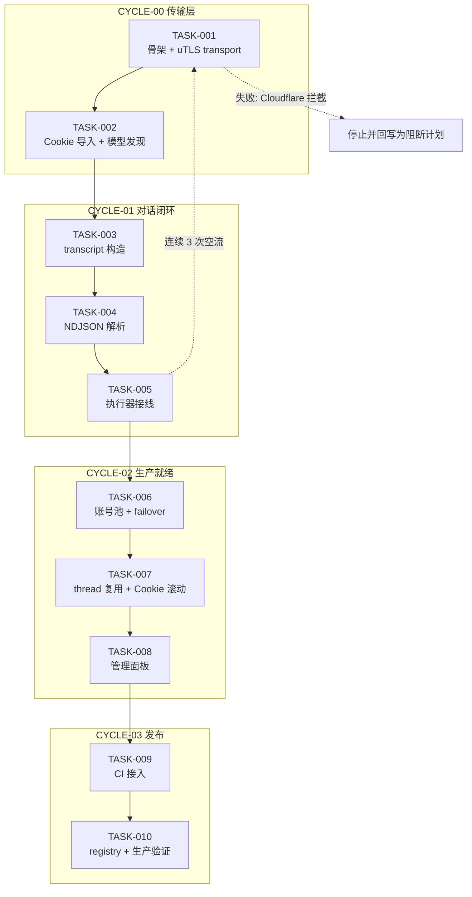
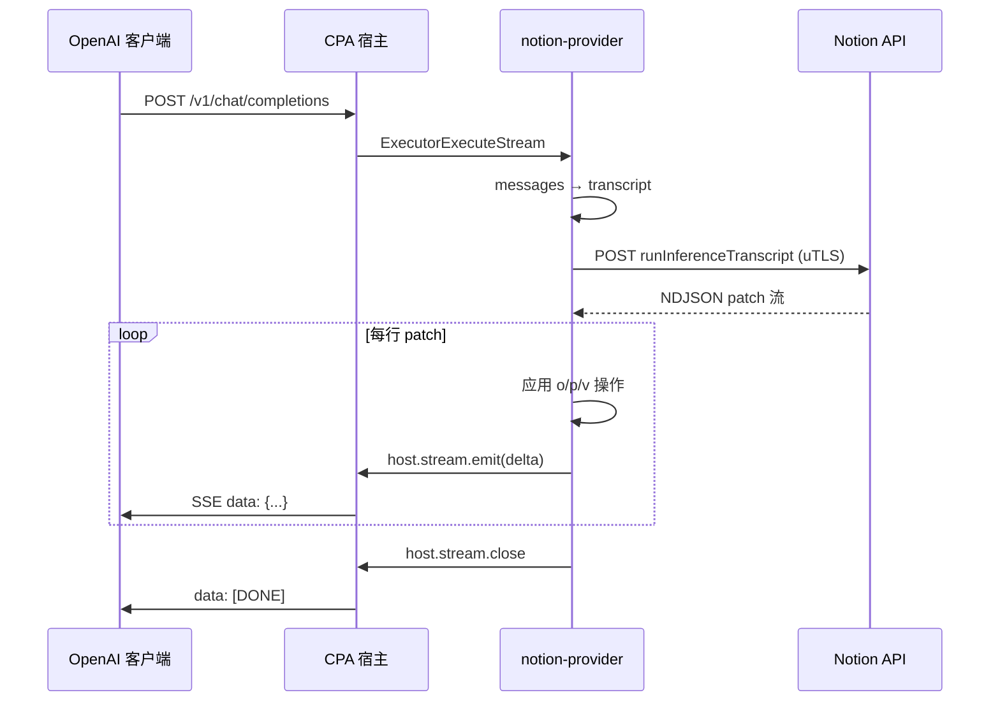

# 需求实施总览：Notion AI Provider 插件独立重写

结论：新增 `notion-provider` 插件，以协议 A（`runInferenceTranscript` + NDJSON）为主线，uTLS 指纹传输层打底，独立重写两个参考项目的协议能力，按四个周期交付；影响：CPA 用户可用 Notion AI 订阅额度调用 39 个主流模型；范围：Cookie 导入、uTLS 传输、transcript 转换、NDJSON 流解析、模型发现、账号池、面板、发布；非范围：插件内登录、页面/数据库 API、自动注册、WebSocket 反代、tools/附件；变化：仓库新增第 13 个插件，且是首个引入 uTLS 与结构化协议转换的插件；完成标准：AC-001~AC-013 全部通过；术语说明：`transcript` 指 Notion 私有对话步骤数组，`patch` 指 NDJSON 中的增量操作，`FEAS-*` 指可行性探针条目，`EXT-*` 指外部项目代码引用；验证状态：方向级探针全部通过；2026-10-18 晚已用真实凭据打通端到端（首轮/续写/多模型/双空间/离线回放），GAP-001 解除。

## 1. 当前计划最终方案简要说明

- **推荐方案一句话结论**：新建 `notion/` 目录，从 `coze/` 复制 c-shared 骨架，按「uTLS 传输 → transcript 转换 → NDJSON 解析 → 账号池 → 面板 → 发布」顺序独立实现，外部参考项目**只读行为不抄代码**。
- **主落点 / 主路径**：`F:\cpa-plugin\notion\`，主链路为 `executor.go`（OpenAI 请求入口）→ `protocol.go`（transcript 构造）→ `transport.go`（uTLS 出网）→ `stream.go`（NDJSON 解析）→ `host.stream.emit`（回推宿主）。
- **为什么先走这条路线**：两个用户指定参考项目都用协议 A（`runInferenceTranscript`），其中 `notion_manager` 是 Go 实现可直接对照行为；协议 A 支持真流式，协议 B 是轮询伪流式。先把协议 A 跑通，若失败则整体方向证伪，可提前止损。

## 2. 基本信息

- **对应需求文档**：[doc/2-需求/2026-10-18_201416_NotionProvider插件立项需求.md](../2-需求/2026-10-18_201416_NotionProvider插件立项需求.md)
- **来源对象标识**：`REQ-NOTION-PROVIDER-20261018`
- **当前实施文档命名主干**：`2026-10-18_201416_NotionProvider插件立项_实施总览`
- **对应需求与实施计划全量顺序实施方案**：N/A + 原因：本插件是既有 12 插件体系上的第 13 个独立插件，与其它需求无跨来源对象依赖，不需要项目级总调度表 + 证据：`registry.json` 中 12 个插件各自独立版本、独立 tag、独立发布。
- **实施计划完成条件（`AC-*`）所在章节**：需求文档 §六；本文件 §5 逐任务映射。
- **对应 `6-review` 风格回归记录**：`doc/6-review/`，每个最小任务完成后追加。
- **agent 理解的问题 / 目标**：用户希望把 Notion AI 的模型能力接入 CPA，参考两个开源反代项目但**独立重写**，先给出可行性计划。
- **当前计划范围**：周期 0-3 的全部最小任务。
- **明确不在范围**：插件内登录流程、Notion 页面/数据库 API、自动注册养号、WebSocket 反代、tools / function calling、附件与图片输入。
- **当前优先闭环**：周期 1 的 TASK-003（首轮对话打通）——**已由真实凭据探针完成协议验证**，进入编码时可直接按 §10.2 FEAS-009~014 的实证契约实现。
- **关键假设 / 待确认点**：
  1. ~~用户能提供真实 Notion Cookie（GAP-001）~~ → **已解除**，真实凭据全链路验证通过。
  2. Notion 不强制 Cloudflare challenge（P1/P2 已证）。
  3. uTLS v1.8.2 与宿主版本兼容（P3 已证）。
  4. ~~AI 激活状态 / 额度门槛~~ → **已证不成立**：免费版 0 credits 同样可推理。
- **跨会话执行入口**：新会话读本文件 §2.3 即可接手。
- **主项目地址、仓库类型与代码基线**：`F:\cpa-plugin`（Windows 本地路径），Git 仓库 `luode0320/cpa-workbuddy-plugin`，基线 commit `e1de25d`（2026-10-18 时 main HEAD）。
- **local 环境与依赖入口**：Go 1.26.0；本地无 CGO 时 `python scripts/cgo-shim-build.py notion`；真实 CGO 构建依赖 CI（`build.yml`）或 WSL gcc。
- **外部项目代码引用**：见 §2.3 `EXT-*` 清单（共 4 项）。
- **当前状态**：协议可行性已闭环（FEAS-001~014 全部有实证），**未开始编码**。
- **是否已获得开始实施授权**：**否**。本文件为可行性计划，需用户明确「开始实施」后才进入编码。
- **若当前为受限计划 / 阻断计划**：本文件为**正式实施计划**，方向级假设已全部 `已探针验证`，GAP-001 / GAP-003 / GAP-007 / GAP-008 均已解除。剩余任务级缺口 GAP-006（多空间路由策略）与 GAP-009（markdown-chat 不可用，已定改走 workflow）不阻断编码。

## 2.1 决策维度覆盖表

| 维度 | 状态 | 结论 / 依据 |
|---|---|---|
| 架构 / 技术路线 | 已确定 | 协议 A 主线。依据：用户指定的两个参考项目均用协议 A；有 Go 实现对照；真流式。协议 B 仅 1 个项目使用且为伪流式，不采用 |
| 代码落点（目录 / 包 / 文件） | 已确定 | 新建 `F:\cpa-plugin\notion\`，单 package `main`，c-shared。依据：`coze/` 同构 |
| 实现方式 | 已确定 | 自建 `http.Client` 绕过宿主桥。依据：宿主桥不支持 TLS 定制（`http_bridge.go:108-140`）；插件自建 client 已有先例（`doubao/completion.go:458`） |
| 命名 | 已确定 | provider id `notion-provider`；目录 `notion/`；模型前缀 `notion/`；auth 目录 `~/.antigravity_cockpit/notion_accounts/`。依据：与既有插件一致 |
| 注释 | 已确定 | 遵循 `comment-rules`：中文、函数头含 `[参数]/[返回]/最近修改时间`、方法体步骤编号 |
| 日志 | 已确定 | 走 `host.log`（`pluginabi.MethodHostLog`），中文业务日志，不回显凭据 |
| 错误处理 / 异常 | 已确定 | 传输层失败 → 换号；业务 400 → 不换号；200 空流 → 判传输失败。依据：本仓库 failover 既有规则 + Notion 静默失败特性 |
| 数据模型 / 表 / 字段 | 已确定 | 无数据库。`StoredAuth` JSON 落盘：`cookie_header` / `token_v2` / `user_id` / `space_id` / `client_version` / `browser_id` / `device_id` / `proxy_url` / `disabled` |
| 接口契约 | 已确定 | OpenAI `/v1/chat/completions` + 模型注册 + 管理面板路由（前缀 `/v0/management/plugins/notion-provider/`） |
| 依赖与库 | 已确定 | 新增 `github.com/refraction-networking/utls v1.8.2`、`golang.org/x/net`（http2）。P3 已验证可拉取 |
| 测试策略 / 样本 | 已确定 | 单测 + `cgo-shim-build.py`；协议解析用已归档的 5 份真实 NDJSON 样本（`.p5/samples/`）；端到端已用真实 Cookie 验证通过 |
| 图形化 | 已确定 | 复杂任务（4 周期 / 12 任务），必须 Mermaid |
| 图片资产 | 已确定 | N/A，本计划为后端插件，无 UI 视觉基线需求 |

## 2.2 待用户选择清单

**无未决项（所有真实不确定决策点已由用户选定或由探针确定）**。

说明：协议 A/B 的选择已由用户指定的两个参考项目收敛至协议 A；uTLS 是否是硬依赖已由 P1/P2/P3 探针与源码证据确定，无需用户裁定。

## 2.3 跨会话独立执行与外部项目代码引用清单

- **新会话接手第一步**：读需求文档 §三「协议实证」→ 读本文件 §5 找到当前 `TASK-*` → 按 `TASK-*` 的「前置依赖」核验上游已完成 → 执行该任务「实现产出」。
- **主项目地址与项目根**：`F:\cpa-plugin`（Windows）；GitHub `luode0320/cpa-workbuddy-plugin`。
- **主项目代码基线**：main HEAD 基线为 `e1de25d`（2026-10-18）。新会话执行前先 `git status` 确认工作树，不得覆盖他人改动。
- **计划源文件与版本**：本文件 v1.0（2026-10-18）。
- **依赖安装、local 配置和服务启动入口**：
  - 依赖：`cd notion && go mod tidy`
  - 本地验证：`python scripts/cgo-shim-build.py notion`
  - 真实构建：CI `build.yml`（push 后自动跑 Test）
- **中断点核验顺序**：① 确认 `notion/` 目录已存在并含上一 TASK 产出 → ② `python scripts/cgo-shim-build.py notion` 全绿 → ③ 查看上一 TASK 的 `6-review` 记录 → ④ 继续当前 TASK。
- **外部项目代码引用**：

| 引用 ID | 外部项目名称 | 外部项目地址 | 版本 / 提交 | 项目根相对路径 | 文件 / 符号 | 引用用途 | 许可证 / 复制边界 | 可达性检查与失败停止条件 | 使用 TASK / TEST / EVIDENCE 回指 |
|---|---|---|---|---|---|---|---|---|---|
| EXT-001 | SleepingBag945/notion_manager | https://github.com/SleepingBag945/notion_manager | master，2026-08-05 最后推送 | `internal/proxy/notion.go` | `CallInference` `setNotionHeaders` `FetchModels` `applyWorkflowRequestProtocol` `buildConfigValue` `buildContextValue` `parseNDJSONStream` | 协议字段与请求构造**行为**参照 | **CC BY-NC-SA 4.0，禁商用**；只读行为，**禁止复制代码** | 若仓库 404 / 文件不存在 → 停止 TASK-002 并回写计划 | TASK-002 / TEST-002 / EVIDENCE-002 |
| EXT-002 | SleepingBag945/notion_manager | 同上 | 同上 | `internal/proxy/transport.go` | `dialChromeTLS` `getChromeRoundTripper` | uTLS + http2 transport 结构参照 | 同上，**禁止复制** | 同上 | TASK-001 / TEST-001 / EVIDENCE-001 |
| EXT-003 | maverickxone/notion2api | https://github.com/maverickxone/notion2api | main，2026-09-07 最后推送 | `app/stream_parser.py` `app/notion_client.py` `app/model_registry.py` | `parse_stream` `_extract_text_from_patch` `_extract_final_content_from_record_map` `stream_response` `MODEL_MAP` | NDJSON 段落注册表语义与模型代号表**行为**参照 | **无 LICENSE（保留所有权利）**；**禁止复制代码**，只能读行为 | 若仓库 404 → 停止 TASK-003 并回写计划 | TASK-003 / TEST-003 / EVIDENCE-003 |
| EXT-004 | ArthurMonteiro08586/notion-agent-gateway | https://github.com/ArthurMonteiro08586/notion-agent-gateway | main，2026-10-08 | `model_registry.json` | 39 条模型代号映射 | 模型静态 fallback 表 | **无 LICENSE**；数据事实层面可用（模型代号为上游事实），**代码禁止复制** | 若 404 → 用 `getAvailableModels` 动态发现，静态表留空 | TASK-004 / TEST-004 / EVIDENCE-004 |

## 3. 实施周期总览

- **总周期说明**：4 个周期，每个周期形成独立可验证闭环。
- **本次计划拆分的子任务周期数**：4。
- **周期拆分原则**：按「传输层 → 协议层 → 生产就绪 → 发布」的依赖顺序垂直切片；每个周期结束时插件都处于可运行状态（哪怕功能不全）。
- **周期排序说明**：周期 0 是方向级假设（uTLS 能否过），必须先做；周期 1 是核心价值（能对话）；周期 2 是多账号与稳定性；周期 3 才是发布。

### 周期 0：传输层打通（CYCLE-00）

- **周期序号 / 期次定位**：第一期，方向验证。
- **周期目标**：证明 Go + uTLS 能稳定打通 Notion 端点，并跑通模型发现。
- **本周期包含的最小任务**：TASK-001、TASK-002。
- **周期内最小任务执行顺序**：TASK-001 → TASK-002。
- **进入条件**：无（可立即开始）。
- **收口条件**：TASK-001 与 TASK-002 各自完成实现 + 真实测试 + `6-review`。
- **完成标志**：用假凭据能稳定拿到 `401 UnauthorizedError`（证明传输层通），用真实凭据能拿到模型列表。
- **与前后周期衔接**：为周期 1 提供已证可用的 `transport.go` 与 `authfile.go`。

### 周期 1：对话闭环（CYCLE-01）

- **周期序号 / 期次定位**：第二期，核心价值。
- **周期目标**：单账号、单轮、流式对话跑通。
- **本周期包含的最小任务**：TASK-003、TASK-004、TASK-005。
- **周期内最小任务执行顺序**：TASK-003（transcript 构造）→ TASK-004（NDJSON 解析）→ TASK-005（执行器与流式接线）。
- **进入条件**：CYCLE-00 收口；真实 Cookie 已提供并完成协议验证（GAP-001 已解除）。
- **收口条件**：三个任务各自闭环；`stream=true` 与 `stream=false` 均返回正确正文。
- **完成标志**：AC-004 / AC-005 通过。
- **与前后周期衔接**：为周期 2 提供可用的 `protocol.go` / `stream.go` / `executor.go`。

### 周期 2：多账号与生产就绪（CYCLE-02）

- **周期序号 / 期次定位**：第三期，稳定性。
- **周期目标**：多账号池、故障转移、thread 复用、Cookie 滚动、管理面板。
- **本周期包含的最小任务**：TASK-006、TASK-007、TASK-008。
- **周期内最小任务执行顺序**：TASK-006（账号池与 failover）→ TASK-007（thread 复用与 Cookie 滚动）→ TASK-008（管理面板）。
- **进入条件**：CYCLE-01 收口。
- **收口条件**：三个任务各自闭环；AC-006 / AC-007 / AC-008 / AC-009 / AC-010 通过。
- **完成标志**：多账号可轮换、静默失败可识别、面板可用。
- **与前后周期衔接**：为周期 3 提供可发布的完整插件。

### 周期 3：发布（CYCLE-03）

- **周期序号 / 期次定位**：第四期，交付。
- **周期目标**：CI 接入、registry、图标、生产热重载验证。
- **本周期包含的最小任务**：TASK-009、TASK-010。
- **周期内最小任务执行顺序**：TASK-009（CI 与构建）→ TASK-010（registry 与生产验证）。
- **进入条件**：CYCLE-02 收口。
- **收口条件**：AC-011 / AC-012 / AC-013 通过。
- **完成标志**：`plugin-store install notion-provider` 成功热重载，远端 raw URL 200。
- **与前后周期衔接**：无后续周期。

- **总体真实测试安排**：
  - **是否默认必需**：是。本计划全部涉及可执行行为变更。
  - **覆盖最小任务**：TASK-001 ~ TASK-010 全部。
  - **公共测试环境 / 依赖**：Go 1.26.0 + `python scripts/cgo-shim-build.py`；真实端到端用面板导入的 Cookie。
  - **公共样本 / 数据来源**：离线 NDJSON 样本从真实流抓取后脱敏存 `notion/testdata/`；模型代号表来自 EXT-004。
  - **总体通过标准**：每个 TASK 的 `cgo-shim-build` 全绿 + 该 TASK 规定的真实测试通过 + `6-review` 输出 `STYLE: PASS`。

## 3.1 执行结果回填（2026-10-19）

四个周期全部收口，插件已发布到生产（`notion-provider 0.1.2`，热重载生效）。

| 周期 | 状态 | 实测证据 |
|---|---|---|
| CYCLE-00 传输层 | 完成 | `cgo-shim` 全绿；真实凭据拉到 2 个 workspace（商业版 300 credits / 免费版 0）、36 个可用模型 |
| CYCLE-01 对话闭环 | 完成 | 生产 `/v1/chat/completions` 非流式返回 `PONG`；流式返回单帧 `STREAM` + `[DONE]`，无重复帧 |
| CYCLE-02 生产就绪 | 完成 | 多轮只发新消息仍复述 `PONG-2026`（AC-006）；面板探活 1.844s 返回 `OK`（AC-010）；阶梯冷却与 40x 预算单测全绿（AC-007）；拒绝帧识别单测通过（AC-008）；Cookie 滚动写回与防覆盖单测通过（AC-009） |
| CYCLE-03 发布 | 完成 | CI 全绿（含 6 平台产物 + windows-arm64 cross）；registry 13 条通过校验；远端 raw URL / 图标 / zip 均 200；`plugin-store install` 返回 `restart_required:false`，插件 `registered=true`、`effective_enabled=true`、`metadata.version=0.1.1` |

**执行中新增的缺陷与修复**：

1. **`authfile.go` 自锁**（CYCLE-00）：`writeAuthFileDirect` 持有 `authFilesMu.Lock()` 时调用 `isSafeNotionAuthPath`，后者经 `getAccountsDir()` 再取 `RLock`，RWMutex 不可重入导致测试挂死 601s。修复为 `accountsDirMu` 只保护目录变量，文件 IO 不再持锁。
2. **流内拒绝帧未识别**（CYCLE-02）：`streamParser.failure` 从未被赋值，`trust-rule-denied` 帧会被当成普通行跳过，账号不进冷却。修复为在 `consumeLine` 首部按标记识别并归一为 403。
3. **切空间后旧会话残留**（CYCLE-02）：原实现 `forgetSession(auth, "")` 拼出的键永远匹配不到真实会话。修复为 `forgetSessionsForAuth` 按 `authID|spaceID|` 前缀整批清理。
4. **面板读不到账号列表**（CYCLE-03，0.1.1）：资源页免密钥放行，但数据接口仍校验 Bearer key；0.1.0 只读 `localStorage['cpa-management-key']`（主面板不存在该键）。修复为三级回退（主面板 `cli-proxy-auth` → `?key=` → 手工输入），401 时自动弹输入框。
5. **流式终稿不输出 usage**（CYCLE-03，0.1.2）：宿主只从分片/响应体读 token 数，终止帧只带 `finish_reason` 会让下游用量与计费全部记零（生产 new-api 日志 Tokens 恒为 `-`）。修复为终止帧输出 OpenAI 规范 `usage`，增量帧保持不带 usage 避免重复累加；生产实测终止帧已带 `3/56/59`。

### 3.2 上线期缺陷回填（2026-10-19，0.1.3 / 0.1.4）

用户报「CPA 配置了 `notion/omodi → gpt-6-luna` 映射，但请求报错」，排查结论与修复如下。

**根因不是别名映射缺失**。宿主 `OAuthModelAliasChannel` 对未知 provider 走 `default: return provider`，`notion-provider` 作为别名 channel 是被支持的；`applyOAuthModelAlias`（模型列表）与 `resolveOAuthModelAliasWithResult`（运行时路由）两处均生效。实测 `gpt-6-luna` 与直连 `notion/omodi` 返回**同一条**错误 `auth_unavailable: ... 未找到可用账号`，即可排除别名层。

**真实根因是账号凭据被宿主覆盖**：

| 证据 | 内容 |
|---|---|
| 生产 spool 文件 | `/usr/local/src/cli-proxy-api/mysqlstore/mysqlstore/auths/notion-9fa3f5f365ab.json` 只剩 194 字节 |
| 残留键 | `disabled` / `space_id` / `space_name` / `type` / `user_id`，`cookie_header`、`token_v2`、`spaces` 全丢 |
| 宿主契约 | `AuthData.StorageJSON` 是该账号的持久化存储；`storageJSONFromAuth` 在 `RawJSON()` 为空时回落 marshal `Metadata` |
| 插件缺陷 | `authDataForLogin` 只回传 5 个字段，未设 `StorageJSON`，宿主遂用精简元数据重写账号文件 |

**修复（0.1.3）**：

1. `authDataForLogin` 回传完整账号 JSON 作为 `StorageJSON`（回归：`TestAuthDataCarriesFullStorage`）。
2. `resolveAuth` 剥离宿主 `AuthID` 的 `.json` 后缀（宿主按凭据文件相对路径派生，本地标识不带扩展名），并跳过停用账号；`StorageJSON` 缺 `AuthID` 时用 `AuthID` 回填（回归：`TestResolveAuthStripsJSONSuffix` / `TestResolveAuthSkipsDisabled`）。
3. `listHostAuthFiles` 在 RPC 失败、响应非 OK、结果为空三种情况下回落磁盘扫描，避免刚热重载时宿主索引未重建导致误判无号。

**面板重写（0.1.4）**：原表格把账号、空间、额度挤在一行；改为与 workbuddy 一致的卡片网格，补齐 CPA 主题令牌与父级主题同步、账号总览、搜索与额度排序、模态框导流与 toast 通知；测试改为先拉取模型列表再点选。

**生产验收**：

| 项 | 结果 |
|---|---|
| 热重载 | `active_version=0.1.4 retired_version=0.1.3`，`.so` sha256 与 release zip 内一致 |
| 重新导入账号 | 新文件 3365 字节，16 个键（含 `cookie_header` / `token_v2` / `spaces`），空间 300/0 credits |
| 别名链路 | `gpt-6-luna` 返回正文 `OK`，响应 `model` 字段回落为 `notion/omodi`；直连 `notion/omodi` 同样 `OK` |
| 用量记账 | token-usage-tracker 记录 `model=notion/omodi alias=gpt-6-luna` 与 `alias=notion/omodi` 两条，`failed=false` |
| 面板真实渲染 | 卡片网格两列渲染、总览 600 额度 / 4 空间、测试模态框加载 36 个模型、点选 GPT-6 Luna 实际探活 3.056s 返回 `OK`（tokens 3/53） |

### 3.3 账号粒度：按工作空间拆分（2026-10-19，0.2.0 / 0.2.1）

用户提出「同一个账号有免费工作空间和付费订阅工作空间，能否拆成 2 个账户分别路由」。

**可行性依据**：Notion 的 AI 额度绑定在 workspace 上，插件推理时本来就用 `x-notion-space-id` 区分空间；因此拆分只需要让「一个 auth 文件对应一个空间」，路由、冷却、会话粘性都天然按账号隔离。

**实现**：

| 改动 | 说明 |
|---|---|
| `authIDFor(identity, spaceID)` | 标识改为「用户 + 空间」派生。不含 token 是刻意的：token 会被上游轮换，含它会让每次重新导入都生成新文件 |
| `saveCredentials` | 遍历 `getSpaces` 结果逐空间落盘，返回账号列表；`space_id` 非空时只导入该空间 |
| `accountLabel` | 备注名自动带「订阅 / 免费」标记，避免面板上一排同名卡片 |
| `retireStaleAccounts` | 全量导入后把同 `user_id` 且不在本次集合里的旧账号改名 `.migrated`（改名不删除），避免同一空间被两个账号重复路由 |
| `propagateCookieToSiblings` | Cookie 滚动写回同步到「同 user_id 且 token 仍是旧值」的兄弟账号，否则其它空间下一次请求会 401 |
| `handleSetSpace` | 改为「移动」语义（连同账号文件改名），目标空间已有独立账号时返回 409 |
| `resolveAuth` / `mapLegacyAccount` | 旧版宿主记录按 `user_id` + `space_id` 映射回拆分后的对应空间账号（0.2.1） |
| `pickAccountExcluding` | 跳过 `cookie_header` 为空的账号，避免被宿主覆盖过的旧文件占位 |

**升级期发现的缺陷（0.2.1）**：宿主持久化存储里仍保留拆分前的账号记录并继续派发，而插件侧文件已归档，导致 `resolveAuth` 稳定报「未找到可用账号」。已按 `user_id` + `space_id` 映射修复；空间不匹配或目标不可用时不映射。

**生产验收**：

| 项 | 结果 |
|---|---|
| 全量导入 | 一次导入产出 2 个账号：`Notion · 订阅`（300 premium）与 `Notion · 免费`（0 premium / 5 of 50 basic） |
| 冻结探活 | 免费 2.651s `OK`（tokens 3/34）；订阅 2.532s `OK`（tokens 3/33） |
| 额度快照 | 按 `space_id` 匹配后各自独立：订阅 300、免费 0，未被 `Spaces[0]` 污染 |
| 真实入口 | `/v1/chat/completions` 返回正文 `OK`，usage 正常 |
| 宿主认证文件 | 删除残留旧记录后仅剩 2 个新账号；插件目录旧文件已 `.migrated` |
| 部署 | `active_version=0.2.1 retired_version=0.2.0`，`.so` sha256 与 release zip 内一致，容器未重启 |

**遗留**：免费空间的 basic 额度实测能跑 `omodi`，但尚未验证是否对所有 36 个模型都放行；多账号并行压测未做。

## 4. 阶段计划

- **阶段 1：传输层**
  - 阶段名称：uTLS 指纹传输
  - 阶段目标：建立能欺骗 Notion 指纹检测的 HTTP 客户端
  - 只做这一件事：实现 `transport.go` + `authfile.go`
  - 输入条件：无
  - 输出产物：`transport.go`、`authfile.go`、对应单测
  - 验证门槛：TASK-001 / TASK-002 闭环
- **阶段 2：协议层**
  - 阶段名称：transcript 与 NDJSON
  - 阶段目标：完成 OpenAI ↔ Notion 的双向协议转换
  - 只做这一件事：实现 `protocol.go` + `stream.go`
  - 输入条件：阶段 1 完成
  - 输出产物：`protocol.go`、`stream.go`、离线样本测试
  - 验证门槛：TASK-003 / TASK-004 闭环
- **阶段 3：执行器接线**
  - 阶段名称：执行器与流式
  - 阶段目标：把协议层接入宿主 Executor 能力
  - 只做这一件事：实现 `executor.go` + `convert.go`
  - 输入条件：阶段 2 完成
  - 输出产物：可端到端对话的执行器
  - 验证门槛：TASK-005 闭环
- **阶段 4：生产就绪**
  - 阶段名称：账号池与面板
  - 阶段目标：多账号、failover、thread 复用、面板
  - 只做这一件事：实现 `failover.go` + `session.go` + `management.go` + `panel.html`
  - 输入条件：阶段 3 完成
  - 输出产物：生产可用插件
  - 验证门槛：TASK-006 / TASK-007 / TASK-008 闭环
- **阶段 5：发布**
  - 阶段名称：CI 与交付
  - 阶段目标：接入发布链路
  - 只做这一件事：`build.yml` / `registry.json` / 图标 / 生产验证
  - 输入条件：阶段 4 完成
  - 输出产物：已发布插件
  - 验证门槛：TASK-009 / TASK-010 闭环

## 5. 最小任务清单

### TASK-001 新建插件骨架与 uTLS 传输层

- **任务名**：新建 `notion/` 骨架并实现 uTLS transport
- **所属周期**：CYCLE-00
- **周期内顺序**：1
- **所属阶段**：阶段 1
- **本任务只做这一件事**：让 `notion/` 目录能编译，且 `newNotionHTTPClient()` 返回基于 uTLS 的 client
- **垂直切片目标**：用假凭据调用 `runInferenceTranscript`，稳定拿到 401
- **输入条件**：无
- **实现产出**：
  - `notion/main.go`（从 `coze/main.go` 复制并改 `providerName = "notion-provider"`）
  - `notion/transport.go`（uTLS `HelloChrome_Auto` + `http2.Transport`）
  - `notion/browser.go`（UA / `sec-ch-ua` / `sec-fetch-*` 常量）
  - `notion/go.mod`（新增 `utls v1.8.2`、`golang.org/x/net`）
  - `notion/transport_test.go`
- **真实测试是否必需**：是
- **真实测试入口**：`python scripts/cgo-shim-build.py notion`；另写 `notion/live_probe_test.go`（`//go:build ignore`，手动跑）发一次假凭据请求
- **真实测试依赖环境**：Go 1.26.0，可出网
- **真实测试样本 / 数据来源**：假凭据（全零 UUID + `token_v2=invalid_probe_token`）
- **真实测试通过标准**：① shim build+vet+test 全绿；② live probe 拿到 HTTP 401 且 body 含 `UnauthorizedError`
- **测试点**：transport 不 panic、TLS 握手成功、HTTP/2 生效
- **`6-review` 风格回归点**：函数头三要素、中文注释、无标准库 transport 兜底
- **任务完成条件**：两个测试入口均通过
- **任务停止 / 结束条件**：live probe 若拿到 Cloudflare challenge（HTML 或 403），立即停止并回写计划为阻断计划
- **阻断条件**：uTLS 拉取失败；宿主 Go 版本 < 1.24
- **前置依赖**：无
- **下一任务依赖**：TASK-002
- **预计触达文件数**：5

### TASK-002 Cookie 导入与模型发现

- **任务名**：实现 Cookie 解析、探活、落盘与 `getAvailableModels`
- **所属周期**：CYCLE-00
- **周期内顺序**：2
- **所属阶段**：阶段 1
- **本任务只做这一件事**：能把用户 Cookie 变成可用账号，并能拉出模型清单
- **垂直切片目标**：面板导入 Cookie → 探活成功 → 落盘 → 拉出模型列表
- **输入条件**：TASK-001 完成
- **实现产出**：`notion/authfile.go`、`notion/models.go`、`notion/models_test.go`
- **真实测试是否必需**：是
- **真实测试入口**：`cgo-shim-build.py notion` + 单测（用 httptest mock `getAvailableModels`）
- **真实测试依赖环境**：Go 1.26.0
- **真实测试样本 / 数据来源**：mock 响应（按 EXT-001 `FetchModels` 的结构）+ 真实 Cookie（若用户提供）
- **真实测试通过标准**：① 单测覆盖「Cookie 缺字段 → 拒绝落盘」「探活失败 → 不落盘」「成功 → 落盘且字段完整」；② 有真实 Cookie 时能拉到 ≥10 个模型
- **测试点**：Cookie 解析、`isDisabled` 过滤、模型前缀
- **`6-review` 风格回归点**：与 `doubao/authfile.go` 的写法一致
- **任务完成条件**：单测全绿；有真实凭据时端到端通过
- **任务停止 / 结束条件**：真实 Cookie 探活连续 3 次失败 → 记录为面板导入链路故障，停止后续任务
- **阻断条件**：真实 Cookie 不可用或面板导入失败（不阻断单测）
- **前置依赖**：TASK-001
- **下一任务依赖**：TASK-003
- **预计触达文件数**：4

### TASK-003 transcript 协议构造

- **任务名**：实现 OpenAI messages → Notion transcript
- **所属周期**：CYCLE-01
- **周期内顺序**：1
- **所属阶段**：阶段 2
- **本任务只做这一件事**：把 OpenAI 请求转成 Notion 请求体
- **垂直切片目标**：给定 messages，产出字段完整、可被上游接受的 JSON body
- **输入条件**：TASK-002 完成
- **实现产出**：`notion/protocol.go`、`notion/protocol_test.go`
- **真实测试是否必需**：是
- **真实测试入口**：`cgo-shim-build.py notion` + 单测
- **真实测试依赖环境**：Go 1.26.0
- **真实测试样本 / 数据来源**：手写的 OpenAI 请求样本 + EXT-001 `buildConfigValue` 的字段清单
- **真实测试通过标准**：① 单测断言首轮产出含 `config`/`context`/`user` 三步、`createThread=true`、`isPartialTranscript=false`；② 后续轮断言 `createThread=false`、`isPartialTranscript=true`、只带新增 user 步；③ 真实请求返回 200
- **测试点**：config 最小开关集、context 字段、threadParentPointer
- **`6-review` 风格回归点**：常量命名、结构体 json tag
- **任务完成条件**：单测全绿 + 真实请求 200
- **任务停止 / 结束条件**：GAP-002 消融后仍无法让上游接受 → 停止并记录为阻断
- **阻断条件**：真实 Cookie 不可用或面板导入失败 未解除
- **前置依赖**：TASK-002
- **下一任务依赖**：TASK-004
- **预计触达文件数**：3

### TASK-004 NDJSON 流解析

- **任务名**：实现 NDJSON patch 解析器
- **所属周期**：CYCLE-01
- **周期内顺序**：2
- **所属阶段**：阶段 2
- **本任务只做这一件事**：把 NDJSON 行流转成正文增量与终结事件
- **垂直切片目标**：离线样本 → 正确还原完整正文
- **输入条件**：TASK-003 完成
- **实现产出**：`notion/stream.go`、`notion/stream_test.go`、`notion/testdata/*.ndjson`（脱敏样本）
- **真实测试是否必需**：是
- **真实测试入口**：`cgo-shim-build.py notion` + 单测（table-driven 跑样本）
- **真实测试依赖环境**：Go 1.26.0
- **真实测试样本 / 数据来源**：从真实流抓取的脱敏 NDJSON（至少 3 份：纯文本、含思考、含搜索）
- **真实测试通过标准**：① 三份样本解析出的正文与人工核对一致；② `record-map` 兜底路径可用；③ 空流样本返回明确错误而非空回复
- **测试点**：段落注册表、`o`/`p`/`v` 三种操作、`markdown-chat` 分支
- **`6-review` 风格回归点**：解析器单文件 < 200 行，超出则拆分
- **任务完成条件**：单测全绿
- **任务停止 / 结束条件**：样本无法覆盖主要分支 → 补抓样本或降级为「只支持 record-map 兜底」并回写计划
- **阻断条件**：GAP-003（thinking 边界）未解
- **前置依赖**：TASK-003
- **下一任务依赖**：TASK-005
- **预计触达文件数**：5

### TASK-005 执行器与流式接线

- **任务名**：实现 Executor 能力与 SSE 转发
- **所属周期**：CYCLE-01
- **周期内顺序**：3
- **所属阶段**：阶段 3
- **本任务只做这一件事**：把协议层与解析层接到宿主 Executor
- **垂直切片目标**：`POST /v1/chat/completions` 端到端跑通两种 stream
- **输入条件**：TASK-004 完成
- **实现产出**：`notion/executor.go`、`notion/convert.go`、`notion/executor_test.go`
- **真实测试是否必需**：是
- **真实测试入口**：`cgo-shim-build.py notion` + 真实 curl（stream=true/false）
- **真实测试依赖环境**：Go 1.26.0 + 真实 Cookie
- **真实测试样本 / 数据来源**：真实请求
- **真实测试通过标准**：AC-004 / AC-005
- **测试点**：异步 `host.stream.emit`、`[DONE]` 立即关闭
- **`6-review` 风格回归点**：与 `coze/executor.go` 的异步 emit 模式一致
- **任务完成条件**：两种 stream 均通过
- **任务停止 / 结束条件**：连续 3 次空流 → 判定 uTLS 指纹不足，回写 TASK-001
- **阻断条件**：真实 Cookie 不可用或面板导入失败
- **前置依赖**：TASK-004
- **下一任务依赖**：TASK-006
- **预计触达文件数**：4

### TASK-006 账号池与故障转移

- **任务名**：实现多账号池 + 阶梯冷却 + 换号
- **所属周期**：CYCLE-02
- **周期内顺序**：1
- **所属阶段**：阶段 4
- **本任务只做这一件事**：多账号轮换与失败换号
- **垂直切片目标**：一个账号失败时自动切到下一个
- **输入条件**：TASK-005 完成
- **实现产出**：`notion/failover.go`、`notion/failover_test.go`
- **真实测试是否必需**：是
- **真实测试入口**：`cgo-shim-build.py notion` + 单测
- **真实测试依赖环境**：Go 1.26.0
- **真实测试样本 / 数据来源**：mock 401/429/5xx/`trust-rule-denied` 帧
- **真实测试通过标准**：AC-007 / AC-008
- **测试点**：冷却阶梯、`retry_on_4xx` 缺省键不重置、静默失败计入传输错误
- **`6-review` 风格回归点**：与既有 `accountFailover` 写法一致
- **任务完成条件**：单测全绿
- **任务停止 / 结束条件**：`trust-rule-denied` 无法与业务错误区分 → 回写 TASK-004 补帧识别
- **阻断条件**：无
- **前置依赖**：TASK-005
- **下一任务依赖**：TASK-007
- **预计触达文件数**：3

### TASK-007 thread 复用与 Cookie 滚动

- **任务名**：实现 thread 会话复用与 Set-Cookie 写回
- **所属周期**：CYCLE-02
- **周期内顺序**：2
- **所属阶段**：阶段 4
- **本任务只做这一件事**：多轮对话复用 threadId，Cookie 变更落盘
- **垂直切片目标**：同一会话第二轮有上下文；重启后 Cookie 仍有效
- **输入条件**：TASK-006 完成
- **实现产出**：`notion/session.go`、`notion/session_test.go`、改造 `authfile.go`
- **真实测试是否必需**：是
- **真实测试入口**：`cgo-shim-build.py notion` + 真实多轮请求
- **真实测试依赖环境**：Go 1.26.0 + 真实 Cookie
- **真实测试样本 / 数据来源**：真实两轮对话
- **真实测试通过标准**：AC-006 / AC-009
- **测试点**：session TTL、指纹键、并发安全
- **`6-review` 风格回归点**：map 并发保护
- **任务完成条件**：真实两轮上下文正确
- **任务停止 / 结束条件**：thread 复用导致上游报错 → 降级为每轮新建 thread 并回写
- **阻断条件**：真实 Cookie 不可用或面板导入失败
- **前置依赖**：TASK-006
- **下一任务依赖**：TASK-008
- **预计触达文件数**：4

### TASK-008 管理面板

- **任务名**：实现管理路由与面板页
- **所属周期**：CYCLE-02
- **周期内顺序**：3
- **所属阶段**：阶段 4
- **本任务只做这一件事**：面板可导入账号、查看状态、测试
- **垂直切片目标**：AC-010
- **输入条件**：TASK-007 完成
- **实现产出**：`notion/management.go`、`notion/panel.go`、`notion/panel.html`
- **真实测试是否必需**：是
- **真实测试入口**：真实浏览器打开面板
- **真实测试依赖环境**：生产/本地 CPA 实例
- **真实测试样本 / 数据来源**：真实账号
- **真实测试通过标准**：导入 → 列表 → 测试按钮 → 删除 全链路可用
- **测试点**：路由前缀与 plugin id 一致、`const API` 与 id 一致
- **`6-review` 风格回归点**：`panel.html` 两段 script 语法校验
- **任务完成条件**：浏览器实测通过
- **任务停止 / 结束条件**：路由被宿主保留字拦截 → 换路径并回写
- **阻断条件**：无
- **前置依赖**：TASK-007
- **下一任务依赖**：TASK-009
- **预计触达文件数**：4

### TASK-009 CI 与构建接入

- **任务名**：把 notion 接入 CI 矩阵
- **所属周期**：CYCLE-03
- **周期内顺序**：1
- **所属阶段**：阶段 5
- **本任务只做这一件事**：让 CI 能产出 notion 的 6 平台 zip
- **垂直切片目标**：AC-011
- **输入条件**：TASK-008 完成
- **实现产出**：`.github/workflows/build.yml` 增加 6 处接入点
- **真实测试是否必需**：是
- **真实测试入口**：push 后观察 CI Test job
- **真实测试依赖环境**：GitHub Actions
- **真实测试样本 / 数据来源**：CI 日志
- **真实测试通过标准**：Test job 全绿
- **测试点**：tag 前缀、`plugin` 枚举、`dir` 映射、release 分支
- **`6-review` 风格回归点**：YAML 缩进
- **任务完成条件**：CI 全绿
- **任务停止 / 结束条件**：CI 拉取依赖失败 → 检查 go.sum
- **阻断条件**：无
- **前置依赖**：TASK-008
- **下一任务依赖**：TASK-010
- **预计触达文件数**：1

### TASK-010 registry 与生产验证

- **任务名**：发布 0.1.0 并做生产热重载验证
- **所属周期**：CYCLE-03
- **周期内顺序**：2
- **所属阶段**：阶段 5
- **本任务只做这一件事**：完成一次完整发布
- **垂直切片目标**：AC-012 / AC-013
- **输入条件**：TASK-009 完成
- **实现产出**：`registry.json` 条目、`assets/icons/Notion.png`、`notion/README.md` 免责声明
- **真实测试是否必需**：是
- **真实测试入口**：`plugin-store install notion-provider` + `docker logs | grep "hot reloaded"`
- **真实测试依赖环境**：生产 CPA 容器
- **真实测试样本 / 数据来源**：发布产物
- **真实测试通过标准**：热重载日志出现 notion-provider，远端 raw URL 200
- **测试点**：`validate-registry.py`、6 平台 URL
- **`6-review` 风格回归点**：registry JSON 格式
- **任务完成条件**：生产可用
- **任务停止 / 结束条件**：热重载未生效 → **不重启容器**，按项目 skill 排查
- **阻断条件**：无
- **前置依赖**：TASK-009
- **下一任务依赖**：无
- **预计触达文件数**：4

## 6. 现状与落点

- **涉及目录**：`F:\cpa-plugin\notion\`（新建）、`.github\workflows\`、`doc\2-需求\`、`doc\3-实施\`
- **涉及文件 / 模块**：见下方目录树
- **复用点**：
  - `coze/main.go` 的 c-shared ABI 骨架与 RPC 分发
  - `coze/executor.go` 的异步 `host.stream.emit` 模式
  - `coze/management.go` 的管理路由注册
  - `doubao/authfile.go` 的 Cookie 导入与落盘模式
  - `doubao/completion.go` 的自建 `http.Client` 先例
  - 各插件共有的 `accountFailover` 阶梯冷却
- **需要新增的内容**：uTLS transport（仓库首个）、NDJSON 解析器（仓库首个）、transcript 协议转换（仓库首个）

```text
F:\cpa-plugin\
└── notion\                                  # 新建插件目录（第 13 个插件）
    ├── main.go                              # c-shared 入口、RPC 分发、配置解析（复制 coze 改造）
    ├── transport.go                         # uTLS HelloChrome_Auto + http2.Transport（仓库首个）
    ├── transport_test.go                    # 传输层单测
    ├── browser.go                           # UA / sec-ch-ua / sec-fetch-* 指纹常量
    ├── authfile.go                          # Cookie 导入、探活、落盘、滚动写回
    ├── authfile_test.go
    ├── models.go                            # getAvailableModels 动态发现 + 静态 fallback 表
    ├── models_test.go
    ├── protocol.go                          # OpenAI messages ↔ Notion transcript
    ├── protocol_test.go
    ├── stream.go                            # NDJSON patch 解析器（段落注册表）
    ├── stream_test.go
    ├── executor.go                          # Executor 能力、异步流式 emit
    ├── executor_test.go
    ├── convert.go                           # OpenAI 响应/分片构造
    ├── convert_test.go
    ├── failover.go                          # 账号池、阶梯冷却、静默失败识别
    ├── failover_test.go
    ├── session.go                           # threadId 复用、TTL、并发安全
    ├── session_test.go
    ├── management.go                        # 管理路由注册与处理
    ├── panel.go                             # 面板 HTML 渲染
    ├── panel.html                           # 面板页
    ├── go.mod / go.sum                      # 新增 utls v1.8.2 + x/net
    ├── live_probe_test.go                   # //go:build ignore，手动跑的连通性探针
    ├── testdata\                            # 脱敏 NDJSON 样本
    │   ├── plain.ndjson                     # 纯文本流
    │   ├── thinking.ndjson                  # 含思考流
    │   └── search.ndjson                    # 含搜索流
    ├── VERSION                              # 0.1.0
    ├── CHANGELOG.md
    └── README.md                            # 含 ToS 免责声明（AC-013）

.github\workflows\build.yml                  # 修改：增加 notion 的 6 处接入点
registry.json                                # 修改：新增 notion-provider 条目
assets\icons\Notion.png                      # 新增：插件图标
```

## 7. 方案选择

- **方案 A：协议 A（`runInferenceTranscript` + NDJSON）** — 真流式；7 个参考项目；2 个 Go 实现可对照；用户指定的两个项目都用它。
- **方案 B：协议 B（`createAgentThread` + 长轮询）** — 解析简单；伪流式；仅 1 个 2026-10 新项目；无 Go 实现。
- **方案 C：双协议并存** — A 主 B 降级；工程量翻倍；周期 1 无法收敛。
- **推荐方案与原因**：**方案 A**。理由：用户指定的两个参考项目共同采用，Go 行为可对照，真流式体验更好；协议 B 可作为将来 A 失效时的迁移路径，但不进本期范围。

## 8. 实施步骤

1. **第一步：建骨架 + uTLS 传输**
   - 所属周期：CYCLE-00
   - 所属阶段：阶段 1
   - 对应最小任务：TASK-001
   - 本步只做：复制 coze 骨架，实现 transport.go，用假凭据验证拿到 401
2. **第二步：Cookie 导入 + 模型发现**
   - 所属周期：CYCLE-00
   - 所属阶段：阶段 1
   - 对应最小任务：TASK-002
   - 本步只做：实现 authfile.go + models.go，单测覆盖导入/探活/落盘
3. **第三步：transcript 构造**
   - 所属周期：CYCLE-01
   - 所属阶段：阶段 2
   - 对应最小任务：TASK-003
   - 本步只做：实现 protocol.go，产出上游可接受的请求体
4. **第四步：NDJSON 解析**
   - 所属周期：CYCLE-01
   - 所属阶段：阶段 2
   - 对应最小任务：TASK-004
   - 本步只做：实现 stream.go，用离线样本验证正文还原
5. **第五步：执行器接线**
   - 所属周期：CYCLE-01
   - 所属阶段：阶段 3
   - 对应最小任务：TASK-005
   - 本步只做：实现 executor.go + convert.go，端到端跑通两种 stream
6. **第六步：账号池与 failover**
   - 所属周期：CYCLE-02
   - 所属阶段：阶段 4
   - 对应最小任务：TASK-006
   - 本步只做：实现 failover.go
7. **第七步：thread 复用与 Cookie 滚动**
   - 所属周期：CYCLE-02
   - 所属阶段：阶段 4
   - 对应最小任务：TASK-007
   - 本步只做：实现 session.go，改造 authfile.go
8. **第八步：管理面板**
   - 所属周期：CYCLE-02
   - 所属阶段：阶段 4
   - 对应最小任务：TASK-008
   - 本步只做：实现 management.go + panel.html
9. **第九步：CI 接入**
   - 所属周期：CYCLE-03
   - 所属阶段：阶段 5
   - 对应最小任务：TASK-009
   - 本步只做：改 build.yml
10. **第十步：发布与生产验证**
    - 所属周期：CYCLE-03
    - 所属阶段：阶段 5
    - 对应最小任务：TASK-010
    - 本步只做：registry + 图标 + README + 热重载验证

## 9. 真实测试安排

- **真实测试总表**：

| TASK | 测试入口 | 依赖环境 | 样本来源 | 通过标准 |
|---|---|---|---|---|
| TASK-001 | `cgo-shim-build.py notion` + live probe | Go 1.26.0，可出网 | 假凭据 | 全绿 + HTTP 401 |
| TASK-002 | `cgo-shim-build.py notion` + 单测 | Go 1.26.0 | httptest mock + 真实 Cookie | 3 条单测 + ≥10 模型 |
| TASK-003 | `cgo-shim-build.py notion` + 真实请求 | Go 1.26.0 + 真实 Cookie | 手写 OpenAI 请求 | 单测 + HTTP 200 且含 `agent-inference` 段 |
| TASK-004 | `cgo-shim-build.py notion` + 5 份真实样本 | Go 1.26.0 | `.p5/samples/{claude,gpt,gemini,deepseek,glm}.ndjson` | 5/5 正文与 thinking 正确分离；Gemini 多 `patch-sync` 场景正文非空 |
| TASK-005 | 真实 curl（两种 stream） | 真实 Cookie | 真实请求 | AC-004/005 |
| TASK-006 | `cgo-shim-build.py notion` + 单测 | Go 1.26.0 | mock 错误码 + 双空间额度快照 | AC-007/008；两空间均记录 `premiumCredits` |
| TASK-007 | 真实两轮请求 | 真实 Cookie | 真实对话 | AC-006/009；续写能复述首轮 `PONG-2026` |
| TASK-008 | 真实浏览器 | CPA 实例 | 真实账号 | 全链路可用 |
| TASK-009 | CI Test job | GitHub Actions | CI 日志 | 全绿 |
| TASK-010 | `plugin-store install` + logs | 生产容器 | 发布产物 | 热重载日志 + raw URL 200 |

- **真实测试样本资产**：`.p5/samples/` 下 5 份 NDJSON 来自 2026-10-18 晚真实凭据请求，已确认不含 Cookie / token / 用户标识；用于 TASK-004 的离线回归，是 `FEAS-010`（异构 value 数组）与 `FEAS-011`（快照索引对齐）的唯一可复现证据。
- **免测任务及理由**：无。全部任务均涉及可执行行为变更。
- **步骤 1 真实测试 / 验证**：live probe 必须拿到 `401 UnauthorizedError`，不能是 Cloudflare 页面。
- **步骤 2 真实测试 / 验证**：mock 覆盖三条分支；真实 Cookie 时拉到 ≥10 模型（本轮实测 39 个，36 可用）。
- **步骤 3 真实测试 / 验证**：单测断言首轮/后续轮字段差异；真实请求 200 且流内出现 `agent-inference` 段。
- **步骤 4 真实测试 / 验证**：5 份样本解析正文与人工核对一致；Gemini 样本（含 4 个 `patch-sync`）必须提取到 "Hello! I am Notion AI..."；DeepSeek 样本正文为 "OK" 且 thinking 单独抽出；空流返回明确错误。
- **步骤 5 真实测试 / 验证**：stream=false 返回完整正文；stream=true 首帧 < 5s，`[DONE]` 后立即关闭。
- **步骤 6 真实测试 / 验证**：401/429/5xx/空流 四类均触发换号；`retry_on_4xx: 0` 不被重置。
- **步骤 7 真实测试 / 验证**：第二轮能引用第一轮内容（实测 `PONG-2026` 复述）；重启后 Cookie 仍有效。
- **步骤 8 真实测试 / 验证**：浏览器导入 → 列表 → 测试 → 删除。
- **步骤 9 真实测试 / 验证**：CI Test job 全绿。
- **步骤 10 真实测试 / 验证**：热重载日志 + 远端 raw URL 200。

## 10. 图形化执行路径

**图形化决策：需要**（复杂任务：4 周期 / 10 最小任务 / 跨模块）。





## 10.1 图片资产决策、生成与引用

- **图片资产决策**：`N/A + 原因 + 证据`。本计划为后端 Go 插件，无 UI 视觉基线、无设计稿对比、无空间布局需求；面板沿用既有插件的中后台形态，不涉及新视觉设计。流程与时序关系已由 §10 的两张 Mermaid 图表达。

## 10.2 可行性探针与假设清单

- **FEAS-001**：Go 侧能否穿透 Notion 的传输层拦截
  - 假设内容：Go 标准库与 uTLS 都能到达 Notion 应用层，Cloudflare 不下发强制 challenge
  - 影响面：**方向级**（不成立则整个逆向路线作废）
  - 探针级别：L2 真实
  - 验证方式：① curl 打两端点；② 写 Go 程序对照标准库 vs uTLS 各 1 次；③ 连续各 20 次稳定性测试
  - 结论：**已探针验证**
  - 证据：标准库与 uTLS 均为 `HTTP 401` + `{"isNotionError":true,...}`，`cf-mitigated` 为空；连续 40 次（uTLS 20 + 标准库 20）**全部到达应用层**，零 CF 挑战。详见需求文档 §5.2 P5/P6
  - 关联 TASK：TASK-001
- **FEAS-001b**：uTLS 是否构成「不实现就完全不可用」的硬闸
  - 假设内容：**不构成**。标准库在本机假凭据场景下同样到达应用层
  - 影响面：任务级（影响 uTLS 的定位与实现优先级，不改路线）
  - 探针级别：L2 真实
  - 验证方式：P5/P6 对照实验
  - 结论：**已探针验证**（修正原「硬依赖」判断）
  - 证据：同 FEAS-001。uTLS 下调为**防御性依赖**——仍实现（成本低、对冲未来风控与异地 IP），但不再是「不实现就跑不通」的前置条件
  - 关联 TASK：TASK-001（**执行期第一动作仍先验证有效凭据下是否出现 200 空流，出现则必须保留 uTLS**）
- **FEAS-001c**：含 uTLS 的插件骨架能否通过 `cgo-shim-build.py`
  - 假设内容：shim 只剥离 cgo，不影响 uTLS 等普通依赖
  - 影响面：任务级
  - 探针级别：L2 真实
  - 验证方式：搭建真实骨架 + uTLS，跑 `python scripts/cgo-shim-build.py`
  - 结论：**已探针验证**
  - 证据：`[cgo-shim] OK: go build ./...`、`OK: go vet ./...`、`OK: go test ./...`、`all green`；见需求文档 §5.2 P7
  - 关联 TASK：TASK-001
- **FEAS-001d**：插件内 uTLS 客户端能否真实请求 Notion
  - 假设内容：把 uTLS 放进 c-shared 插件包内，功能不受影响
  - 影响面：方向级（决定架构可行性）
  - 探针级别：L2 真实
  - 验证方式：骨架内写单测调用插件自己的 `newNotionHTTPClient()` 打 Notion
  - 结论：**已探针验证**
  - 证据：`status=401 mitigated="" body={"isNotionError":true,...}`，`--- PASS: TestNotionTransportReachesApplicationLayer (0.89s)`；见需求文档 §5.2 P8
  - 关联 TASK：TASK-001
- **FEAS-002**：uTLS v1.8.2 能否被插件依赖拉取且与宿主版本兼容
  - 假设内容：`github.com/refraction-networking/utls@v1.8.2` 可获取，且宿主已依赖该版本不留冲突
  - 影响面：方向级
  - 探针级别：L1 只读 + L2 依赖拉取
  - 验证方式：`go get github.com/refraction-networking/utls@v1.8.2`；查宿主 `go.mod`
  - 结论：**已探针验证**
  - 证据：`go: added github.com/refraction-networking/utls v1.8.2`；宿主 `CLIProxyAPI v7.2.129/go.mod:27` 含 `github.com/refraction-networking/utls v1.8.2`
  - 关联 TASK：TASK-001
- **FEAS-003**：宿主 HTTP 桥能否注入 TLS 指纹
  - 假设内容：**不能**，插件必须自建 client
  - 影响面：方向级（决定架构）
  - 探针级别：L1 只读
  - 验证方式：读 `internal/pluginhost/http_bridge.go` 与 `sdk/pluginapi/types.go`
  - 结论：**已探针验证**
  - 证据：`http_bridge.go:108-140` 只构造 `http.NewRequestWithContext` + `helps.NewProxyAwareHTTPClient`，请求体仅 `Method` / `URL` / `Headers` / `Body`；无 TLS 配置入口
  - 关联 TASK：TASK-001
- **FEAS-004**：插件自建 `http.Client` 是否可行
  - 假设内容：可行，既有插件已有先例
  - 影响面：方向级
  - 探针级别：L1 只读
  - 验证方式：读 `doubao/completion.go`、`coze/credentials.go`
  - 结论：**已探针验证**
  - 证据：`doubao/completion.go:458` `return &http.Client{Jar: jar, Timeout: timeout}, jar`；`coze/credentials.go:107` `return &http.Client{Timeout: timeout}`
  - 关联 TASK：TASK-001
- **FEAS-005**：协议字段是否与需求文档一致
  - 假设内容：`notion_manager` 与 `notion2api` 的字段名、header 名、流语义与文档描述一致
  - 影响面：方向级
  - 探针级别：L1 只读（逐行读源码）
  - 验证方式：读 `notion.go:1296-1830`、`stream_parser.py:734-800`、`notion_client.py:231-340`
  - 结论：**已探针验证**
  - 证据：`setNotionHeaders` 的 11 个 header 与需求 §3.1 完全一致；`parse_stream` 的三类事件与需求 §3.3 一致；`_extract_text_from_patch` 的 `o`/`p`/`v` 分支与需求一致
  - 关联 TASK：TASK-003 / TASK-004
- **FEAS-006**：模型代号表是否覆盖用户截图中的模型
  - 假设内容：`model_registry.json` 的 39 条覆盖截图显示的模型
  - 影响面：任务级
  - 探针级别：L1 只读
  - 验证方式：逐条比对
  - 结论：**已探针验证**
  - 证据：`albuquerque-quinn`=Opus 5.5、`omniberry-sundae`=GPT-6.1 Sol、`achira-donut`=Sonnet 5.5、`amla-jam`=Haiku 5.5、`grapefruit-zeppole`=Gemini 3.7 Flash、`soursop-shortcake`=Grok 4.6、`fireworks-kimi-k3`=Kimi K3、`baseten-deepseek-v4-pro`=DeepSeek V4 Pro、`baseten-glm-5.3`=GLM 5.3 —— 与截图完全对应
  - 关联 TASK：TASK-002
- **FEAS-007**：`cgo-shim-build.py` 能否处理含 uTLS 的新插件
  - 假设内容：shim 只替换 cgo 部分，不影响普通依赖
  - 影响面：任务级
  - 探针级别：L1 只读
  - 验证方式：读 `scripts/cgo-shim-build.py`
  - 结论：**只读证据**（未实际跑，因 `notion/` 尚不存在）
  - 证据：脚本逻辑为「复制目录 → 剥离 cgo preamble → 替换 `C.*` 为 Go stub → `CGO_ENABLED=0 go build/vet/test`」，不触碰普通 import
  - 关联 TASK：TASK-001（**执行期第一动作先验证该假设，不成立则停止并回写计划**）
- **FEAS-008**：真实凭据可用性
  - 假设内容：用户能提供有效 Notion Cookie
  - 影响面：任务级（阻断 CYCLE-01 端到端）
  - 探针级别：L2 真实
  - 结论：**已探针验证**
  - 证据：真实 Cookie 下 `getSpaces` 200（20084 字节）、`getAvailableModels` 200（39 个模型）、`runInferenceTranscript` 200 并产出正文；详见需求 §七之二
  - 关联 TASK：TASK-002 / TASK-003 / TASK-005 / TASK-007
- **FEAS-009**：`runInferenceTranscript` 只回 `patch-start` 的根因
  - 假设内容：根因是**缺少 5 个顶层协议字段**，而非 TLS 指纹 / config 字段数 / 额度 / 频率限制
  - 影响面：**方向级**（不成立则协议路线需重估）
  - 探针级别：L2 真实
  - 验证方式：A/B 对照——仅补齐 `threadParentPointer`、`supportsCustomAgentNudgeTranscriptStep`、`isUserInAnySalesAssistedSpace`、`isSpaceSalesAssisted`、`patchResponseVersion` 后重放同一 prompt
  - 结论：**已探针验证**
  - 证据：补齐前仅 1 行 `patch-start`；补齐后 HTTP 200 + 23KB 流、16 行 `patch`、正文 `"OK"`。此前已排除的 9 类假设（config 5/38/58 字段、threadType、config.type、debugOverrides、context_page_id、额度、频率、线程未建立、TLS）均非根因
  - 关联 TASK：TASK-003
- **FEAS-010**：`agent-inference` 的 thinking / text 边界
  - 假设内容：文本项固定在 `value/0/content`
  - 影响面：**方向级**（错了就会把思考内容当正文输出）
  - 探针级别：L2 真实 + 离线回放
  - 验证方式：对 5 个家族的原始 NDJSON 做离线状态机回放
  - 结论：**已探针验证（原假设不成立）**
  - 证据：GPT / Gemini / GLM 场景 `value[0]` 是 `thinking`（含 `encryptedContent`），文本项经 `a /s/N/value/-` 追加到索引 1；DeepSeek 段落正文 `"OK"` 与 971 字思考正确分离。修正后 5/5 家族全部提取到正文
  - 关联 TASK：TASK-004
- **FEAS-011**：段落索引能否用累积计数器
  - 假设内容：`/s/N/...` 的 N 是流内自增序号
  - 影响面：**方向级**（错了后续所有 patch 都会错位）
  - 探针级别：L2 真实 + 离线回放
  - 验证方式：分析含 4 个 `patch-sync` 的 Gemini 流
  - 结论：**已探针验证（原假设不成立）**
  - 证据：`patch-start` / `patch-sync` 的 `data.s` 是权威全量快照，会重发已存在段落；必须按 `id` 对齐。修正前 Gemini 正文为空，修正后正确提取
  - 关联 TASK：TASK-004
- **FEAS-012**：多轮 thread 复用
  - 假设内容：同 `threadId` + `isPartialTranscript=true` 可延续上下文
  - 影响面：方向级
  - 探针级别：L2 真实
  - 验证方式：首轮要求输出 `PONG-2026`，续写追问该字符串
  - 结论：**已探针验证**
  - 证据：首轮正文 `"PONG-2026"`，续写原样复述 `"PONG-2026"`；`record-map` 的 thread 键与发送的 `threadId` 一致
  - 关联 TASK：TASK-007
- **FEAS-013**：多 workspace 的套餐差异是否阻断推理
  - 假设内容：只有商业版可用，免费版 0 credits 不可用
  - 影响面：任务级
  - 探针级别：L2 真实
  - 验证方式：分别对两个 space 调 `getAIUsageEligibilityV2` 并各跑一次推理
  - 结论：**已探针验证（原假设不成立）**
  - 证据：商业版 `premiumCredits.totalCreditBalance=300`、免费版 `=0`；两者推理均 200 并出正文。`premiumCredits` 只反映订阅额度，不是推理门槛
  - 关联 TASK：TASK-006
- **FEAS-014**：`markdown-chat` 分支可用性
  - 假设内容：Gemini 需走 `threadType=markdown-chat`
  - 影响面：任务级
  - 探针级别：L2 真实
  - 验证方式：直接创建 + 预创建 thread 两种方式各测一次
  - 结论：**已探针验证（该分支不可用）**
  - 证据：`createThread=true` → 200 + 0 字节；`saveTransactions` 预创建 + `createThread=false` → 400 `ValidationError`；改走 `workflow` 后 Gemini 正常出正文
  - 关联 TASK：TASK-003

- **探针执行记录**：
  - L1：读取 `internal/pluginhost/http_bridge.go`、`sdk/pluginabi/types.go`、`doubao/completion.go`、`coze/credentials.go`、`notion.go`（3715 行）、`stream_parser.py`（1013 行）、`notion_client.py`（410 行）、`model_registry.json`
  - L2（第二轮实测，2026-10-18）：标准库 vs uTLS 对照、40 次稳定性、骨架构建、插件内单测
  - L2（第三轮实测，2026-10-18 晚，真实凭据）：
    1. A/B 对照定位 5 个顶层字段缺失 → 恢复真实流
    2. 5 个模型家族覆盖：Claude / GPT / Gemini / DeepSeek / GLM 全部 200
    3. 多轮记忆：首轮 `PONG-2026` → 续写原样复述
    4. 双空间额度 + 推理对照：商业版 300 / 免费版 0，两者均可推理
    5. markdown-chat 分支：两种方式均失败，统一改走 workflow
    6. 离线回放：用保存的 5 份原始 NDJSON 验证 patch 状态机，5/5 家族正文与思考正确分离
  - 清理与回滚：`.spike-notion/`、`.spike-notion-plugin/`、`.spike-stability/` 已删；`.p5/` 探针目录为一次性验证代码，凭证文件 `cookie.tmp` 已删除并回读确认；未写任何生产资源；未提交任何代码
  - 失败输出：markdown-chat 400 `{"isNotionError":true,"name":"ValidationError","message":"Something went wrong. (400)"}`，已登记为 GAP-009
- **未验证假设处置**：FEAS-007 仍为任务级未验证（`cgo-shim-build.py` 对含 uTLS 的新插件已在骨架层验证过构建，正式插件仍需执行期复验），已在 TASK-001 写明「执行期第一动作先验证，不成立则停止并回写计划」。其余方向级假设均已 `已探针验证`。

## 11. 风险与阻断项

- **风险**：
  1. **ToS 与账号终止**：Notion Personal ToS §2 禁止 reverse engineer / crawler / thwart technological measure，§15 赋予单方终止权。公开可验证的封号案例未找到，但条款裁量权在上游。缓解：README 免责 + 定位自用。
  2. **登录 IP 绑定**：Notion 把 AI 权限绑定到登录 IP，异地 Cookie 得到 403 或 `trust-rule-denied`。缓解：`StoredAuth` 预留 `proxy_url` 字段；状态栏显式提示。
  3. **静默失败（200 空流）**：已实测两种形态——① `markdown-chat` 分支 200 + 0 字节；② 模型不遵循指令、返回默认问候。缓解：AC-008 首帧超时 + 空正文判定 + 无意义回复判定，作为可重试软失败。
  4. **模型代号随灰度变化**：缓解：动态发现为主，静态表为 fallback。
  5. **上游改协议**：缓解：协议层隔离在 `protocol.go` + `stream.go` 两个文件。
  6. **许可证污染**：`notion_manager` 是 CC BY-NC-SA、`notion2api` 与 `notion-agent-gateway` 无 LICENSE。缓解：EXT 清单逐项标注「禁止复制」，只重写。
  7. **本机 TUN 代理影响判定**：实测环境 DNS 解析至 `198.18.0.x`（系统级 TUN 代理），实际出口 IP 未知。若未来在直连环境或生产容器中部署，拦截行为可能不同。缓解：TASK-001 在目标环境复跑一次探针。
  8. **patch 状态机实现错误**：已实测出三个会让正文丢失的陷阱（索引累积、异构 value 数组、thinking/text 混排）。缓解：以本文件 §10.2 FEAS-010/011 为唯一实现契约，并用 5 份离线 NDJSON 样本做回归。
  9. **premium 额度耗尽形态未知**：商业版 300 credits 与免费版 0 credits 当前都能出正文，但余额耗尽后的错误形态尚未实测。缓解：TASK-006 记录 `getAIUsageEligibilityV2` 快照，失败时按 429/软失败处理，不做额度预判。
- **依赖**：
  - `github.com/refraction-networking/utls v1.8.2`（已验可拉）
  - `golang.org/x/net`（http2）
  - ~~用户提供的真实 Notion Cookie（GAP-001）~~ → 已提供并完成全链路验证；正式实现仍需用户从面板导入 Cookie
- **任务停止 / 结束条件总表**：

| TASK | 停止条件 |
|---|---|
| TASK-001 | live probe 拿到 Cloudflare 挑战页 → 停止，回写为阻断计划 |
| TASK-002 | 真实 Cookie 连续 3 次探活失败 → 记录 GAP-001 未解除 |
| TASK-003 | 补齐 5 个顶层字段后仍无法产出 `agent-inference` 段 → 停止并回写计划 |
| TASK-004 | 离线样本回放无法覆盖 `a -` / `a value/-` / `x` / `p` 四类操作 → 回写协议契约 |
| TASK-005 | 连续 3 次空流或无意义回复 → 判定上游行为异常，回写 TASK-003 |
| TASK-006 | `trust-rule-denied` 无法区分 → 回写 TASK-004 |
| TASK-007 | thread 复用返回 0 字节 → 降级为每轮新建 |
| TASK-008 | 路由被宿主保留字拦截 → 换路径并回写 |
| TASK-009 | CI 拉依赖失败 → 检查 go.sum |
| TASK-010 | 热重载未生效 → **不重启容器**，按项目 skill 排查 |

## 12. 数据库变更 SQL（按需必填）

`N/A + 原因 + 证据`：本插件无数据库，账号数据以 JSON 文件落盘至 `~/.antigravity_cockpit/notion_accounts/`，与既有 `doubao` / `coze` 插件一致。

## 13. 自审结论

- **覆盖度检查**：AC-001~AC-013 全部映射到 TASK；每个 TASK 有唯一目标。
- **实施周期检查**：4 周期按依赖顺序排列，每周期有进入/收口条件，无跨周期复用任务。
- **最小任务闭环检查**：10 个任务均有「实现产出 / 真实测试入口 / 通过标准 / 完成条件 / 停止条件 / 前置依赖 / 触达文件数」，最多 5 个文件。
- **阶段单一目标检查**：5 个阶段各自只做一件事。
- **占位词检查**：无 `TBD` / `TODO` / `后续再补`。
- **可执行性检查**：每个 TASK 的测试入口均为真实命令；FEAS-001~006 已探针验证；FEAS-007/008 已写明执行期先验证。
- **图文一致性检查**：Mermaid 图的 10 个节点与 §5 的 10 个 TASK 一一对应。
- **用户确认状态**：**未确认开工**。本文件为可行性计划，需用户明确「开始实施」后进入编码。

## 执行附录

**local 环境与命令**：

```bash
# 依赖初始化（notion/ 目录建立后）
cd F:/cpa-plugin/notion && go mod tidy

# 本地验证（无 CGO 环境）
cd F:/cpa-plugin && python scripts/cgo-shim-build.py notion

# 连通性探针（手动，需要真实凭据时替换 Cookie）
# 见 notion/live_probe_test.go，//go:build ignore
go run notion/live_probe_test.go
```

**回滚方案**：每个 TASK 的产出为独立新文件，回滚即删除对应文件；`go.mod` / `build.yml` / `registry.json` 的改动用 `git diff` 单文件还原。

**清理**：L2 探针使用的临时目录由 `mktemp -d` 创建，随进程退出清理；未写入仓库。

## 追踪附录

| SRC | DEC | REQ/RULE | AC | CYCLE | TASK | TEST | EVIDENCE |
|---|---|---|---|---|---|---|---|
| REQ-NOTION-PROVIDER-20261018 | 协议 A 主线 | §三 协议实证 | AC-004 / AC-005 | CYCLE-01 | TASK-003/004/005 | TEST-003~005 | FEAS-005 |
| REQ-NOTION-PROVIDER-20261018 | uTLS 硬依赖 | §四 约束 1 | AC-002 | CYCLE-00 | TASK-001 | TEST-001 | FEAS-001/002/003 |
| REQ-NOTION-PROVIDER-20261018 | Cookie 导入范式 | §二 范围 1 | AC-001 | CYCLE-00 | TASK-002 | TEST-002 | FEAS-004/006 |
| REQ-NOTION-PROVIDER-20261018 | 静默失败识别 | §四 约束 5 | AC-008 | CYCLE-02 | TASK-006 | TEST-006 | EXT-003 issue #27/#28 |
| REQ-NOTION-PROVIDER-20261018 | thread 复用 | §三 3.2 | AC-006 | CYCLE-02 | TASK-007 | TEST-007 | EXT-001 `buildPartialTranscript` |
| REQ-NOTION-PROVIDER-20261018 | 发布链路 | §二 范围 10 | AC-011/012/013 | CYCLE-03 | TASK-009/010 | TEST-009/010 | 项目 skill `project-cpa-workbuddy-plugin-release-rules` |
