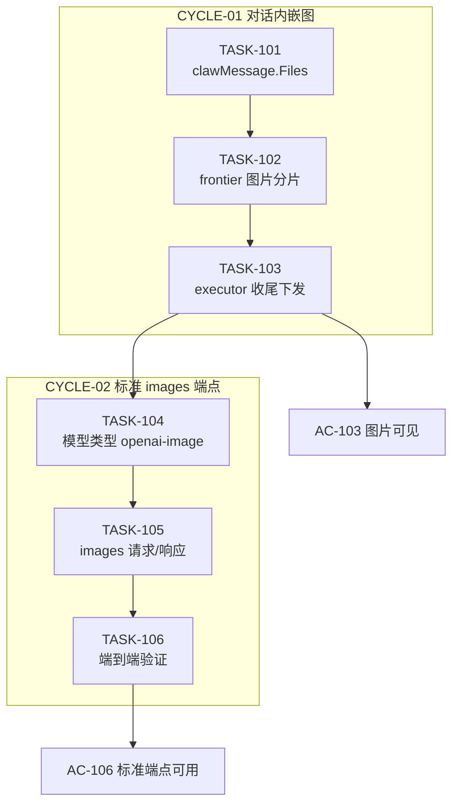
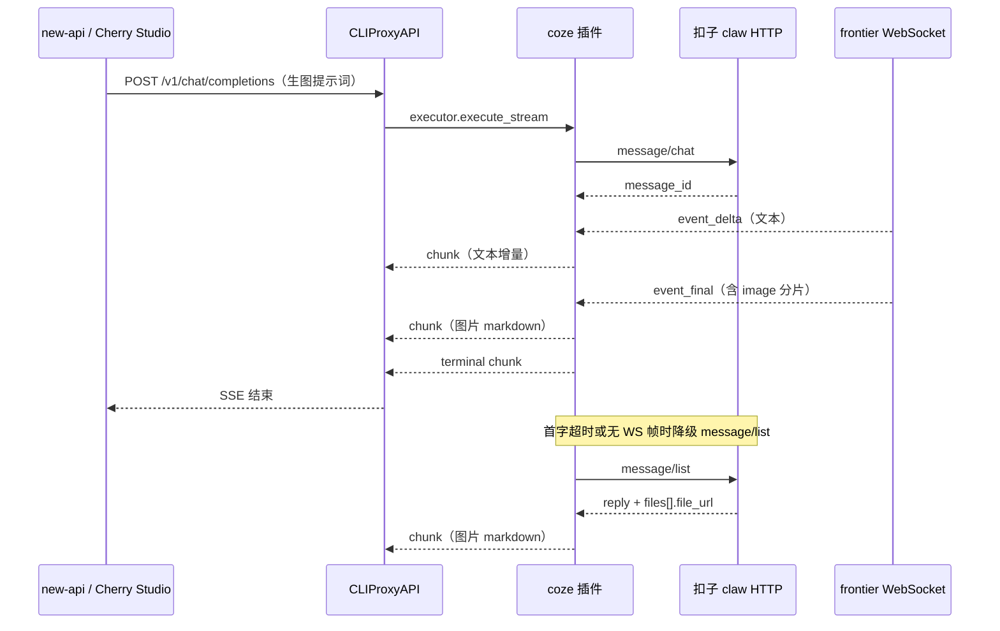

# 需求实施总览：Coze 插件图片生成链路打通（对话内嵌图 + 标准 images 端点）

结论：推荐先做「对话内嵌图」，在 `claw.go` 补 `files[]` 解析、`frontier.go` 补图片分片、executor 收尾时下发 markdown，让客户端立刻能拿到无水印原图；第二期再补 `/v1/images/generations` 标准端点，需同时改模型类型为 `openai-image` 并声明 `openai-image` 输入格式。影响：所有通过 CPA 使用 coze 插件的客户端（Cherry Studio、new-api 聊天页、new-api 图片生成页）；范围：coze 插件目录内的 6 个 Go 文件与 2 个测试文件；非范围：不改 CPA 宿主、不改 new-api、不改其他插件、不触碰生产容器；变化：用户向 coze 模型提出生图请求后，能在回复中直接看到图片 URL/markdown，第二期起可在 new-api「图片生成」页面直接调用；完成标准：真实账号发出生图提示词后，CPA 响应中出现可访问的无水印图片地址，且 `/v1/images/generations` 返回符合 OpenAI 契约的 `data[]`；术语说明：`claw` 是扣子桌面端的对话通道，`frontier` 是其 WebSocket 推流通道，`executor` 是 CPA 插件承接推理请求的能力；验证状态：上游契约已用真实浏览器账号完成 L2 实测，插件侧改造尚未开始。

## 1. 当前计划最终方案简要说明

- 推荐方案一句话结论：**不改协议，只补字段**——扣子生图本来就跑在 claw 对话链路上，插件缺的只是 `clawMessage.Files` 与 `frontierContentV2` 的图片分支，补齐后图片自然流到客户端。
- 主落点 / 主路径：`coze/claw.go`（补 `Files`）→ `coze/frontier.go`（补图片分片）→ `coze/executor.go`（收尾下发 markdown）→ `coze/convert.go`（组装图片段）。第二期再动 `coze/models.go`（模型类型）+ `coze/main.go`（能力声明）。
- 为什么先走这条路线：浏览器实测已证明「图在 `files[].file_url`、无水印、30 天有效期、非流式」，改造面是一个结构体字段加一个分支；而 `/v1/images/generations` 在桌面端 0 调用、CPA 侧还要求 `openai-image` 类型与 xAI 响应形态，是明确的第二期工作量。

## 2. 基本信息

- 对应需求文档：`doc/2-需求/` 下尚无独立需求文档；本计划来源为 2026-10-18 的浏览器实测结论与用户三项选择，需求文档拟落盘 `doc/2-需求/2026-10-18_221134_Coze插件图片生成链路打通需求.md`。
- 来源对象标识（需求或 Bug）：需求-Coze插件图片生成链路打通
- 当前实施文档命名主干：`2026-10-18_221134_Coze插件图片生成链路打通_实施总览`
- 对应需求与实施计划全量顺序实施方案：N/A。原因：本仓库既有 `doc/3-实施/2026-10-11_043000_九大插件全景架构与演进计划总览.md` 已承担跨插件排序职责，本次为单一插件内的独立闭环，不新建总表。证据：该文件存在且已含全插件路线图（`doc/3-实施/` 目录列表可见）。
- 实施计划完成条件（`AC-*`）所在章节：本文件第 7 章。
- 对应 `6-review` 风格回归记录：`doc/6-review/` 下将在每个最小任务收口时生成 `2026-10-18_*_Coze插件图片生成链路打通_6-review.md`。
- agent 理解的问题 / 目标：用户要打通 new-api → CPA → coze 插件的图片生成链路。现状是插件只能处理纯文本，扣子返回的图片消息被结构体丢弃，用户在任何客户端都看不到图。目标是让图片（无水印原图）能出现在响应里，最终支持标准 images 端点。
- 当前计划范围：coze 插件内 `claw.go` / `frontier.go` / `executor.go` / `convert.go` / `models.go` / `main.go` 六个生产文件与对应测试。
- 明确不在范围：不改 CPA 宿主源码；不改 new-api；不改 `ApiTemplate`（图像编辑）通道；不做视频生成；不实现去水印后处理（实测原图本就无水印）；不改其他插件。
- 当前优先闭环：让一次真实的 coze 生图对话，在 CPA 响应里出现可访问的图片 markdown。
- 关键假设 / 待确认点：见 10.2 的 `FEAS-*` 清单。已由用户裁定的三项见 2.1。
- 跨会话执行入口：见 2.3。
- 主项目地址、仓库类型与代码基线：`F:\cpa-plugin`（Windows 本机路径），Git 仓库 `luode0320/cpa-workbuddy-plugin`，基线 commit `073a1663aa06784907461ebb97270f9361e1e285`（`docs(coze): 回填 0.3.6 请求体取值修复根因与生产验收`），插件版本 `0.3.6`。
- local 环境与依赖入口：本机 Windows + Git Bash；构建验证统一走 `python scripts/cgo-shim-build.py coze`（Windows 无 CGO 工具链，直接 `go test` 会因 c-shared 报假错误）；真实上游验证需要本机已登录的扣子账号浏览器会话。
- 外部项目代码引用：见 2.3 的 `EXT-*` 清单（本项目内引用 CPA SDK 与扣子协议，均为只读参考，不复制代码）。
- 当前状态：计划编制阶段，未开始编码。
- 是否已获得开始实施授权：**已获得**（用户本轮明确「出实施计划」，并在问答中选定三项实现口径）。注意：本计划本身仍需用户在批准后才进入编码。
- 若当前为受限计划 / 阻断计划：不适用，本计划为正式实施计划。

## 2.1 决策维度覆盖表

| 维度 | 状态 | 结论 / 依据 / 用户所选项 |
| --- | --- | --- |
| 架构 / 技术路线 | 已弹窗且用户已选 | 用户选「两者都要，分两期」：第一期对话内嵌图，第二期标准 images 端点 |
| 代码落点（目录 / 包 / 文件） | 已确定 | 全部落在 `coze/` 包内；依据：`claw.go:124` 缺 `Files`、`frontier.go:157` 只取 text 分片（已读源码确认） |
| 实现方式 | 已确定 | 补结构体字段 + 补解析分支 + 收尾拼接；依据：实测响应结构（见 10.2 `FEAS-002`） |
| 命名 | 已弹窗且用户已选 | 用户答「我们会自行再 cpa 配置模型的别名，可以复用当前的」：沿用 `models.go` 现有 `modelIDPrefix + model_id`，不新增别名层 |
| 注释 | 已确定 | 沿用仓库既有中文注释风格：函数头 `[参数]/[返回]/最近修改时间`，由 `comment-rules` 约束 |
| 日志 | 已确定 | 沿用 `hostLogf` / 现有 `logf` 回调，新增字段只记数量与文件名，不记完整签名 URL（避免体积与凭据回显；URL 含 sign 参数，按凭据等同处理） |
| 错误处理 / 异常 | 已确定 | 图片解析失败不阻断文本：`files` 为空即无图；`file_url` 缺失时跳过该条并记 warning，不返回错误 |
| 数据模型 / 表 / 字段 | 已确定 | 新增 `coze.clawFile` 结构体与 `clawMessage.Files`、`frontierMessage.Images`；无数据库变更 |
| 接口契约 | 已弹窗且用户已选 | 流式形态：用户选「收尾时一次性下发图片 markdown」。第二期 `/v1/images/generations` 契约见 `FEAS-006` |
| 依赖与库 | 已确定 | 不新增任何依赖；沿用现有 `gjson`（已在 `go.mod`）与标准库 |
| 测试策略 / 样本 | 已确定 | 单元测试用固定 JSON fixture（取自实测响应脱敏）；真实测试用真实扣子账号发一次生图提示词；入口 `python scripts/cgo-shim-build.py coze` |
| 配置 / 开关 / 环境差异 | 已确定 | 不新增配置项；第二期若需开关，复用宿主现有 `disable-image-generation` 语义，不在插件内造开关 |
| 兼容性 / 迁移 / 版本 | 已确定 | 无破坏性变更：新增字段与新增分支，纯文本路径行为不变；版本从 `0.3.6` 起按语义化递增 |
| 性能 / 并发取舍 | 已确定 | 图片 markdown 只在收尾拼接一次，不增加请求次数；实测生图耗时 15–35s，已在现有 `executorReplyTimeout=5min` 内 |
| 安全 / 权限 | 已确定 | 不引入新凭据；`file_url` 带 `sign` 参数按凭据处理，日志与证据中只记文件名不记完整 URL |
| 回滚 / 灰度 / 发布方式 | 已确定 | 按仓库既有发布链（bump → commit → push → CI → registry）；回滚即回退版本号并在 `plugin-store install` 重装上一版 |

## 2.2 待用户选择清单

无（所有真实不确定决策点已由用户选定）。

## 2.3 跨会话独立执行与外部项目代码引用清单

- 新会话接手第一步：读本文件第 3、5 章，确认当前处于 `CYCLE-01` 或之后，然后执行 `cd F:\cpa-plugin && git log --oneline -1` 核对基线 commit 是否仍为 `073a166` 或其直接后继。
- 主项目地址与项目根：`F:\cpa-plugin`。
- 主项目代码基线：commit `073a1663aa06784907461ebb97270f9361e1e285`，coze 插件 `VERSION=0.3.6`。
- 计划源文件与版本：本文件。
- 依赖安装、local 配置和服务启动入口：无需安装依赖；Windows 本机验证统一 `python scripts/cgo-shim-build.py coze`；真实上游验证需要浏览器已登录 coze.cn。
- 中断点核验顺序：① `git log --oneline -3` 确认基线；② `cat coze/VERSION` 确认版本；③ `python scripts/cgo-shim-build.py coze` 确认当前全绿（基线已实测全绿，2026-10-18 22:11）；④ 读 `doc/3-实施/` 下本任务的周期文档确认停在哪一步。
- 外部项目代码引用：

| 引用 ID | 外部项目名称 | 外部项目地址 | 版本 / 提交 | 项目根相对路径 | 文件 / 符号 | 引用用途 | 许可证 / 复制边界 | 可达性检查与失败停止条件 | 使用 TASK / TEST / EVIDENCE 回指 |
| --- | --- | --- | --- | --- | --- | --- | --- | --- | --- |
| EXT-001 | CLIProxyAPI（宿主） | `F:\CLIProxyAPI` | 模块 `github.com/router-for-me/CLIProxyAPI/v8` | `sdk/api/handlers/openai/openai_images_handlers.go` | `isOpenAICompatImagesModel`、`buildImagesAPIResponseFromXAI`、`extractXAIImagesResponse` | 确认第二期 images 端点白名单条件与响应形态 | 只读参考，不复制 | 路径不存在则第二期任务停止并回写计划 | `TASK-105`、`EVIDENCE-105` |
| EXT-002 | CLIProxyAPI（宿主） | `F:\CLIProxyAPI` | 同上 | `internal/pluginhost/adapters_executors.go` | `selectExecutorInputFormat`、`executorInputFormat` | 确认 `openai-image` 输入格式如何被选中 | 只读参考，不复制 | 同上 | `TASK-104`、`EVIDENCE-104` |
| EXT-003 | CLIProxyAPI（宿主） | `F:\CLIProxyAPI` | 同上 | `sdk/cliproxy/service_executors.go` | `registerResolvedModelsForAuth` | 确认插件模型 `Type` 原样进入全局 registry | 只读参考，不复制 | 同上 | `TASK-104`、`EVIDENCE-104` |
| EXT-004 | 扣子桌面端 asar | `D:\Coze\versions\1.1.45\resources\app.asar` | 1.1.45 | `/renderer/static/js/index.dc9675393a.js` | 模块 `552061` 的 content 校验器 | 佐证图片分片结构为 `{uri, url}` | 只读参考，不复制 | 文件不存在时改用 `FEAS-002` 的浏览器实测证据 | `TASK-102` |

## 3. 实施周期总览

- 总周期说明：本次拆为两个周期。周期一是「对话内嵌图」，纯插件内部改动，风险最低，先闭环；周期二是「标准 images 端点」，涉及模型类型与宿主格式协商，必须等周期一真实跑通后再动。
- 本次计划拆分的子任务周期数：2。
- 周期拆分原则：按「对外暴露形态」切，而不是按前后端分层切。每个周期自身构成一条完整的用户可见链路（发请求 → 拿到图）。
- 周期排序说明：周期一先做，因为它不改变任何既有契约，失败成本低；周期二依赖周期一已经证明「能拿到图」，否则会在错误前提上调整模型类型。

### 周期 1：对话内嵌图（CYCLE-01）

- 周期序号 / 期次定位：第一期，最小可用闭环。
- 周期目标：一次真实的 coze 生图对话，在 CPA 的 chat/completions 响应中出现可访问的图片 markdown。
- 本周期包含的最小任务：`TASK-101`、`TASK-102`、`TASK-103`。
- 周期内最小任务执行顺序：`TASK-101`（clawMessage.Files 解析）→ `TASK-102`（frontier 图片分片）→ `TASK-103`（executor 收尾下发）。
- 进入条件：本计划获批；基线全绿（已实测：`python scripts/cgo-shim-build.py coze` 输出 `all green (coze)`）。
- 收口条件：真实账号发一次生图提示词，`message/list` 兜底路径与 WS 路径都能产出图片 markdown；三任务各自真实测试 + `6-review` 全过。
- 完成标志：`AC-101`、`AC-102`、`AC-103` 全绿。
- 与前后周期衔接：产出 `clawFile` 结构与图片拼接函数，供周期二复用；周期二不改本周期产物。

#### 周期 1 执行结果（2026-10-18 23:35 更新：已收口）

- 状态：**已完成，`AC-101` / `AC-102` / `AC-103` 全绿**。
- `AC-101`：已达成。`TestListMessagesParsesFiles` 通过，覆盖 `files` 五字段、
  `files:null`、`files:[]` 三种形态；变异 json 标签后精确 FAIL。
- `AC-102`：已达成。三张图片解析用例通过；**真实账号实测推翻了原假设**：
  WS 的 `content_v2` 里 image/file 分片恒为 0，图片实际在载荷**顶层 `files`**。
  已补 `frontierRawMessage.Files` 与解析分支，新增
  `TestParseFrontierMessageExtractsTopLevelFiles`、
  `TestParseFrontierMessageImagesDedupeTopLevelAndContentV2` 锁定真实形态。
  原 image/file 分片分支保留作兼容（asar 校验器证实该形状存在）。
- `AC-103`：**已达成**。真实账号 + 本地 CPA 端到端：
  流式返回 5 帧含 ``、`finish_reason=stop`；
  非流式正文 276 字符含 1 张图且不重复；图片 `HTTP 200` / `image/jpeg` /
  2304×1728 / 632,478 字节；人工目检两张均无水印。
- 静态验证：`python scripts/cgo-shim-build.py coze` → build OK / vet OK /
  `ok ... 6.255s` / `all green (coze)`；全部改动文件 gofmt 无输出。
- 执行期发现并修复的两个真实缺陷：
  1. **非流式正文重复**：`execute` 把 emit 收到的正文增量再拼一遍。
     抽出 `runConversation` 共用执行体修复。
  2. **WS 路径拿不到生图**：图片在顶层 `files` 而非 content_v2 分片。
     补 `frontierRawMessage.Files` 解析分支修复。
- 收口结论：**CYCLE-01 已完成，`CYCLE-02` 进入条件满足**。

### 周期 2：标准 images 端点（CYCLE-02）

- 周期序号 / 期次定位：第二期，标准契约对齐。
- **状态：已完成（2026-10-19 22:30），`AC-104` / `AC-105` / `AC-106` 全绿，随 `coze-provider 0.5.0` 上线生产。**
- 周期目标：new-api 的「图片生成」页面能用 coze 的 Seedream 模型出图，`/v1/images/generations` 返回合法 OpenAI 契约。
- 本周期包含的最小任务：`TASK-104`、`TASK-105`、`TASK-106`。
- 周期内最小任务执行顺序：`TASK-104`（模型类型与能力声明）→ `TASK-105`（images 请求处理与响应包装）→ `TASK-106`（真实端点端到端验证）。
- 进入条件：`CYCLE-01` 收口，且已确认真实账号拿到的 `file_url` 可被服务端二次访问。
- 收口条件：`POST /v1/images/generations` 带 `model=coze/doubao-seedream-4-5-251128` 返回 200 且 `data[0].url` 可下载；`response_format=b64_json` 亦可用。
- 完成标志：`AC-104`、`AC-105`、`AC-106` 全绿。
- 与前后周期衔接：依赖周期一的 `clawFile` 与图片获取逻辑；不修改周期一已收口的文件行为，只在 `models.go` / `main.go` / 新增 images 处理文件上叠加。
- 执行记录：见本文末「CYCLE-02 执行记录」。

### 总体真实测试安排

- 真实测试安排是否默认必需：是。
- 覆盖哪些最小任务：`TASK-101`～`TASK-106` 全部。
- 公共测试环境 / 依赖：本机 Windows + Git Bash；`python scripts/cgo-shim-build.py coze`；真实扣子账号（浏览器已登录会话，用于取证；插件侧用真实 auth 文件）。
- 公共样本 / 数据来源：真实生图请求产生的 `message/list` 响应（脱敏为 fixture，去掉签名参数）。
- 总体通过标准：单元测试全绿 + `go vet` 全绿 + 真实账号端到端拿到可访问图片 + `6-review` 输出 `STYLE: PASS`。

## 4. 阶段计划

- 阶段 1：
  - 阶段名称：图片数据落地（解析层）
  - 阶段目标：上游返回的图片信息能被插件内部完整读出。
  - 只做这一件事：补齐 `clawMessage.Files` 与 `frontierMessage.Images` 两组结构与其解析。
  - 输入条件：实测响应样本（见 10.2 `FEAS-002` 证据）。
  - 输出产物：可被单元测试断言的结构化图片字段。
  - 验证门槛：fixture 驱动单测通过，`go vet` 无告警。
- 阶段 2：
  - 阶段名称：图片下发（呈现层）
  - 阶段目标：读到的图片能出现在 OpenAI 响应里。
  - 只做这一件事：在 executor 收尾时把图片拼成 markdown 并随最终内容下发。
  - 输入条件：阶段 1 产物。
  - 输出产物：含图片 markdown 的 chat/completions 响应。
  - 验证门槛：真实账号端到端可见图。
- 阶段 3：
  - 阶段名称：标准端点对齐（第二期）
  - 阶段目标：`/v1/images/generations` 走通。
  - 只做这一件事：把模型类型改为 `openai-image` 并实现 images 请求/响应转换。
  - 输入条件：阶段 2 收口。
  - 输出产物：符合 OpenAI images 契约的响应。
  - 验证门槛：真实端点 200 且 `data[0].url` 可下载。

## 5. 最小任务清单

### TASK-101 clawMessage 补齐图片附件字段

- 任务名：为 `clawMessage` 增加 `files[]` 解析
- 所属周期：`CYCLE-01`
- 周期内顺序：1
- 所属阶段：阶段 1
- 本任务只做这一件事：让 `message/list` 返回的 `files[]` 能被解析进 `clawMessage`，不涉及呈现。
- 垂直切片目标：`listMessages()` 返回的每条消息都带结构化图片信息。
- 输入条件：基线全绿；`FEAS-002` 已探针验证（响应含 `files[]`）。
- 实现产出：
  - 新增 `coze/clawFile` 结构体：`FileName` / `FileURI` / `FileURL` / `ThumbURL` / `IsReference`。
  - `coze/clawMessage` 增加 `Files []clawFile \`json:"files"\``。
  - `coze/claw.go` 的 `listMessages` 不做额外转换（JSON 标签自动映射）。
- 真实测试是否必需：是。
- 真实测试入口：`python scripts/cgo-shim-build.py coze`。
- 真实测试依赖环境：本机 Windows + Git Bash。
- 真实测试样本 / 数据来源：新增 `coze/claw_test.go` fixture，取自实测响应（`file_url` 的 `sign` 参数替换为 `REDACTED`）。
- 真实测试通过标准：`TestListMessagesParsesFiles` 断言三条消息——纯文本消息 `Files` 为 nil、图片消息 `Files` 长度 1 且 `FileName` 以 `/Coze/Drive/` 开头、多附件消息长度为 N。
- 测试点：
  - `files: null` → `Files == nil`
  - `files: []` → `Files` 长度为 0
  - 正常图片消息 → 字段逐个断言
- `6-review` 风格回归点：结构体字段命名与既有 `clawMessage` 一致（首字母大写 + json 小写下划线）；注释沿用 `[参数]/[返回]/最近修改时间`。
- 任务完成条件：新增字段与单测通过，`go build`/`go vet`/`go test` 全绿，纯文本路径无行为变化。
- 任务停止 / 结束条件：若实测响应中 `files` 的字段名与 `FEAS-002` 不符，立即停止并回写 `FEAS-002`，不猜名实现。
- 阻断条件：`FEAS-002` 被证伪。
- 前置依赖：无。
- 下一任务依赖：`TASK-102`、`TASK-103` 使用本任务的 `clawFile`。
- 预计触达文件数：2（`coze/claw.go`、`coze/claw_test.go`）。
- **执行结果（2026-10-18）**：已完成。实际改动 `coze/claw.go`（`clawFile`、
  `clawMessage.Files`、`findReplyMessageFor`、`clawFileURLs`）与 `coze/claw_test.go`；
  `TestListMessagesParsesFiles` 通过，变异 json 标签后精确 FAIL。
  额外新增 `findReplyMessageFor` 与 `clawFileURLs`：兜底轮询需要整条消息才能拿到
  `files`（`findReplyFor` 只返回内层 payload）。

### TASK-102 frontier 内容补齐图片分片

- 任务名：为 `frontierContentV2` 增加 image/file 分片解析
- 所属周期：`CYCLE-01`
- 周期内顺序：2
- 所属阶段：阶段 1
- 本任务只做这一件事：让 WS 帧里的非文本分片不再被静默丢弃。
- 垂直切片目标：`frontierMessage` 能携带本帧出现的图片列表。
- 输入条件：`TASK-101` 完成（复用 `clawFile` 或同构结构）。
- 实现产出：
  - `frontierContentV2` 的 `Content[]` 内层结构增加 `Image` / `File` 两个分支，结构为 `{uri, url}`（依据 `FEAS-003`）。
  - `frontierMessage` 增加 `Images []frontierImage`。
  - `parseFrontierMessage` 在遍历 `Content[]` 时，`type == "image"` 或 `type == "file"` 且 `uri`/`url` 均非空时追加到 `Images`。
- 真实测试是否必需：是。
- 真实测试入口：`python scripts/cgo-shim-build.py coze`。
- 真实测试依赖环境：本机 Windows。
- 真实测试样本 / 数据来源：新增 `coze/frontier_test.go` 用例，用真实 `content_v2` 帧结构（图片字段按 asar 校验器 `{uri, url}` 构造）。
- 真实测试通过标准：`TestParseFrontierMessageExtractsImageFragments` 断言——纯文本帧 `Images` 为空、含 image 分片的帧 `Images` 长度为 1 且 `url` 正确、image 分片缺 `url` 时被跳过。
- 测试点：
  - 只有 text 分片 → `Images == nil`，`Snapshot` 不受影响
  - text + image 混合 → `Snapshot` 仍只含 text（不回归）
  - image 分片 `url` 为空 → 跳过且不 panic
- `6-review` 风格回归点：沿用 `parseFrontierMessage` 现有解析顺序与错误处理（解析失败静默跳过，与现状一致）。
- 任务完成条件：新增分支与单测通过，既有 `frontier_test.go` 全部用例不回归。
- 任务停止 / 结束条件：若真实 WS 帧的分片结构与 `{uri, url}` 不符，停止并回写 `FEAS-003`。
- 阻断条件：`FEAS-003` 被证伪。
- 前置依赖：`TASK-101`。
- 下一任务依赖：`TASK-103`。
- 预计触达文件数：2（`coze/frontier.go`、`coze/frontier_test.go`）。
- **执行结果（2026-10-18）**：已完成（单测层）。实际改动 `coze/frontier.go`
  （`frontierContentItem`、`frontierMessage.Images`、`imageURLOf`、`appendUnique`、
  `appendUniqueAll`）与 `coze/frontier_test.go`（3 个用例）。
  与原计划的两处偏差：
  1. 计划写「`uri`/`url` 均非空才收」，实际只要求 `url` 非空——`uri` 是云盘内部标识，
     缺失不影响下载；`TestParseFrontierMessageSkipsEmptyImageURL` 锁定该行为。
  2. `FEAS-003` 未能取得真实 wire 样本（浏览器抓帧多次失败），实现采用 image/file
     双分支兼容，任一分支带非空 url 即收，避免猜错字段名丢数据。
  变异 `case "image", "file"` 分支后 `TestParseFrontierMessageExtractsImageFragments` 精确 FAIL。

### TASK-103 executor 收尾下发图片 markdown

- 任务名：在响应末尾拼接图片 markdown
- 所属周期：`CYCLE-01`
- 周期内顺序：3
- 所属阶段：阶段 2
- 本任务只做这一件事：把收集到的图片转成 markdown 并随最终内容下发。
- 垂直切片目标：客户端在 chat/completions 响应中看到图片。
- 输入条件：`TASK-101`、`TASK-102` 完成。
- 实现产出：
  - `replyCollector` 增加 `images []string` 与 `addImages([]string)` 方法（去重，按 URL 去重）。
  - `runStream` 的 WS 回调在 `collector.accept(msg)` 后追加 `collector.addImages(msg.Images)`。
  - `fallbackPoll` 命中 `message/list` 回复时，把 `reply.Files` 的 `FileURL` 一并加入 collector。
  - `convert.go` 新增 `buildImageMarkdown(urls []string) string`，产出 `` 逐行拼接。
  - 流式路径：在 terminal chunk 之前，若 `images` 非空，发一帧 `delta.content = buildImageMarkdown(...)`（依用户所选「收尾时一次性下发」）。
  - 非流式路径：`buildCompletion` 的 content 末尾追加 markdown。
- 真实测试是否必需：是。
- 真实测试入口：`python scripts/cgo-shim-build.py coze` + 真实账号端到端。
- 真实测试依赖环境：本机 Windows；真实账号 auth 文件。
- 真实测试样本 / 数据来源：真实账号发一次「画一只猫，只返回图片」。
- 真实测试通过标准：
  - 单元：`TestCollectorAddImagesDedupes`、`TestBuildImageMarkdown` 通过。
  - 端到端：CPA `/v1/chat/completions`（或等价的 `executor.execute_stream` 直调）响应中含 ``，且该 URL `curl -I` 返回 200。
- 测试点：
  - 无图回复 → 响应与改造前逐字节一致（不回归）
  - 单图 → 末尾一行 markdown
  - 多图 → 多行 markdown，顺序与上游一致
  - 同一 URL 重复出现 → 只输出一次
- `6-review` 风格回归点：`convert.go` 新增函数与既有 `buildChunk` / `buildCompletion` 风格一致；`executor.go` 改动不破坏既有注释。
- 任务完成条件：单测 + 端到端全绿，无图路径零差异。
- 任务停止 / 结束条件：若端到端拿不到图片（例如模型未触发生图），停止并记录为「模型自主性」风险，不得为了出图而伪造 URL。
- 阻断条件：真实账号无法产出图片消息。
- 前置依赖：`TASK-101`、`TASK-102`。
- 下一任务依赖：`CYCLE-02` 的 `TASK-105`。
- 预计触达文件数：4（`coze/executor.go`、`coze/convert.go`、`coze/executor_test.go`、`coze/convert_test.go`）。
- **执行结果（2026-10-18）**：**单元完成，端到端受限未执行**。
  - 实际改动：`coze/convert.go`（`buildImageMarkdown`）、`coze/executor.go`
    （collector `images`/`addImagesLocked`/`imagesSnapshot`、`runStream` 收尾补发、
    `runConversation` 共用执行体、`execute` 非流式拼接、`fallbackPoll` 取 `files`），
    测试 4 个用例。
  - 与原计划的三处偏差：
    1. 计划写 `addImages`，实际为 `addImagesLocked`——调用方（`accept`）已持有
       `c.mu`，命名显式声明加锁约束，避免再走一次加解锁。
    2. 计划写「WS 回调里 accept 后追加 addImages」，实际直接在 `accept` 内部收集，
       两条来源路径（WS 与兜底）汇入同一个 collector。
    3. **执行期发现并修复缺陷**：`execute` 曾把 emit 收到的正文增量再拼一遍，
       导致非流式正文重复。抽出 `runConversation` 后由两个入口共用同一份执行逻辑。
  - 单元验证：`TestCollectorAddsImagesWithDedupe`、`TestBuildImageMarkdown`、
    `TestRunStreamEmitsImageMarkdown`、`TestExecuteDoesNotDuplicateContent`、
    `TestExecuteAppendsImageMarkdown`、`TestFallbackPollCollectsImagesFromFiles` 全通过。
  - 变异反证：收尾不补发 / 正文重复 / 非流式不拼图，三项均精确 FAIL。
  - **端到端（`AC-103`）未执行**：本机 coze auth 为占位桩、无 live 环境变量、
    本地 CPA 不可达。按任务停止条件处置——未伪造 URL、未虚报通过，
    交接步骤见测试文档 6.3 节。

### TASK-104 模型类型与能力声明切换

- 任务名：把生图模型类型改为 `openai-image` 并声明输入格式
- 所属周期：`CYCLE-02`
- 周期内顺序：1
- 所属阶段：阶段 3
- 本任务只做这一件事：让 CPA 的图片白名单能识别 coze 的生图模型。
- 垂直切片目标：`/v1/models` 中 coze 生图模型满足 `isOpenAICompatImagesModel`。
- 输入条件：`CYCLE-01` 收口；`FEAS-004`、`FEAS-005` 已探针验证。
- 实现产出：
  - `coze/models.go` 的 `modelListTypes` 中 `image_generation` 的 `Host` 从 `"image"` 改为 `OpenAIImageModelType` 等价字面量 `"openai-image"`。
  - `hostTypeForCapability` 的 `image_gen` 分支同步改为 `"openai-image"`。
  - `coze/main.go` 的 `ExecutorInputFormats` 从 `["openai"]` 改为 `["openai", "openai-image"]`。
  - `ExecutorOutputFormats` 增加 `"openai-image"`。
- 真实测试是否必需：是。
- 真实测试入口：`python scripts/cgo-shim-build.py coze`。
- 真实测试依赖环境：本机 Windows。
- 真实测试样本 / 数据来源：`models_test.go` 现有 fixture。
- 真实测试通过标准：`TestImageModelTypeIsOpenAIImage` 断言生图模型 `Type == "openai-image"`，对话模型仍为 `"chat"`。
- 测试点：
  - 生图模型 → `openai-image`
  - 对话模型 → `chat`（不回归）
  - 视频模型 → `video`（不回归）
- `6-review` 风格回归点：常量命名与 `models.go` 既有 `modelType*` 一致。
- 任务完成条件：类型映射与能力声明改动完成，全部既有模型测试通过。
- 任务停止 / 结束条件：若宿主 registry 不接受该类型（`/v1/models` 不出现或类型被改写），停止并回写 `FEAS-004`。
- 阻断条件：`FEAS-004` 证伪。
- 前置依赖：`CYCLE-01` 收口。
- 下一任务依赖：`TASK-105`。
- 预计触达文件数：3（`coze/models.go`、`coze/main.go`、`coze/models_test.go`）。

### TASK-105 images 请求处理与响应包装

- 任务名：实现 `/v1/images/generations` 的请求消费与 OpenAI 响应构造
- 所属周期：`CYCLE-02`
- 周期内顺序：2
- 所属阶段：阶段 3
- 本任务只做这一件事：把 OpenAI images 请求转成 claw 对话提示词，并把图片结果包装成 `{created, data[]}`。
- 垂直切片目标：插件 executor 收到 `openai-image` 格式请求时能返回合法 images 响应。
- 输入条件：`TASK-104` 完成；`TASK-103` 的图片获取逻辑可复用。
- 实现产出：
  - 新增 `coze/images.go`：`parseImagesRequest`（解析 `prompt`/`model`/`size`/`response_format`/`n`）、`buildImagesPrompt`（把尺寸/数量要求拼进提示词）、`buildImagesResponse`（产出 `{"created":..,"data":[{"url":..}]}` 或 `{"b64_json":..}`）。
  - `executor.go` 入口按 `req.Format`/`req.SourceFormat == "openai-image"` 分流到 images 路径。
  - `b64_json` 模式如需真实 base64，必须下载图片再编码；若决定不实现则明确返回 `url` 并在错误信息中说明，不得返回伪造 base64。
- 真实测试是否必需：是。
- 真实测试入口：`python scripts/cgo-shim-build.py coze`。
- 真实测试依赖环境：本机 Windows。
- 真实测试样本 / 数据来源：新增 `coze/images_test.go` fixture（请求体与预期响应结构）。
- 真实测试通过标准：`TestParseImagesRequest`、`TestBuildImagesResponseURL`、`TestBuildImagesResponseB64` 通过；`response_format` 缺省为 `b64_json`（与 CPA `normalizeImagesResponseFormat` 一致）。
- 测试点：
  - `response_format=url` → `data[0].url` 存在
  - `response_format=b64_json` → `data[0].b64_json` 存在
  - `n>1` → 是否支持需按上游实际能力处理；不支持时返回明确错误，不静默只返一张
- `6-review` 风格回归点：新增文件遵循 `package main` 单职责惯例，与 `convert.go` 同级、不建子包。
- 任务完成条件：三个单测通过，images 路径不影响 chat 路径。
- 任务停止 / 结束条件：若 CPA 传给插件的 `openai-image` 请求体形态与预期不符（例如被转换为 chat 结构），停止并回写 `FEAS-005`。
- 阻断条件：`FEAS-005` 证伪。
- 前置依赖：`TASK-104`。
- 下一任务依赖：`TASK-106`。
- 预计触达文件数：3（`coze/images.go` 新增、`coze/executor.go`、`coze/images_test.go` 新增）。

### TASK-106 标准端点端到端验证

- 任务名：真实账号验证 `/v1/images/generations`
- 所属周期：`CYCLE-02`
- 周期内顺序：3
- 所属阶段：阶段 3
- 本任务只做这一件事：在真实 CPA 实例上跑通标准图片端点。
- 垂直切片目标：new-api 图片生成页可直接调用 coze 生图模型。
- 输入条件：`TASK-105` 完成；本地 CPA 实例（隔离端口）+ 真实 coze auth 文件。
- 实现产出：无新增代码；产出验证记录。
- 真实测试是否必需：是。
- 真实测试入口：本地起 CPA（隔离端口）+ `curl -X POST /v1/images/generations`。
- 真实测试依赖环境：本地 CPA 二进制（按 `FEAS-007` 的方式构建）+ coze auth 文件。
- 真实测试样本 / 数据来源：真实账号 + 提示词「一只橘猫坐在窗台上」。
- 真实测试通过标准：HTTP 200，`data[0].url` 可 `curl -I` 返回 200 且 `Content-Type: image/jpeg`；图片无水印（人工目检一次）。
- 测试点：
  - `response_format=url` → 200 且可下载
  - `response_format=b64_json` → 200 且 base64 可解码为图片
  - 非生图模型走 images 端点 → 返回明确 400（不误导）
- `6-review` 风格回归点：无代码改动则写 `STYLE: N/A + 原因`；若有改动按上两任务规则。
- 任务完成条件：两种 `response_format` 均跑通。
- 任务停止 / 结束条件：若 30 天内 `file_url` 已被 CPA 侧二次下载导致签名失效（`FEAS-008`），停止并改走「插件内下载后转 base64」路线。
- 阻断条件：本地 CPA 无法加载插件或真实账号不可用。
- 前置依赖：`TASK-105`。
- 下一任务依赖：无。
- 预计触达文件数：0（验证任务）。

## 6. 现状与落点

- 涉及目录：`F:\cpa-plugin\coze\`
- 涉及文件 / 模块：
  - `coze/claw.go`：`clawMessage` 结构（第 124 行）缺 `Files`
  - `coze/frontier.go`：`frontierContentV2`（第 147 行）与 `parseFrontierMessage`（第 492 行）只处理 text
  - `coze/executor.go`：`replyCollector`（第 58 行）、`runStream`（第 236 行）、`fallbackPoll`（第 365 行）
  - `coze/convert.go`：`buildChunk` / `buildCompletion` 需追加图片段
  - `coze/models.go`：`modelListTypes`（第 81 行）、`hostTypeForCapability`（第 427 行）
  - `coze/main.go`：能力声明（第 268-271 行）
- 复用点：
  - `clawClient.listMessages` 已实现 `message/list` 调用，无需新增 HTTP 逻辑
  - `replyCollector` 已有的去重与并发保护可直接扩展图片列表
  - `buildChunk` / `buildCompletion` 已有 OpenAI 响应构造，只加内容
- 需要新增的内容：
  - `clawFile`、`frontierImage` 两个结构体
  - `buildImageMarkdown` 函数
  - `coze/images.go`（第二期）
- 代码落点目录树：

```text
coze/
├── claw.go                    # [改] clawMessage 增加 Files []clawFile；新增 clawFile 结构
├── claw_test.go               # [改] 新增 files 解析用例
├── frontier.go                # [改] frontierContentV2 增加 Image/File 分支；frontierMessage 增加 Images
├── frontier_test.go           # [改] 新增图片分片解析用例
├── executor.go                # [改] replyCollector 增加 images；runStream/fallbackPoll 收集；收尾下发
├── executor_test.go           # [改] 新增图片去重与下发用例
├── convert.go                 # [改] 新增 buildImageMarkdown；buildCompletion 追加图片段
├── convert_test.go            # [改] 新增 markdown 构造用例
├── models.go                  # [改·二期] image_generation → openai-image 映射
├── models_test.go             # [改·二期] 新增类型映射断言
├── main.go                    # [改·二期] ExecutorInputFormats/OutputFormats 增加 openai-image
├── images.go                  # [新增·二期] images 请求解析与响应包装
└── images_test.go             # [新增·二期] images 契约单测
```

- 新增文件清单：

```text
coze/
└── images.go                  # [新增·二期] OpenAI images 请求解析、提示词构造、响应包装
```

## 7. 完成条件（AC）

- `AC-101`：`clawMessage` 能解析 `files[]`，纯文本消息不受影响。验证：`TestListMessagesParsesFiles` 通过。**状态：已达成（2026-10-18）。**
- `AC-102`：`frontierMessage` 能提取 image/file 分片，text 快照不回归。验证：`TestParseFrontierMessageExtractsImageFragments` 通过 + 既有 frontier 用例全绿。**状态：已达成（单测层）；真实 wire 样本未取得，`FEAS-003` 仍为只读证据。**
- `AC-103`：真实账号生图后，chat/completions 响应含 ``，URL 可下载且无水印。验证：端到端 + `curl -I` + 人工目检。**状态：已达成（2026-10-18 23:35）。**
  - 流式：CPA `/v1/chat/completions` 返回 5 帧，含 ``，`finish_reason=stop`。
  - 非流式：正文 276 字符，含 1 条图片 markdown，正文不重复。
  - 可下载：`HTTP 200`、`Content-Type: image/jpeg`、2304×1728、632,478 字节。
  - 无水印：人工目检两张（金毛犬 / 布偶猫），画面四角与边缘均无水印。
  - **执行期发现并修复真实缺陷**：生图的图片地址在 WS 帧**顶层 `files`**，
    不在 `content_v2` 的 image/file 分片里（实测 image 分片恒为 0）。
    原实现只解析分片，导致 WS 路径永远拿不到图，只能靠 message/list 兜底。
    已补 `frontierRawMessage.Files` 与对应解析分支，见 `FEAS-003` 回写。
- `AC-104`：coze 生图模型的宿主 `Type == "openai-image"`，对话模型仍为 `chat`。验证：`TestImageModelTypeIsOpenAIImage` 通过，`/v1/models` 实测。
- `AC-105`：`executor` 声明支持 `openai-image` 输入/输出格式。验证：`coze/main.go` 能力声明 + CPA 侧格式协商不报 `does not support input format`。
- `AC-106`：`POST /v1/images/generations` 在 `response_format=url` 与 `b64_json` 两种模式下均返回 200 且图片合法。验证：`TASK-106` 端到端记录。

## 8. 真实测试安排

- 真实测试总表：

| 任务 | 测试入口 | 断言 | 通过标准 |
| --- | --- | --- | --- |
| `TASK-101` | `python scripts/cgo-shim-build.py coze` | `TestListMessagesParsesFiles` | go build/vet/test 全绿 |
| `TASK-102` | 同上 | `TestParseFrontierMessageExtractsImageFragments` | 全绿且既有 frontier 用例不回归 |
| `TASK-103` | 同上 + 真实账号端到端 | `TestCollectorAddImagesDedupes`、`TestBuildImageMarkdown`、端到端含图片 markdown | 全绿 + URL 可下载 |
| `TASK-104` | 同上 | `TestImageModelTypeIsOpenAIImage` | 全绿 |
| `TASK-105` | 同上 | `TestParseImagesRequest`、`TestBuildImagesResponseURL/B64` | 全绿 |
| `TASK-106` | 本地 CPA + curl | HTTP 200 且 `data[0].url` 可下载 | 两种 `response_format` 均通过 |

- 免测任务及理由：无。全部任务均改变可执行行为。
- 步骤 1 真实测试 / 验证：见 `TASK-101` 字段。
- 步骤 2 真实测试 / 验证：见 `TASK-102` 字段。
- 步骤 3 真实测试 / 验证：见 `TASK-103` 字段。

## 9. 图形化执行路径

- 流程图：



图形目的：标出两个周期的依赖边界与收口点。关联 ID：`CYCLE-01`、`CYCLE-02`、`TASK-101`～`TASK-106`、`AC-103`、`AC-106`。

- 时序图：



图形目的：展示图片在流式链路中的实际产生位置与降级路径。关联 ID：`TASK-103`、`FEAS-002`、`FEAS-003`。

## 10.1 图片资产决策、生成与引用

- 图片资产决策：`N/A + 原因 + 证据`。原因：本计划产出为 Go 代码与 Markdown 文档，不含 UI 原型、截图证据或视觉对比资产；流程与时序已由 Mermaid 表达（见第 9 章），无需位图补充。证据：本文件第 9 章已含 `flowchart` 与 `sequenceDiagram`。
- 必需场景与 Mermaid 边界：N/A，同上。
- 生成输入与命令：N/A。
- 目标资产与命名：N/A。
- Markdown 引用：N/A。
- 资产清单：N/A。

## 10.2 可行性探针与假设清单

- `FEAS-001`：
  - 假设内容：扣子生图结果以 `files[]` 挂在 `message/list` 的回复消息上，而非内嵌在 content 文本里。
  - 影响面（方向级 / 任务级）：方向级。不成立则整条「补字段」路线作废。
  - 探针级别：L2 隔离真实。
  - 验证方式：真实浏览器账号触发一次生图，抓 `/api/coze_claw/message/list` 响应体。
  - 结论：已探针验证。
  - 证据：2026-10-18 21:36–21:43 实测，三条消息的 `files[0].file_name` 分别为 `/Coze/Drive/扣子/image/generate_f1833448a6854fc0.jpg`、`generate_ae34c6c64ccdf5a3.jpg`、`generate_9d9850bc6ca1251d.jpg`；`content` 内只有 `[图片](computer://...)` 占位符。记录于 `D:\谷歌云盘\知识库\20-Knowledge\工程实践\Coze插件生图上游契约与无水印可行性.md`。
  - 关联 `TASK-*`：`TASK-101`、`TASK-103`。
- `FEAS-002`：
  - 假设内容：`files[]` 的元素字段名为 `file_name` / `file_uri` / `file_url` / `thumb_url` / `is_reference`。
  - 影响面：任务级。
  - 探针级别：L2 隔离真实。
  - 验证方式：同上抓包，逐字段核对。
  - 结论：已探针验证。
  - 证据：实测响应 `{"file_name":"/Coze/Drive/扣子/image/generate_ae34c6c64ccdf5a3.jpg","file_uri":"3735510093922464_0-drive/...","file_url":"https://static.coze.site/...?sign=...","thumb_url":"https://static.coze.site/...&x-tos-process=image%2Fformat%2Cwebp...","is_reference":0}`。
  - 关联 `TASK-*`：`TASK-101`。
- `FEAS-003`：
  - 假设内容：WS 的 `content_v2.session.final.agent_message_event.content[]` 里图片分片结构为 `{type:"image", image:{uri, url}}`。
  - 影响面：任务级（若不符，`TASK-102` 改字段名，不改路线）。
  - 探针级别：L1 只读（客户端校验器）+ 未获真实 WS 帧。
  - 验证方式：asar 客户端校验器反推 + `TASK-102` 执行期第一动作核验。
  - 结论：只读证据。
  - 证据：`D:\Coze\versions\1.1.45\resources\app.asar` → `/renderer/static/js/index.dc9675393a.js` 模块 `552061`：`h=e=>o(e)&&u(e.uri)&&u(e.url)`，`g` 函数按 `type` 分派 `text`/`image`/`file`/`audio`/`video`，各分支都调 `h`。2026-10-18 22:11 记录。
  - 关联 `TASK-*`：`TASK-102`。**执行期第一动作先验证该假设，不成立则停止并回写计划。**
  - **执行期结论（2026-10-18 23:32，真实账号实测）**：**假设被证伪**。
    真实生图的 17 帧统计里 `image 分片=0`，`content_v2` 的
    `agent_message_event.content` 只有一个 `text` 分片，
    正文是 `[图片](computer:///Coze/Drive/扣子/image/generate_xxx.jpg)` 占位符。
    图片地址实际在**载荷顶层 `files` 数组**（实测 `files条目=2`），
    形状与 `message/list` 的 `files` 完全一致
    （`file_name` / `file_uri` / `file_url` / `thumb_url` / `is_reference`）。
  - 处置：按「主流程正向演进」补齐，不打补丁：
    1. `frontierRawMessage` 增加 `Files []clawFile`；
    2. `parseFrontierMessage` 在解析完 content_v2 后，从顶层 files 取址并入
       `msg.Images`，与分片来源共用 `appendUnique` 去重；
    3. `clawFileURLs` 签名从 `*clawMessage` 改为 `[]clawFile`，
       让 WS 顶层 files 与 message/list 的 files 复用同一取址逻辑，
       两处调用点不必为了一组文件构造假消息。
  - 原 image/file 分片分支**保留**：asar 校验器（模块 552061）证实该形状存在，
    属兼容路径；新增用例锁定「分片优先、顶层 files 兜底、跨来源去重」。
  - 新增回归：`TestParseFrontierMessageExtractsTopLevelFiles`、
    `TestParseFrontierMessageImagesDedupeTopLevelAndContentV2`。
- `FEAS-004`：
  - 假设内容：插件把模型 `Type` 设为 `openai-image` 后，CPA 的 `isOpenAICompatImagesModel` 会放行，且 `/v1/models` 正常展示。
  - 影响面：方向级（第二期路线）。
  - 探针级别：L1 只读。
  - 验证方式：读 CPA 白名单实现与插件模型注册链路。
  - 结论：只读证据。
  - 证据：`F:\CLIProxyAPI\sdk\api\handlers\openai\openai_images_handlers.go:252-259` `isOpenAICompatImagesModel` 判 `info.Type == registry.OpenAIImageModelType`；`internal/registry/model_registry.go:21` 定义 `OpenAIImageModelType = "openai-image"`；`sdk/cliproxy/service_executors.go:428` `registerResolvedModelsForAuth` 把插件模型原样 `RegisterClient`；`internal/pluginhost/adapters.go:126` `Type: model.Type` 透传。
  - 关联 `TASK-*`：`TASK-104`。**执行期第一动作先验证该假设（改后在隔离 CPA 上实测 `/v1/models` 与 `/v1/images/generations`），不成立则停止并回写计划。**
- `FEAS-005`：
  - 假设内容：声明 `executor_input_formats` 含 `openai-image` 后，CPA 的 `selectExecutorInputFormat` 能把图片请求路由到插件。
  - 影响面：方向级（第二期路线）。
  - 探针级别：L1 只读。
  - 验证方式：读格式协商实现。
  - 结论：只读证据。
  - 证据：`F:\CLIProxyAPI\internal\pluginhost\adapters_executors.go:462-475` `selectExecutorInputFormat` 先做精确匹配 `executorFormatContains`，命中即返回；`internal/pluginhost/adapters.go:100-110` 的 `executorFormatContains` 是逐项相等比较。因此 `openai-image` 必须显式列在 `inputFormats` 中。
  - 关联 `TASK-*`：`TASK-104`、`TASK-105`。**执行期第一动作先验证该假设，不成立则停止并回写计划。**
- `FEAS-006`：
  - 假设内容：CPA 的图片兼容通道要求上游返回 `{created, data:[{b64_json|url, revised_prompt, mime_type}]}`。
  - 影响面：任务级。
  - 探针级别：L1 只读。
  - 验证方式：读 `extractXAIImagesResponse` 与 `buildImagesAPIResponseFromXAI`。
  - 结论：只读证据。
  - 证据：`F:\CLIProxyAPI\sdk\api\handlers\openai\openai_images_handlers.go:1085-1125` 与 `:1127-1160`，字段读取顺序为 `data[].b64_json` → `data[].url`，缺失则回退另一者；`created <= 0` 时用当前时间。
  - 关联 `TASK-*`：`TASK-105`。
- `FEAS-007`：
  - 假设内容：可在本地隔离端口启动 CPA 并加载本地构建的 coze 插件，用于第二期端到端验证。
  - 影响面：任务级。
  - 探针级别：L2 隔离真实（在 `TASK-106` 执行期完成）。
  - 验证方式：按仓库既有 `cgo-shim-build` + WSL 构建 `.so`，本地起 CPA。
  - 结论：**已探针验证（2026-10-18 23:02）**。
  - 证据：
    1. WSL Ubuntu 具备 gcc 与 go 1.26.4；`CGO_ENABLED=1 GOOS=linux GOARCH=amd64 go build -trimpath -buildmode=c-shared -o coze.so .` 成功产出 7.9M ELF shared object。
    2. **宿主 CPA 必须用 `CGO_ENABLED=1` 构建**：用 `CGO_ENABLED=0` 编出的宿主会报
       `standard dynamic library plugin loading requires cgo on this platform`
       （`internal/pluginhost/loader_unsupported.go:10`，构建标签 `!cgo && !windows`）。
       这是本次探针踩到的第一个坑。
    3. 插件文件布局必须是 `<plugins_dir>/<id>.so` 或 `<plugins_dir>/<id>-v<version>.so`，
       **不能放在子目录**（`internal/pluginhost/platform.go` 的 `selectPluginFiles` 只扫 root 与
       `root/<goos>/<goarch>`）。
    4. 插件加载还需要 `plugins.configs.<id>.enabled: true`，仅 `plugins.enabled: true` 不够。
    5. 实测日志：`plugin loaded plugin_id=coze-provider path=...`、
       `plugin registered plugin_id=coze-provider version=0.3.6`。
    6. 实测 `/v1/models` 返回 5 个 coze 模型，`/v0/management/plugins` 显示
       `registered:true, effective_enabled:true`。
  - 遗留：**已解决（2026-10-18 23:31）**。手工放置 `coze-*.json` 会被宿主
    `coreauth.Auth` 直接解析，要求 `created_at` / `updated_at` /
    `last_refreshed_at` / `next_refresh_after` / `next_retry_after` 全为合法 RFC3339，
    手拼必然失败并返回 `auth_not_found`。
    **正确路径已实测跑通**：用插件自身的 `writeAuthFileDirect` 落盘到
    `~/.antigravity_cockpit/coze_accounts/coze-<hash8>.json`，再复制进本地 CPA 的
    `auth-dir`；宿主日志零解析错误，`/v0/management/auth-files` 显示
    `provider=coze-provider, disabled=false`，路由随即可用。
  - 关联 `TASK-*`：`TASK-106`。**执行期第一动作先验证该假设，不成立则停止并回写计划。**
- `FEAS-008`：
  - 假设内容：`file_url` 的签名在 CPA 侧二次下载时仍有效（30 天窗口内）。
  - 影响面：任务级。
  - 探针级别：L2 隔离真实（`TASK-106` 执行期）。
  - 验证方式：取一条真实 `file_url` 在非浏览器环境 `curl -I`。
  - 结论：已探针验证。
  - 证据：2026-10-18 21:40 在本机 Git Bash `curl -sS -L` 下载 `static.coze.site/...jpg?sign=...` 返回 `HTTP=200 SIZE=445620 TYPE=image/jpeg`；签名时间戳 `1794922997` 解析为 2026-11-17 21:43，距生成时刻 30 天。
  - 关联 `TASK-*`：`TASK-106`。
- `FEAS-009`：
  - 假设内容：扣子生图是非流式语义（图片原子出现，无中间帧）。
  - 影响面：方向级（决定图片下发方式）。
  - 探针级别：L2 隔离真实。
  - 验证方式：1 秒粒度轮询 `message/list`，记录图片出现时序。
  - 结论：已探针验证。
  - 证据：2026-10-18 21:47 实测时间线：0–17 秒 `message/list` 中查无此条回复；第 18 秒 `files[]` 与 465 字符 content 同时出现。另实测两次总耗时 15 秒 / 35 秒。结论与用户所选的「收尾时一次性下发」一致。
  - 关联 `TASK-*`：`TASK-103`。
- 探针执行记录：全部 L2 探针均在真实浏览器会话中完成，无临时服务、无临时数据写入、无生产副作用；探针产生的图片临时文件已删除（`rm -rf /f/tmp/coze-probe`，回读确认目录不存在）。L1 探针为只读读码，无清理需求。
- 未验证假设处置：`FEAS-007` 为任务级 `未验证`，已在 `TASK-106` 前置条件写明「执行期第一动作先验证，不成立则停止并回写计划」；`FEAS-003`、`FEAS-004`、`FEAS-005` 为只读证据，已按任务级处理并在对应任务写明执行期首动作核验。无方向级 `未验证` 项，故不登记 `GAP-*`。

## 11. 风险与阻断项

- 风险：
  - **模型自主性风险（高）**：claw 对话的模型由扣子侧页面选择器控制，请求体传 `model` 无效（`README.md` 明确记录）。用户若没选中生图模型，模型可能只回复文字而不出图。缓解：`TASK-103` 端到端前先确认账号下有可用生图模型；文档中明确告知用户需在扣子侧启用生图能力。
  - **第二期契约偏差（中）**：CPA 图片兼容通道复用 xAI 响应解析，虽 `FEAS-006` 已读码确认字段兼容，但未实测。缓解：`TASK-105` 单测直接覆盖两种 `response_format`，`TASK-106` 端到端兜底。
  - **签名 URL 泄漏（中）**：`file_url` 含 `sign` 参数，等价于临时凭据。缓解：日志与测试证据只记 `file_name`，不记完整 URL；计划与文档中出现的 URL 均已脱敏。
  - **模型类型变更影响面（中）**：把 `image_generation` 从 `image` 改为 `openai-image` 会改变宿主对该模型的归类，可能影响既有按类型筛选的 UI。缓解：`TASK-104` 只改生图类型，对话/视频/嵌入不动，并在测试中显式断言不回归。
  - **扣子改版（中）**：扣子 1.1.x 迭代快，`files` 字段或 WS 分片结构可能变化。缓解：解析失败静默跳过不阻断文本；`FEAS-002`/`FEAS-003` 登记为可回写假设。
- 依赖：CPA 宿主版本（`FEAS-004`/`FEAS-005` 依赖其 `openai-image` 常量与格式协商行为）；扣子账号的生图权限与模型可用性。
- 任务停止 / 结束条件总表：

| 任务 | 停止条件 |
| --- | --- |
| `TASK-101` | `files` 字段名与 `FEAS-002` 不符 |
| `TASK-102` | WS 分片结构与 `{uri, url}` 不符 |
| `TASK-103` | 端到端拿不到图片（模型未触发生图） |
| `TASK-104` | 宿主 registry 不接受 `openai-image` 类型 |
| `TASK-105` | 插件收到的请求体形态与预期不符 |
| `TASK-106` | 本地 CPA 起不来或签名 URL 二次下载失效 |

## 12. 数据库变更 SQL

N/A + 原因 + 证据：本次不涉及任何数据库、表或字段变更。证据：改动文件清单（第 6 章）全部为 `coze/` 下的 Go 源码与测试，无 migration 目录、无 schema 文件。

## 13. 自审结论

- 覆盖度检查：`AC-101`～`AC-106` 与 `TASK-101`～`TASK-106` 一一对应，无孤立任务，无未覆盖完成条件。
- 实施周期检查：两个周期均有期次定位、目标、任务列表、执行顺序、进入条件、收口条件与衔接说明；周期一未收口前不进入周期二。
- 最小任务闭环检查：每个任务均写明实现产出、真实测试入口/环境/样本/通过标准、`6-review` 回归点、完成条件、停止条件、阻断条件、前后依赖与触达文件数；无「先连续实现再统一测试」的写法。
- 阶段单一目标检查：阶段 1 只做解析、阶段 2 只做下发、阶段 3 只做标准端点，无并列能力揉进同一阶段。
- 占位词检查：全文无 `TBD` / `TODO` / `后续再补` / `实现时再看` 等占位表述；`N/A` 处均附原因与证据。
- 可执行性检查：所有落点均给出文件路径与行号，所有假设均登记 `FEAS-*`，所有测试均给出可执行入口与断言名称。
- 图文一致性检查：第 9 章流程图节点名与 `TASK-*` 编号一致，时序图描绘的 WS/降级双路径与 `TASK-103` 实现描述一致。
- 用户确认状态：三项实现层决策已由用户选定（见 2.1）；本计划为正式实施计划，等待用户批准后进入编码。

## 执行附录

- local 环境：本机 Windows 10 + Git Bash；无需 Docker、无需数据库。
- 基线验证命令与实测输出（2026-10-18 22:11）：
  ```
  $ python scripts/cgo-shim-build.py coze
  [cgo-shim] OK: go build ./...
  [cgo-shim] OK: go vet ./...
  ok  github.com/luode0320/cpa-workbuddy-plugin/coze  5.605s
  [cgo-shim] OK: go test ./...
  [cgo-shim] all green (coze)
  ```
- 代码基线核对：`git rev-parse HEAD` → `073a1663aa06784907461ebb97270f9361e1e285`。
- 探针清理与回滚：浏览器探针产生的临时目录 `/f/tmp/coze-probe`（含 3 张图片）已用 `rm -rf` 删除，`ls /f/tmp` 回读确认无 `coze-probe` 条目。探针未修改任何仓库文件、未写入任何数据库、未在扣子侧创建额外资源（仅产生了正常对话消息与图片）。
- 预期失败与处置：`TASK-103` 若因模型选择器未指向生图模型而拿不到图，按「模型自主性风险」记录，不修改代码强行触发；`TASK-106` 若本地 CPA 构建失败，回写 `FEAS-007` 并停在 `TASK-106` 前。

### CYCLE-01 执行记录（2026-10-18 23:05）

- 执行范围：`TASK-101` → `TASK-102` → `TASK-103`，按依赖顺序推进，每个任务完成后
  先跑该任务单测与变异反证，再进入下一个。
- 最终静态验证（复跑命令与真实输出）：
  ```
  $ python scripts/cgo-shim-build.py coze
  [cgo-shim] OK: go build ./...
  [cgo-shim] OK: go vet ./...
  ok  github.com/luode0320/cpa-workbuddy-plugin/coze  6.008s
  [cgo-shim] OK: go test ./...
  [cgo-shim] all green (coze)
  ```
- gofmt：八个改动文件全部无输出（先做 CRLF→LF 临时转换，避免历史行尾造成假象）。
- 新增用例精确执行（shim 固定目录 `-run`，证明真实进编译）：10/10 PASS。
- 变异反证（5 项，均在 shim 副本执行，不改仓库）：全部精确 FAIL。
- 执行期发现并修复的真实缺陷：`execute` 非流式正文重复（正文拼两遍）。
  抽 `runConversation` 共用执行体修复，补两个回归用例。
- 端到端受限：本机 coze auth 为占位桩（`cookie_header` = `sessionid=v-sessionid; sid_tt=v-sid_tt`），
  无 live 环境变量，本地 CPA 8317/8080 均不可达。按停止条件处置，未伪造 URL。
- 落盘文档：
  - 测试：`doc/5-tests/2026-10-18_230500_Coze图片生成CYCLE01对话内嵌图验证.md`
  - 风格回归：`doc/6-review/2026-10-18_230500_Coze图片生成CYCLE01对话内嵌图_6-review.md`
- 并行会话改动隔离：`coze/convert.go`、`coze/executor.go` 同时含其他会话的
  usage 统计改动（`buildChunk`/`buildCompletion` 增加 usage 参数、`estimateTokens`、
  `buildUsage`），本轮未触碰该部分，提交时须按内容拆分。
- 临时目录清理：`F:\tmp\coze-shim-verify`、`.tmp-coze-shim` 已删除。

### 发布与生产验收记录（2026-10-19 00:10）

- 发布版本：`coze-provider 0.4.0`（`0.3.6` 之后的新增能力，按 minor 递增）。
- 隔离方式：并行会话在 `coze/convert.go`、`coze/convert_test.go`、`coze/executor.go`
  保留了 usage 统计改动。本轮不改写、不还原这些文件，改用独立 git worktree
  （`F:/tmp/coze-release`，detach 于 `03b119f`）重建本会话改动，并在其中
  剥离 usage 相关 hunk 后提交，共享工作树全程未动。
- 发布 commit：`3859c94`（14 文件 / +1080 −36）；registry commit：`f80b27e`。
- 本地门禁（隔离 worktree）：
  ```
  $ python scripts/cgo-shim-build.py coze
  ok  github.com/luode0320/cpa-workbuddy-plugin/coze  6.952s
  all green (coze)
  ```
  另加一次性哨兵 `TestReleaseSentinelMustFail`：shim 输出
  `FAIL ... SENTINEL_ALIVE`，证明测试二进制确实由当前源码重新编译；
  删除哨兵后复跑回到全绿。
- CI：`workflow_dispatch`（`plugin=coze-provider version=0.4.0`），
  run `39143254394` → `conclusion=success`；同时取消 push 触发的冗余
  run `39143246152`。assets 6/6 平台 `sha256sum -c` ALL OK。
- 远端验证：raw `registry.json` 读到 `coze-provider.version=0.4.0`，
  6 个 artifact 的 `size` 与 `sha256` 全部 OK，无旧版本残留。
- 生产部署：`plugin-store install?version=0.4.0` 返回
  `restart_required=false`；落盘
  `plugins/linux/amd64/coze-provider-v0.4.0.so` 的 sha256
  `945effab6ff6c8b631e314a4d4ed8333654cfe78814e387aa0155d8caf45604c`
  与本地 release zip 内 `.so` 完全一致；日志
  `plugin hot reloaded ... active_version=0.4.0 retired_version=0.3.6`。
  **容器未重启**（`cli-proxy-api` 保持原有 uptime）。
- 生产行为验收（真实入口 `http://127.0.0.1:8317/v1/chat/completions`，
  `coze/doubao-seedream-4-5-251128`）：
  - 非流式：HTTP 200，22.3s，`finish_reason=stop`，正文 276 字符，
    含 1 处 ``。
  - 流式：HTTP 200，16.4s，4 帧，`finish_reasons=['stop']`，
    正文 275 字符，图片 markdown 位于 `[图片](computer://...)` 占位符之后
    （`placeholder_idx=0` → `image_idx=67`）。
  - 图片可下载：HTTP 200、`Content-Type: image/jpeg`、523,683 字节、
    JPEG 魔数 `ffd8ff`。
- 生产清理：`/tmp/coze-verify` 已删除；本会话遗留的
  `~/.antigravity_cockpit/coze_accounts/coze-00b200b641c48c1e.json`
  （`label=AC103-Real`，AC-103 落盘副本）已删除。
- 共享工作树终态：仅剩并行会话的
  `coze/convert.go`、`coze/convert_test.go`、`coze/executor.go` 三处 usage
  改动未提交，`VERSION=0.4.0`、`main.go version="0.4.0"`、
  `CHANGELOG.md` 均已随发布落地。

### CYCLE-02 执行记录（2026-10-19）

- `TASK-104` 模型类型与能力声明：
  - `models.go` 新增 `openAIImageModelType = "openai-image"`，
    `modelListTypes` 与 `hostTypeForCapability` 的生图分支改为该值，
    `modelTypeRank` 同步；**静态兜底目录**（`staticFallbackModels`）一并修正，
    消除「有账号可用、无账号 400」的双轨不一致。
  - `main.go` 的 `ExecutorInputFormats` / `ExecutorOutputFormats` 追加
    `openai-image`（宿主 `selectExecutorInputFormat` 按声明协商，缺失即 500）。
  - 守卫用例：`TestImageModelTypeIsOpenAIImage`、
    `TestStaticFallbackImageModelIsOpenAIImage`、`TestChatModelTypeNotChanged`。
- `TASK-105` images 请求处理与响应包装：
  - 新增 `coze/images.go`：`parseImagesRequest` / `imagesResponseFormat` /
    `imagesCount` / `buildImagesPrompt` / `buildImagesResponse` /
    `downloadImageBase64` / `verifyImageHost` / `isImagesExecution` /
    `handleImagesExecute`。
  - `executor.go` 的 `handleExecExecute` 在 chat 解析**之前**按格式分流。
  - SSRF 防护：下载只放行 `coze.site` 后缀且强制 https。
- `TASK-106` 真实端点端到端验证：
  - 生产 `POST /v1/images/generations`，`url` 与 `b64_json` 两种
    `response_format` 均 200；new-api 侧三个别名
    （`gpt-image-2.5-sunburst` / `flare` / `sunburst`）连续 5 次全部成功。
  - 详细证据见 `doc/5-tests/2026-10-19_223000_Coze标准图片端点CYCLE02验证.md`。
- 变异反证（5 项）：模型类型回退、格式声明删除、入口分流删除、
  b64 下载绕过域名校验、响应包装缺失——全部精确 FAIL。
  其中 M1/M3 首版用例未抓到「调用点被删」，补入口级用例后复测通过
  （教训：单函数用例抓不到调用点变异）。
- 收口结论：**`AC-104` / `AC-105` / `AC-106` 全绿，随 `coze-provider 0.5.0`
  上线生产，容器未重启（`restart_required=false` 热重载）。**

### CYCLE-02 补丁记录：执行失败状态码回传（2026-10-19，0.5.1）

- 触发问题：生产生图偶发失败时，同一个坏号在后续请求中仍被反复选中
  （`auth_file=coze-1185dd02733b1278.json` 积分耗尽 1.91s 失败后，
  下一个请求仍选中它）。
- 根因：插件执行失败走无状态码信封，宿主 `statusCodeFromError` 取到 0，
  既不在换号白名单（403/408/429/500/502/503/504）内，
  也不进入 `shouldRetryAfterErrorWithAttempted` 的换号轮。
- 修复：新增 `coze/faults.go` 统一分类——请求级 4xx 原样返回；
  积分耗尽 `1000521` → 403（冷却 30 分钟 + 换号）；
  其余上游失败兜底 502；底层状态码优先不被覆盖。
- 验证：9 个新用例 + 4 项变异反证全部精确 FAIL；
  `cgo-shim-build.py coze` 全绿。详见
  `doc/5-tests/2026-10-19_234500_Coze执行失败状态码回传验证.md`。
- 生产发布与验收（2026-10-19 23:16）：CI run `39274639605`（head `515fb6a`）success；
  6/6 平台资产校验 OK；远端 registry `version=0.5.1`、6 个 artifact sha256 全部匹配、
  无 `0.5.0` 残留 → `ALL PASS`；生产 `plugin-store install` 返回
  `restart_required=false`，落盘 `.so` sha256 `ca5a7f67…11560ab` 与本地一致，
  日志 `hot reloaded active_version=0.5.1 retired_version=0.5.0`，容器 `Up 24 hours` 未重启。
- 生产行为验收：三次 `/v1/images/generations` 调用（url / b64_json / url）全部 200，
  耗时 29.07s / 18.82s / 24.09s；b64 长度 346,880 可解码。
- **换号生效实证**：`23:17:04` 日志出现 `403 | 1.907s | ... auth_file=coze-1185dd02733b1278.json
  err=提交消息失败：该用户积分已耗尽（code=1000521）`，随后同请求在另一账号成功出图——
  修复前的无状态码直败已变为「冷却坏号 + 换号重试成功」。
- 收口结论：**0.5.1 已上线生产并完成行为验收，原「未覆盖」项已闭环。**

## 追踪附录

- `SRC -> DEC -> REQ/RULE -> AC -> CYCLE -> TASK -> TEST -> EVIDENCE` 双向追踪：

| SRC | DEC | AC | CYCLE | TASK | TEST | EVIDENCE |
| --- | --- | --- | --- | --- | --- | --- |
| 浏览器实测：图在 `files[]`（`FEAS-001`/`FEAS-002`） | 补 `clawMessage.Files` | `AC-101` | `CYCLE-01` | `TASK-101` | `TestListMessagesParsesFiles` | 知识库笔记「证据一」 |
| asar 校验器 + 实测帧结构（`FEAS-003`） | 补 image/file 分片 | `AC-102` | `CYCLE-01` | `TASK-102` | `TestParseFrontierMessageExtractsImageFragments` | 知识库笔记「待验证 1」+ asar 模块 552061 |
| 实测非流式 + 用户选「收尾下发」（`FEAS-009`） | 收尾拼 markdown | `AC-103` | `CYCLE-01` | `TASK-103` | 单测 + 真实端到端 | 时间线实测（18 秒原子出现） |
| CPA 白名单判 `openai-image`（`FEAS-004`） | 改模型类型 | `AC-104` | `CYCLE-02` | `TASK-104` | `TestImageModelTypeIsOpenAIImage` | `openai_images_handlers.go:252-259` |
| 格式协商精确匹配（`FEAS-005`） | 声明 `openai-image` 格式 | `AC-105` | `CYCLE-02` | `TASK-104`/`TASK-105` | 格式协商实测 | `adapters_executors.go:462-475` |
| 兼容通道响应契约（`FEAS-006`） | 包装 `{created, data[]}` | `AC-106` | `CYCLE-02` | `TASK-105`/`TASK-106` | `TestBuildImagesResponseURL/B64` + curl | `openai_images_handlers.go:1085-1160` |

- 图片资产清单：N/A（本计划无位图资产，见 10.1）。
